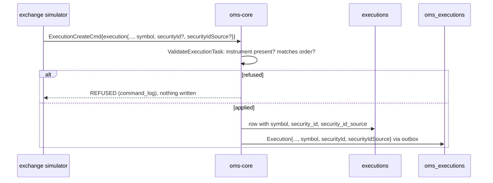

# Design — SPEC-0069: Carry the FIX instrument block on executions

> **Stage 2 of 3 — how.** Concrete enough that the plan can be written without re-reading the
> code, and checked line by line against the architecture policies. Write "None — <reason>" for a
> section that genuinely does not apply.

## Context

How a fill travels today, and where an instrument is missing at each step:

1. **Producer.** The exchange simulator answers a new order (`ExchangeEngine.newOrder`, from the
   `OrderMessage` it consumed, which has `symbol`, `securityId`, `securityIdSource`) and later
   calls `CommandSink.fill(cause, orderId, execId, lastQty, lastPx, cumQty, leavesQty)`.
   `CommandGateway.fill` builds an Avro `Execution` with no instrument and sends an
   `ExecutionCreateCmd`. `SimOrder` keeps only id, quantities and state. By hand, fills come from
   `developer-cockpit/api-templates/lifecycle.http` ("Fill 100") and `oms-core/rest.http`, neither
   with a symbol. The cockpit resolves only `{{orderId}}` in templates
   (`src/renderer/lib/api-templates.ts`, `ctx.orderId`).
2. **Contracts.** `oms-cmd-api.yml` → `Execution` (`execId`, `orderId`, quantities, prices,
   `execType`, `lastMkt`, `lastCapacity`, `transactTime`); `Execution.avsc` the same plus
   `rootOrderId`, `orderVersion`. `Order` models the instrument as `symbol` and `securityId`
   (strings) and `securityIdSource` (`schema.yml#/SecurityIdSource` /
   `msg.SecurityIDSource` enum).
3. **Intake.** `CommandListener` (Kafka) maps Avro → command model with
   `OrderMapper.toCmdExecution`; REST arrives as the command model. `ExecutionCommandProcessor`
   maps it to the entity with `OrderMapper.toExecution` (MapStruct, name-based) and runs the
   pipeline: `ValidateExecutionTask` (order 100) → quantities → state → `PersistExecutionTask` →
   `PublishExecutionEventTask` → `ProjectTask`.
4. **Validation.** `ValidateExecutionTask` checks presence of `orderId`, `execId`, `lastQty`,
   `lastPx`, positivity, and that the order is LIVE. A `TaskResult.failed` there rolls back and
   `CommandDispatcher` turns it into `CommandDispatch.Refused`: HTTP 400 Problem over REST, a
   `REFUSED` row in `command_log` with the reason, not retried over Kafka
   (`ExpectedVersionIntegrationTest#staleVersionIsRefusedOverRest` is the closest example).
5. **Storage.** Entity `org.example.common.model.Execution`, table `executions`; no instrument.
6. **Publication.** `OrderEventAppender.appendExecutionEvent` stages an EXECUTION outbox pointer;
   `OutboxRelay` → `OutboxRecordMapper` → `ExecutionMessageMapper.toExecutionMessageUnderRoot`
   builds the Avro `Execution` for `oms_executions` from the entity. The `ORDER_EXECUTION` record on
   `oms_order_executions` already copies `symbol`/`securityId` from the order.
7. **Read side.** `/api/executions` returns the entity as JSON, so new entity fields appear in the
   REST execution blotter without further work. `MetamodelService.EXECUTION_FIELDS` and
   `EXECUTION_DEFAULT_COLUMNS` decide what oms-ui offers (SPEC-0068); the streaming
   `ExecutionDto` must carry every default column (`OrderExecutionMapperTest` holds a copy of the
   list). `ExecutionDto` has no top-level `symbol` today. oms-ui's `DetailPanel` has an
   execution-only layout (uncommitted work from 2026-11-24) that hides every order-layout field,
   including `symbol` and `securityId`.

**Closest examples followed:** the `rootOrderId`/`orderVersion` addition to `Execution.avsc` and
`executions` (SPEC-0019, SPEC-0044, changelog `011-execution-lifecycle.yaml` with its backfill and
`ExecutionLifecycleMigrationIntegrationTest`); the existing rules in `ValidateExecutionTask`.

**Read:** `domain/model/execution.md`, `capabilities/execution-processing.md`,
`framework/validation-engine.md`, `architecture/concepts/retention-and-archive.md` (replica schema
changes), `specs/policies/architecture-policies.md`.

## Approach



| Proposal change | Where |
|---|---|
| Contract fields | `oms-cmd-api.yml` `Execution`; `Execution.avsc` |
| Validation (required, must match order) | `ValidateExecutionTask` |
| Storage + backfill | changelog `019-execution-instrument.yaml`; entity `Execution` |
| Mapping in | `OrderMapper.toExecution`, `toCmdExecution`: name-based, no new `@Mapping` needed |
| Publication | `ExecutionMessageMapper.toExecutionMessageUnderRoot` sets the three fields |
| Simulator | `SimOrder.instrument`, set in `newOrder`; `CommandSink.fill` gains an `Instrument` argument; `CommandGateway.fill` sets it |
| oms-ui metamodel | `MetamodelService.EXECUTION_FIELDS` + `symbol`, `securityId`; `EXECUTION_DEFAULT_COLUMNS` + `symbol` |
| Streaming default column has data | `ExecutionDto.symbol`, `securityId`; `OrderExecutionMapper` copies them from the `OrderExecution` record |
| Detail screen | `DetailPanel` execution layout: Instrument section (`symbol`, `securityId`, `securityIdSource`) |
| Hand-sent fills | cockpit resolves `{{symbol}}` from the followed order; `lifecycle.http` and `rest.http` fills carry a symbol |

## Contract Changes

`oms-contracts/src/main/openapi/oms-cmd-api.yml`, `components.schemas.Execution.properties`,
appended after `transactTime`:

```yaml
        symbol:
          type: string
          minLength: 1
          description: >-
            Instrument traded (FIX Symbol, tag 55). A fill carries symbol, securityId or both;
            oms-core refuses a fill with neither, or one that differs from its order's.
        securityId:
          type: string
          minLength: 1
          description: Instrument identifier (FIX SecurityID, tag 48), interpreted by securityIdSource.
        securityIdSource:
          allOf:
            - $ref: 'schema.yml#/components/schemas/SecurityIdSource'
          description: Source of securityId (FIX SecurityIDSource, tag 22)
```

`required` stays `[execId, orderId]`: "symbol or securityId" is not expressible as a plain
`required`, and the rule needs the order anyway, so it lives in `ValidateExecutionTask`.

`oms-contracts/src/main/avro/Execution.avsc`, appended as the last fields:

```json
    {
      "name": "symbol",
      "type": ["null", "string"],
      "doc": "Instrument traded (FIX Symbol, 55), as the venue reported it.",
      "default": null
    },
    {
      "name": "securityId",
      "type": ["null", "string"],
      "doc": "Instrument identifier (FIX SecurityID, 48), as the venue reported it.",
      "default": null
    },
    {
      "name": "securityIdSource",
      "type": ["null", "org.example.common.model.msg.SecurityIDSource"],
      "doc": "Source of securityId (FIX SecurityIDSource, 22).",
      "default": null
    }
```

**Compatibility (P-04).** Avro: three nullable fields with `null` defaults, appended; backward and
forward compatible. `ExecutionCreateCmd.avsc` embeds `Execution` and gains them too. The reused
`SecurityIDSource` enum is already a named type in the same namespace (as in `Order.avsc`).
OpenAPI: additive optional properties. The behavioural requirement (an instrument must be present)
is the **BREAKING** change the approved proposal names. Generated classes that change:
`org.example.common.model.cmd.Execution`, `org.example.common.model.msg.Execution`,
`org.example.common.model.msg.ExecutionCreateCmd` (embedded schema). Per the project memory, run
`./gradlew clean build` in oms-contracts so the embedded schema is regenerated.

## Data & Persistence

New file `oms-core/src/main/resources/db/changelog/019-execution-instrument.yaml`, included last
from `db.changelog-master.yaml`. No context: it runs on the primary and on the archive replica,
which oms-core migrates with the same changelog.

- **Changeset `019-execution-instrument-columns`**: `addColumn` on `executions`:
  `symbol varchar(255)`, `security_id varchar(255)`, `security_id_source varchar(32)`, all
  nullable (types as on `orders`). Rollback: `dropColumn` of the three.
- **Changeset `019-execution-instrument-backfill`**: one `sql` statement, idempotent:
  ```sql
  UPDATE executions e
     SET symbol = o.symbol, security_id = o.security_id, security_id_source = o.security_id_source
    FROM orders o
   WHERE o.order_id = e.order_id
     AND e.symbol IS NULL AND e.security_id IS NULL;
  ```
  Rollback: empty (the columns are dropped by the previous changeset's rollback).
  An execution whose order is no longer in `orders` (archived and deleted by retention) keeps null;
  on the replica, where archived orders remain, the same statement fills it.
- **Entity** `org.example.common.model.Execution`: `private String symbol;`,
  `private String securityId;`, `@Enumerated(EnumType.STRING) private SecurityIdSource
  securityIdSource;` (`ddl-auto: validate` must pass).
- No new index or constraint: fills are looked up by order, not by instrument; SPEC-0070 decides
  query indexes.
- Applied changesets 001–018 are untouched.

## Events & Messaging

- **`order_events`:** unchanged in shape. The fill event's execution payload/snapshot is built from
  the entity, so it carries the instrument without code changes; no new event type.
- **Outbox / `oms_executions`:** `ExecutionMessageMapper.toExecutionMessageUnderRoot` adds
  `.setSymbol(..)`, `.setSecurityId(..)`, `.setSecurityIdSource(..)` (entity enum → Avro enum by
  `name()`, null-safe). Still staged through the outbox; no new topic.
- **`oms_order_executions`:** unchanged; it already carries the order's instrument.
- **Idempotency:** unchanged; `(order_id, execid)` uniqueness and `existsByOrderIdAndExecId` still
  decide duplicates. A redelivered fill is refused as a duplicate before or after the instrument
  check — either way nothing is written twice. A refused fill (missing or mismatched instrument) is
  `REFUSED` and not retried, like any validation failure.

## Domain, State & Orchestration

No state machine change: a refused fill causes no transition. `ValidateExecutionTask` gains, after
the existing presence checks and before the LIVE check:

1. **Instrument present.** If `symbol` and `securityId` are both blank → `failed`, message
   `Instrument is required: the fill carries neither symbol nor securityId`.
2. **Symbol matches.** If the fill and the order both have a `symbol` and they differ (exact,
   case-sensitive, as the venue echoes the order's symbol) → `failed`, message
   `Fill symbol AAPL does not match the order's symbol MSFT`.
3. **SecurityId matches.** If the fill and the order both have a `securityId` and they differ →
   `failed`, message `Fill securityId X does not match the order's securityId Y`. A fill with only
   a `securityId` against an order with only a `symbol` is accepted (deferred symbology, proposal).

The refusal path is the existing one: rollback, `CommandDispatch.Refused`, 400 Problem+JSON over
REST with the message as detail, `REFUSED` in `command_log` with the reason.

## Alternatives & Decisions

- **Decision: validate in `ValidateExecutionTask`, not in the OpenAPI schema.** Alternative:
  `required: [symbol]` in the contract. Rejected: FIX allows securityId instead of symbol, and the
  mismatch rule needs the order, which only the pipeline has. One place for both rules.
- **Decision: refuse a mismatched fill** (approved proposal). Alternative: apply and flag.
  Rejected by the proposal approval.
- **Decision: store the instrument as reported, not copied from the order.** Alternative: always
  copy the order's. Rejected: the goal is "whatever came back from exchange/simulator"; the match
  rule makes them agree where both exist, and a securityId-only fill keeps what the venue sent.
- **Decision: reuse the `SecurityIdSource` enums** (OpenAPI `schema.yml`, Avro
  `SecurityIDSource`, entity `common.model.SecurityIdSource`). Alternative: plain strings.
  Rejected: the order uses the enums; MapStruct maps them by name with no extra code.
- **Decision: the simulator passes an `Instrument` record** (`engine/Instrument.java`:
  `symbol`, `securityId`, `securityIdSource`) to `CommandSink.fill`. Alternative: pass the
  `OrderMessage`. Rejected: the engine keeps only what it needs per order (`SimOrder`).
- **Decision: a small streaming change, beyond the proposal's impact table.** `symbol` becomes an
  execution default column, and SPEC-0068's rule is that every default column has data in
  streaming mode too. `ExecutionDto` gains `symbol` and `securityId`, mapped from the
  `OrderExecution` record that already carries them. Alternative: not a default column until
  SPEC-0071. Rejected: the instrument is the first thing a trader reads on a fill. No new
  dependency; no build change.
- **Decision: the cockpit resolves `{{symbol}}`** from the followed order (it already loads it for
  `{{orderId}}`). Alternative: a literal symbol in the template. Rejected: it would be refused for
  any order on another instrument.
- No new dependency, framework or build change (P-17).
- **Changed during implementation: the symbol rule compares only when the order has a symbol**,
  like the securityId rule, because tests (and the archive's legacy rows) hold orders stored
  without one; every order created through the API has a symbol (`required` in the command API),
  so AC-4 is unaffected.
- **Changed during implementation: replay of older logs.** The test-only replay harness
  (SPEC-0024) re-runs stored commands through full validation. A fill recorded before this change
  carries no instrument and is now refused, so replaying such a log reports it as a regression.
  That is the rule change itself, not a defect: production replay (`OrderReplayService`) reads
  stored snapshots and does not re-validate. The harness's own recorded fills now carry a symbol.
  An upcast step was rejected: the stored command shape did not change (schema version stays 1).
- **Changed after independent review (verify stage):**
  - oms-ui shows a column in live mode only if `src/config/streamedFields.json` lists it, so the
    Execution list gains `symbol` and `securityId` (`StreamedFieldsTest`'s fill carries both).
    Without this the new default column stayed hidden in the streaming blotter.
  - A present but blank `symbol` or `securityId` is refused ("Fill symbol must not be blank"):
    Kafka commands have no `minLength` check, and the value would otherwise be stored as
    whitespace.
  - `security_id_source` is `varchar(32)`, narrower than `orders.security_id_source`
    (`VARCHAR(255)`), kept deliberately: it holds an enum name of at most 16 characters
    (`BLOOMBERG_SYMBOL`), and changeset 019 is left as written rather than edited.

## Risks & Mitigations

- **Producers without an instrument are refused after deploy.** Mitigation: every in-repo producer
  (simulator, cockpit, `rest.http`, test helpers) is updated in this ticket; refusal is visible as
  `REFUSED` with a clear reason in `command_log`; the proposal flags it BREAKING.
- **Test churn.** ~19 oms-core test classes build fills directly and ~12 send fill JSON. They are
  updated to carry the order's symbol, through `TestCommands.fillOf` and the fill helpers in
  `AbstractFillFlowIntegrationTest` where possible, so the change is mostly in helpers.
- **Replica replication pause.** Adding columns to a published table stops replication from the
  first row with the column until oms-core migrates the replica at start-up (documented in
  retention-and-archive). Archiving fails safe meanwhile. Accepted; no mitigation needed.
- **Backfill cost.** One `UPDATE … FROM orders` over `executions`; fine at local and test volumes
  (thousands of rows). Rows already carrying an instrument are skipped, so a re-run does nothing.
- **Stale embedded Avro schema** after an incremental build. Mitigation: clean build of
  oms-contracts in the plan, and `ExecutionCompatibilityTest` against the baseline.

## Test Strategy

| AC | Level | Test class#method | What it asserts |
|---|---|---|---|
| AC-1 | integration | `ExecutionInstrumentIntegrationTest#fillWithFullInstrumentIsStoredAndPublished` (new, extends `AbstractKafkaPostgresIntegrationTest`) | REST fill with symbol/securityId/ISIN on a LIVE MSFT order: `executions` row holds the three values; the `Execution` consumed from `oms_executions` holds them |
| AC-1 | unit | `AvroMessageMapperTest#executionMessageCarriesInstrument` (existing class, new method) | `ExecutionMessageMapper` sets the three Avro fields from the entity |
| AC-2 | integration | `ExecutionInstrumentIntegrationTest#fillWithSecurityIdOnlyIsApplied` | applied; row has `security_id`, null `symbol` |
| AC-3 | unit | `ValidateExecutionTaskTest#refusesFillWithoutInstrument` (new) | `failed` with the missing-instrument message |
| AC-3 | integration | `ExecutionInstrumentIntegrationTest#fillWithoutInstrumentIsRefused` | 400; no `executions` row; order `cumQty`/`leavesQty`/state and `order_events` count unchanged; one `REFUSED` `command_log` row with the reason |
| AC-4 | unit | `ValidateExecutionTaskTest#refusesSymbolMismatch`, `#refusesSecurityIdMismatch`, `#acceptsSecurityIdOnlyAgainstSymbolOnlyOrder` | messages name both values; deferred case passes |
| AC-4 | integration | `ExecutionInstrumentIntegrationTest#fillOnAnotherSymbolIsRefused` | AAPL fill on MSFT order: 400 naming both; nothing changes |
| AC-5 | integration | `ExecutionInstrumentMigrationIntegrationTest#legacyFillsGetTheirOrdersInstrument` (new; migrates to the tag before 019, seeds orders and fills, then starts Spring, like `ExecutionLifecycleMigrationIntegrationTest`) | every seeded fill has its order's symbol; securityId/source where the order has them |
| AC-5 | integration | `LiquibaseMigrationIntegrationTest` (existing) | full changelog applies; entity validates |
| AC-6 | unit | `ExchangeEngineTest#fillCarriesTheOrdersInstrument` (new method; `RecordingSink` records it) | the fill sent for an MSFT order carries `MSFT` (and securityId when the order has one) |
| AC-6 | integration | `ExchangeSimulatorKafkaIntegrationTest` (existing, extended) | the `ExecutionCreateCmd` on the commands topic carries the symbol |
| AC-6 | integration | `ExchangeWorkflowIntegrationTest` (existing, oms-core) | simulator-shaped fills (with symbol) are applied, not refused; stored row has the symbol |
| AC-7 | unit | `MetamodelServiceTest#executionMetamodelOffersInstrument` (new method) | `symbol`, `securityId` in the Execution fields; `symbol` in default columns |
| AC-7 | unit | `OrderExecutionMapperTest#executionDtoCarriesAllBlotterDefaultColumns` (existing, list updated) | streaming DTO has `symbol` |
| AC-7 | unit (jest) | `DetailPanel.test.tsx` → `DetailPanel execution layout` › `shows the instrument in an Instrument section` (new) | execution with symbol shows it under an "Instrument" heading |
| AC-8 | unit | `ExecutionCompatibilityTest` (existing; new-schema reads `Execution-baseline.json` and the baseline reader reads a new record) | backward and forward compatible |

Cockpit: `api-templates.test.ts` (or the existing template test) gains a case that `{{symbol}}`
resolves from the followed order; `ApiTemplateService.test.ts` keeps passing with the new template.

## Policy Compliance

| Policy | Title | Status | How / Justification |
|---|---|---|---|
| P-01 | Contracts live only in oms-contracts | comply | Only `oms-contracts/src/main/{openapi,avro}` change |
| P-02 | Specification before code, generated models only | comply | Contract tasks first; models regenerated, none hand-written |
| P-03 | Never edit generated code | comply | Only specs change; regenerate |
| P-04 | Contracts evolve compatibly | comply | Avro fields nullable with defaults, appended; OpenAPI additive; the required-instrument rule is marked BREAKING with its consumers in the approved proposal |
| P-05 | Every state change is recorded in the event log | comply | Fill path unchanged (`appendExecutionEvent`); a refused fill changes no state; integration test checks `order_events` unchanged on refusal |
| P-06 | Kafka only through the transactional outbox | comply | Publication stays in `ExecutionMessageMapper` via `OutboxRelay`; simulator keeps its existing gateway |
| P-07 | Schema changes through new Liquibase changesets | comply | New `019-execution-instrument.yaml`; 001–018 untouched; `ddl-auto: validate` |
| P-08 | Concurrency and idempotency are explicit | comply | Duplicate detection unchanged on `(order_id, execid)`; backfill is idempotent |
| P-09 | Commands and queries stay separate | comply | Command path validates and stores; read side only exposes the new fields |
| P-10 | State transitions go through the state machine and task pipeline | comply | Rules added to `ValidateExecutionTask` in the existing pipeline; no new transition |
| P-11 | Layering and conventions | comply | MapStruct name-based mapping, Lombok entity, existing mapper/task classes extended |
| P-12 | Jackson 3 only | comply | No new Jackson use; tests use `tools.jackson` where JSON is built |
| P-13 | Errors and validation follow the framework specs | comply | Refusal via `TaskResult.failed` → existing Problem+JSON 400 / `REFUSED` path; `validation-engine.md` updated |
| P-14 | Test first, every acceptance criterion is proven by an automated test | comply | Every AC mapped above; tests written before the code in the plan |
| P-15 | Observability | comply | Refusals already logged with orderId and counted (`command_log`, consumer refused metric); no new flow |
| P-16 | Security | comply | Input validated at the boundary (`minLength`, enum, match rule); no secrets |
| P-17 | Simplicity and dependencies | comply | No dependency or build change; smallest set of fields |
| P-18 | Modules build standalone | comply | Contracts change verified against all `impacts` consumers by `spec verify` |
| P-19 | Documentation follows behaviour | comply | KB pages listed below updated in this ticket |

## Knowledge Base Updates

- `oms-knowledge-base/domain/model/execution.md`: the `symbol`, `securityId`, `securityIdSource`
  fields, stored as reported, backfilled from the order (SPEC-0069).
- `oms-knowledge-base/capabilities/execution-processing.md`: a fill must carry an instrument that
  matches its order, else it is refused.
- `oms-knowledge-base/framework/validation-engine.md`: the two new execution validation rules and
  their messages.
- `oms-knowledge-base/architecture/context/streaming-service.md`: `ExecutionDto` carries
  `symbol` and `securityId` (only if the page lists the DTO's fields).
- `oms-knowledge-base/log.md`: entry for SPEC-0069.
