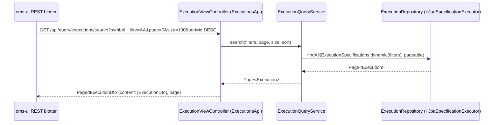

# Design — SPEC-0070: Specify the executions query over stored fills

> **Stage 2 of 3 — how.** Concrete enough that the plan can be written without re-reading the
> code, and checked line by line against the architecture policies. Write "None — <reason>" for a
> section that genuinely does not apply.

## Context

- **Order search, the example to follow.** `GET /api/query/search` (`oms-query-api.yml`,
  operationId `searchOrders`, generated interface `SearchApi`). `QueryController` turns every
  request parameter except `page`/`size`/`sort` into a filter map and calls
  `OrderQueryService.search`, which builds `OrderSpecifications.dynamic(params)` (field `f` or
  `f__op`, ops `eq` (default), `like`, `gt`, `gte`, `lt`, `lte`, `between`; unknown fields logged and
  ignored) and a `Pageable` (page default 0; size 1–500, default 50; `sort=field[,ASC|DESC];…`,
  default `id,DESC`). `QueryOrderDtoMapper.toPagedOrderDto` maps the `Page` to `PagedOrderDto`
  (`content` + `PageMetadata{size,totalElements,totalPages,number}`). The generated interface has
  `@Validated` with `@Min(1) @Max(500)` on `size`; `GlobalExceptionHandler` extends
  `ResponseEntityExceptionHandler`, which answers method-validation failures with 400, and maps
  `IllegalArgumentException` to a 400 Problem.
- **Executions today.**
  - `GET /api/query/executions` (`ExecutionsApi#getExecutions`, implemented by
    `ExecutionViewController`) reads the projection; unchanged by this ticket.
  - `ExecutionController` (`/api/executions`, `/api/executions/{id}`, `@Hidden`) →
    `ExecutionReadService.findAll(pageable)` / `findById`, returning the JPA entity. Filters are
    accepted by the client and ignored here.
  - `ExecutionRepository extends JpaRepository<Execution, Long>` — no `JpaSpecificationExecutor`.
- **Generator.** Query interfaces are generated per first path segment with
  `skipDefaultInterface: true` (`oms-core/build.gradle`), so `/executions/search` lands in the same
  `ExecutionsApi` as `/executions`, and the class implementing `ExecutionsApi` must implement both
  operations.
- **oms-ui.** `OMSApiService.getExecutions(filters, sort, page, size)` calls `/api/executions` with
  `buildQueryParams` (the order-search filter language: `field`, `field__like` (value `%x%`),
  `__gt`, …, `__between` as `a,b`; `sort=field,DIR`) and `normalizePage` (accepts both the
  `{content,page}` shape and a raw Spring `Page`). `Blotter.tsx` sorts executions by `id,desc` when
  the user has not chosen a sort.
- **Read:** `framework/query-engine.md`, `domain/interfaces/query-api.md`,
  `domain/interfaces/rest-read-api.md`, `capabilities/order-query.md`, technical-debt register
  (TD-3), `specs/policies/architecture-policies.md`.

## Approach

A sibling of the order search, over `executions`:



| Proposal change | Where |
|---|---|
| New query in the contract | `oms-query-api.yml`: path `/executions/search`, schemas `ExecutionDto`, `PagedExecutionDto`, `ExecutionStatus` |
| Filters | new `org.example.oms.service.ExecutionSpecifications.dynamic(Map)` (same parser and ops as `OrderSpecifications`) |
| Paging, sorting, sort whitelist | new `org.example.oms.service.ExecutionQueryService.search(params, page, size, sort)` |
| Endpoint | `ExecutionViewController#searchExecutions` (it already implements `ExecutionsApi`), reading the query parameters like `QueryController` |
| Mapping | new MapStruct `org.example.oms.mapper.QueryExecutionDtoMapper` (entity → `ExecutionDto`, `Page` → `PagedExecutionDto`) |
| Repository | `ExecutionRepository` also extends `JpaSpecificationExecutor<Execution>` |
| Retire `/api/executions` | delete `ExecutionController` and `ExecutionReadService` |
| oms-ui | `OMSApiService.getExecutions` calls `/api/query/executions/search` |

## Contract Changes

`oms-contracts/src/main/openapi/oms-query-api.yml` (info.version 2.5.0 → 2.6.0; description gains an
"Execution search" paragraph listing the filterable fields):

```yaml
  /executions/search:
    get:
      operationId: searchExecutions
      summary: Dynamic search for executions (stored fills)
      description: |
        Search the executions table with dynamic filters, pagination and sorting, like /search for
        orders. All query parameters except page, size and sort are filters: `field` (equals),
        `field__like`, `field__gt|gte|lt|lte`, `field__between=a,b`. Unknown filter fields are
        ignored. Newest stored fill first unless `sort` says otherwise; sorting by a field the
        execution does not have is a 400.
        Filterable: String execId, orderId, rootOrderId, symbol, securityId, execType, lastMkt,
        lastCapacity; Numeric lastQty, lastPx, cumQty, leavesQty, avgPx, orderVersion;
        DateTime transactTime; Enum status, securityIdSource.
      tags:
        - Executions
      parameters:
        - name: page
          in: query
          required: false
          schema: { type: integer, minimum: 0 }
          description: 0-based page index (default 0)
        - name: size
          in: query
          required: false
          schema: { type: integer, minimum: 1, maximum: 500 }
          description: Page size (default 50, max 500)
        - name: sort
          in: query
          required: false
          schema: { type: string }
          description: Semicolon-separated `field[,ASC|DESC]`; default `id,DESC` (newest stored first)
      responses:
        '200':
          description: Paged list of matching executions
          content:
            application/json:
              schema:
                $ref: '#/components/schemas/PagedExecutionDto'
        '400':
          description: Bad request (invalid page, size or sort field)
        '500':
          description: Internal server error

  # components.schemas
    ExecutionStatus:
      type: string
      description: Whether a fill still counts (SPEC-0044)
      enum: [APPLIED, BUSTED, CORRECTED]
    ExecutionDto:
      type: object
      description: One stored fill, as the venue reported it, without its order's fields.
      required: [orderId, execId]
      properties:
        id: { type: integer, format: int64, description: Storage id; newest fills have the highest }
        execId: { type: string }
        orderId: { type: string }
        rootOrderId: { type: string }
        symbol: { type: string }
        securityId: { type: string }
        securityIdSource:
          $ref: 'schema.yml#/components/schemas/SecurityIdSource'
        execType: { type: string }
        lastQty: { type: number }
        lastPx: { type: number }
        lastMkt: { type: string }
        lastCapacity: { type: string }
        cumQty: { type: number }
        leavesQty: { type: number }
        avgPx: { type: number }
        transactTime: { type: string, format: date-time, x-java-type: java.time.Instant }
        status:
          $ref: '#/components/schemas/ExecutionStatus'
        orderVersion: { type: integer, format: int64 }
    PagedExecutionDto:
      type: object
      description: Paged collection of ExecutionDto
      properties:
        content:
          type: array
          x-field-extra-annotation: "@lombok.Builder.Default"
          items:
            $ref: '#/components/schemas/ExecutionDto'
        page:
          $ref: '#/components/schemas/PageMetadata'
```

(The real file uses block style like its neighbours; number fields carry the same
`Digits(integer = 10, fraction = 8)` annotation as `ExecutionViewDto`.)

**Compatibility (P-04):** additive — a new path and new schemas; `PageMetadata` reused unchanged.
Generated classes added: `org.example.common.model.query.{ExecutionDto, PagedExecutionDto,
ExecutionStatus}`; `ExecutionsApi` gains `searchExecutions`. The removal of the undocumented
`/api/executions` is the BREAKING change the approved proposal names; it is not in any contract.

## Data & Persistence

None — the query reads the existing `executions` table; no new changelog. Its default sort is the
primary key (`id`), and its common filter (`order_id`) has an index (`idx_executions_order_id`);
`symbol` is unindexed, acceptable at blotter volumes (Out of Scope: production performance).

## Events & Messaging

None — a read-only query; nothing is written, published or consumed.

## Domain, State & Orchestration

None for state. Request handling:

- **Filters** (`ExecutionSpecifications.dynamic`): the order search's parser, over the
  execution's fields: strings by `eq`/`like` (case-insensitive `like`, `%value%` as for orders);
  numbers and `transactTime` by `eq`/`gt`/`gte`/`lt`/`lte`/`between`; `status` and
  `securityIdSource` by `eq` (an unknown enum value matches nothing). Unknown fields are logged
  and ignored, malformed values ignored, as in the order search.
- **Paging:** page < 0 or size outside 1–500 is a 400 from the generated `@Min`/`@Max`
  (method validation); absent values default to 0 and 50.
- **Sorting:** `sort` segments are checked against the `ExecutionDto` field set; an unknown field
  throws `IllegalArgumentException("Cannot sort executions by <field>")` → 400 Problem
  (`urn:oms:error:bad-request`). Default `id,DESC`.

## Alternatives & Decisions

- **Decision: a new `/executions/search`, not a change to `/executions`.** Alternative: extend
  `/executions` with paging and dynamic filters. Rejected: that endpoint is the booking projection
  with fixed filters and a plain-array response; changing it would break its consumers and blur the
  two read models.
- **Decision: implement it in `ExecutionViewController`.** Alternative: a new controller, with
  `useTags`/`x-tags` to split the interface. Rejected: a generator change for one method; the
  controller stays thin and delegates to its own service.
- **Decision: a separate `ExecutionSpecifications`, not a generic one shared with orders.**
  Alternative: generalise `OrderSpecifications` over an entity and a field map. Rejected for now:
  two similar 150-line classes are simpler to read than a generic builder (P-17); a third entity
  would justify extracting it.
- **Decision: reject unknown sort fields with 400.** The order search passes the field to JPA and
  fails at query time; for executions the field set is small and known, so a clear 400 is cheap.
- **Decision: include `id` in `ExecutionDto`.** It is the default sort and the blotter's default
  `sort=id,desc`; without it the client could not sort or page stably.
- **Decision: retire `/api/executions`** (approved proposal). No new dependency or build change.
- **Changed after independent review (verify stage):** a user-chosen sort ends with `id,DESC` as a
  tie-breaker (unless it already names `id`), so paging over a field with equal values neither
  repeats nor skips fills (`ExecutionSpecificationsTest#userSortEndsWithIdAsTieBreaker`). An
  unparsable direction still falls back to ASC, as in the order search.

## Risks & Mitigations

- **An unknown external caller of `/api/executions` breaks.** Accepted at proposal approval; the
  endpoint was hidden from Swagger and absent from every contract.
- **Blotter shape change.** The new response is `{content, page}`, which `normalizePage` already
  accepts (the order search's shape); its raw-`Page` branch becomes unused and is removed.
- **Field drift between the metamodel and the DTO.** The metamodel offers `execId`, `orderId`,
  `symbol`, `securityId`, `execType`, `lastQty`, `lastPx`, `lastMkt`, `leavesQty`, `cumQty`,
  `avgPx`, `transactTime`, `status` (SPEC-0068/0069), all on `ExecutionDto`.
  `ExecutionBlotterIntegrationTest` (every offered field has a value) moves to the new endpoint
  and keeps guarding this.

## Test Strategy

| AC | Level | Test class#method | What it asserts |
|---|---|---|---|
| AC-1 | integration | `ExecutionSearchIntegrationTest#filtersByOrderId` (new, extends `AbstractFillFlowIntegrationTest`) | only order A's fills; `totalElements` = their count |
| AC-2 | integration | `ExecutionSearchIntegrationTest#filtersBySymbolLikeQuantityTimeAndStatus` | each filter alone and combined returns exactly the matching fills (a fill is busted in the test via the repository to vary `status`) |
| AC-2 | unit | `ExecutionSpecificationsTest` (new) | parser: `f`, `f__like`, `__gte`, `__between`, enum eq, unknown field ignored |
| AC-3 | integration | `ExecutionSearchIntegrationTest#pagesNewestFirstAndSorts` | size 3 of 7: newest 3, totals 7/3, page 2 = oldest; `sort=lastPx,ASC` order |
| AC-4 | integration | `ExecutionSearchIntegrationTest#rejectsOversizedPageAndUnknownSort` | `size=501` → 400; `sort=price,ASC` → 400; `unknownField=x` ignored (200) |
| AC-5 | integration | `ExecutionSearchIntegrationTest#entryCarriesExecutionFieldsOnly` | stored values for the listed fields; no `side`, `price`, `orderQty`, `account`, `state` |
| AC-5 | integration | `ExecutionBlotterIntegrationTest` (existing, moved to the new endpoint) | every metamodel field has a value; `id`, `execId`, `orderId`, `avgPx` present |
| AC-6 | unit (jest) | `OMSApiService.test.ts` › `getExecutions calls the execution search with the filters` (existing test rewritten) | GET `/api/query/executions/search` with `symbol__like`, `page`, `size`, `sort`; returns `content` and `page` |
| AC-7 | integration | `ExecutionSearchIntegrationTest#retiredEndpointIsGone` | `GET /api/executions` and `/api/executions/1` → 404 |

## Policy Compliance

| Policy | Title | Status | How / Justification |
|---|---|---|---|
| P-01 | Contracts live only in oms-contracts | comply | Only `oms-contracts/src/main/openapi/oms-query-api.yml` changes |
| P-02 | Specification before code, generated models only | comply | Contract first; `ExecutionDto`/`PagedExecutionDto` generated; the hand-written read endpoint is removed |
| P-03 | Never edit generated code | comply | Regenerate only |
| P-04 | Contracts evolve compatibly | comply | Additive path and schemas; the hidden endpoint's removal is declared BREAKING in the approved proposal |
| P-05 | Every state change is recorded in the event log | n/a | Read-only query |
| P-06 | Kafka only through the transactional outbox | n/a | No messaging |
| P-07 | Schema changes through new Liquibase changesets | n/a | No schema change |
| P-08 | Concurrency and idempotency are explicit | n/a | Read-only, no writes |
| P-09 | Commands and queries stay separate | comply | Under `/api/query`, `@Transactional(readOnly = true)`, own DTO separate from command models |
| P-10 | State transitions go through the state machine and task pipeline | n/a | No state change |
| P-11 | Layering and conventions | comply | Thin controller → service → repository; MapStruct mapper; follows the order search |
| P-12 | Jackson 3 only | comply | No new JSON code beyond tests using `tools.jackson` |
| P-13 | Errors and validation follow the framework specs | comply | 400 Problem+JSON for bad sort (`IllegalArgumentException`) and size (method validation) |
| P-14 | Test first, every acceptance criterion is proven by an automated test | comply | Table above; tests before code in the plan |
| P-15 | Observability | comply | Service logs the search parameters at INFO like `OrderQueryService`; HTTP metrics come from Spring |
| P-16 | Security | comply | Input validated (size, page, sort whitelist; filters by known field only, parameterised by JPA criteria) |
| P-17 | Simplicity and dependencies | comply | No dependency; sibling classes rather than a generic framework |
| P-18 | Modules build standalone | comply | `spec verify` runs contracts consumers |
| P-19 | Documentation follows behaviour | comply | KB pages below |

## Knowledge Base Updates

- `domain/interfaces/query-api.md`: the execution search (path, filters, paging, response).
- `domain/interfaces/rest-read-api.md`: `/api/executions` removed (SPEC-0070).
- `framework/query-engine.md`: executions are searched like orders, over `executions`.
- `capabilities/order-query.md`: execution search as part of the capability.
- `architecture/technical-debt/technical-debt-register.md`: TD-3 narrowed to `/api/orders`.
- `oms-ui/README.md` / `oms-ui/docs/ARCHITECTURE.md` mention `/api/executions`: updated (not KB,
  but the same rule).
- `log.md`: entry for SPEC-0070.
