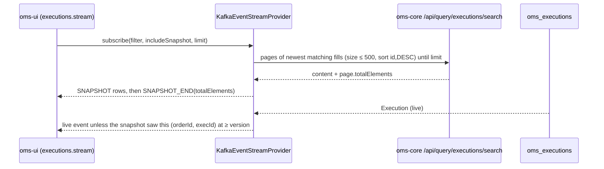

# Design — SPEC-0071: Stream orders and executions without service caches

> **Stage 2 of 3 — how.** Concrete enough that the plan can be written without re-reading the
> code, and checked line by line against the architecture policies. Write "None — <reason>" for a
> section that genuinely does not apply.

## Context

oms-streaming-service today (`oms-streaming-service/src/main/java/org/example/streaming/`):

- **`service/KafkaEventStreamProvider`** (implements `EventStreamProvider`):
  - consumes `oms_orders` (`OrderMessage`) and `oms_order_executions` (`OrderExecution`) through
    reactor-kafka receivers from `config/KafkaConfig` (one consumer group,
    `auto.offset.reset=earliest` for both);
  - keeps `orderCache` and `executionCache` (`ConcurrentHashMap`), bounded by
    `streaming.buffer.max-size` with eviction (terminal orders; oldest fills);
  - warms `executionCache` at startup from `OmsQueryClient.fetchRecentExecutions` →
    `GET /api/query/executions?order=newest&limit=…` (the projection), with retry (SPEC-0067);
  - skips a live fill whose `(orderId, execId)` the cache holds at the same or a higher
    `orderVersion` (`cacheUnlessSeen`);
  - `getOrderEventStream(filter)`: snapshot from `OmsQueryClient.fetchOrderSnapshot(filter, limit)`
    (→ `/api/query/search`, paged, `totalElements` as the matching count), falling back to
    `cachedOrderSnapshot` on error; then the live sink, minus events at or below each order's
    snapshot version; `boundedForSubscriber` caps per-subscriber buffering (SPEC-0057);
  - `getExecutionEventStream(filter)`: snapshot **from `executionCache`**, newest by transactTime,
    `take(limit)`, `SNAPSHOT_END` with the matching count, per-subscription `snapshotVersions` to
    drop live events at or below the version the snapshot saw (SPEC-0057 AC-8);
  - `getCurrentOrders`, `getCurrentExecutions`, `get*CacheSize` for the routes below.
- **`controller/TradeBlotterController`**: RSocket routes `orders.stream`, `executions.stream`
  (oms-ui uses these two), `blotter.stream`, `orders.snapshot`, `executions.snapshot`, `health`.
- **`controller/MetadataController`** → `model/ServiceStatus` with `ordersInCache`,
  `executionsInCache`. **`controller/TestStreamController`** (`@Profile("dev")`): REST
  `/api/test/orders/snapshot` from `getCurrentOrders`.
- **`mapper/OrderExecutionMapper`**: `OrderExecution` → `ExecutionDto` with a nested `OrderDto`
  (`ExecutionDto.order`, copied into `ExecutionEvent.order`).
- **`client/OmsQueryClient`**: `fetchOrderSnapshot` (the pattern to follow),
  `fetchRecentExecutions` (projection; JSON → `ExecutionDto` with order).
- **Settings** (`application.yml`): `streaming.kafka.topics.order-executions`
  (`ORDER_EXECUTION_TOPIC`), `streaming.buffer.max-size`, `streaming.executions.warm-up-size`.

oms-ui: `RSocketStreamingService` subscribes to `orders.stream` and `executions.stream`;
`subscribeToBlotter` (`blotter.stream`) has no caller. `StreamingBlotter.handleExecutionEvent`
passes `isNewRow = true` for every live fill to `takeRow`, which adds it to the "of M" count
(comment: "the server drops redeliveries"); `RowStore.put` upserts by key.
`config/streamedFields.json` lists the Execution fields the stream fills (with `symbol`,
`securityId` since SPEC-0069).

Inputs used: SPEC-0070's `GET /api/query/executions/search` (`PagedExecutionDto`, filters as in
the order search, `id,DESC` default) and SPEC-0069's instrument on `Execution` (Avro). Knowledge
base read: `architecture/context/streaming-service.md`, `capabilities/real-time-streaming.md`,
`domain/interfaces/query-api.md`.

## Approach

| Proposal change | Where |
|---|---|
| Execution snapshot from stored fills | `OmsQueryClient.fetchExecutionSnapshot(filter, limit)` → `ExecutionSnapshot(rows, matching)`, a sibling of `fetchOrderSnapshot`; `KafkaEventStreamProvider.getExecutionEventStream` uses it |
| Live executions from `oms_executions` | `KafkaConfig.executionReceiver` (`KafkaReceiver<String, Execution>`, topic `streaming.kafka.topics.executions`, `auto.offset.reset=latest`); new `mapper/ExecutionMessageMapper` (`Execution` → `ExecutionDto`) |
| No caches | `KafkaEventStreamProvider`: remove `orderCache`, `executionCache`, `warmUpExecutions`, `putIfNewer`, `cacheUnlessSeen`, both evictions, `cachedOrderSnapshot`, `getCurrent*`, `get*CacheSize`; `EventStreamProvider` loses those four methods |
| Unused routes removed | `TradeBlotterController`: `blotter.stream`, `orders.snapshot`, `executions.snapshot`, `toOrderEvent`, `blotterExecutions`; delete `model/StreamRequest`, `model/StreamType` if nothing else uses them; `TestStreamController` loses `/orders/snapshot`; `ServiceStatus`/`MetadataController` lose cache sizes |
| Execution rows carry execution fields only | `ExecutionDto.order` and `ExecutionEvent.order` removed; `OrderExecutionMapper` deleted |
| Settings | `application.yml`: `topics.executions: ${EXECUTION_TOPIC:oms_executions}` replaces `order-executions`; `buffer.max-size` and `executions.warm-up-size` removed |
| oms-ui | `RSocketStreamingService.subscribeToBlotter` and the `StreamRequest`/`StreamType` types removed; `takeRow` counts a live row as new only when the store does not hold its key yet (`RowStore.has`) |

## Contract Changes

None — no OpenAPI or Avro change. The service starts consuming an existing record (`Execution` on
`oms_executions`) and calling an existing endpoint (SPEC-0070). RSocket routes are not part of the
contracts; their removal is the BREAKING change the approved proposal names.

## Data & Persistence

None — the streaming service stores nothing; the point of the ticket is that it no longer holds
state.

## Events & Messaging

- **Consumed:** `oms_executions` (`Execution`, keyed by `rootOrderId`) instead of
  `oms_order_executions`; `oms_orders` unchanged. Same consumer group
  (`streaming-service-group`). The executions receiver sets `auto.offset.reset=latest`: the group
  has no committed offset on the new topic, and history comes from the database snapshot, so a
  first start must not replay every past fill as live. Later restarts resume from the committed
  offset as today; fills re-read after a restart are older than any later snapshot and are dropped
  per subscription (below) or upserted by the UI.
- **Deduplication:** per subscription only, as SPEC-0057 does — `snapshotVersions` maps
  `orderId/execId` → the version the snapshot saw; a live event at or below it is dropped.
  Kafka redeliveries between snapshots are not filtered by the server: the UI upserts the row by
  key and, with the `RowStore.has` check, does not count it as new.
- **Produced:** none. Nothing reaches oms-core's outbox or topics.

## Domain, State & Orchestration

None — no domain state. Stream behaviour:

- **Execution snapshot:** `fetchExecutionSnapshot(filter, limit)` maps the stream filter with
  `StreamFilter.toQueryParams()` (already the order search's language), requests pages of
  `min(limit, 500)` with `sort=id,DESC` until `limit` rows, and reads `page.totalElements` from the
  first page as `matching`. Rows become `SNAPSHOT` events, then `SNAPSHOT_END(matching)`.
  `limit 0` sends only the marker. Ordering changes from "newest by transactTime" (cache) to
  "newest stored first", the search's default; a fill without `transactTime` no longer sorts
  last.
- **oms-core failure:** the snapshot `Flux` errors (timeout or HTTP error) and so does the
  subscription — no fallback. The client's existing error/reconnect path handles it. A
  subscription without a snapshot never calls oms-core.
- **Live event type:** `ExecutionEvent.eventType` = the record's `execType` (or `NEW`), as today.

## Alternatives & Decisions

- **Decision: no cache at all.** Alternative: keep a cache but invalidate it (TTL, delete events).
  Rejected: oms-core has no delete events, and every remaining use is served by the database
  (snapshot) or the UI (upsert). Removing state is the smallest correct change (P-17).
- **Decision: no snapshot fallback** (approved proposal). Alternative: keep the order cache only
  for outages. Rejected: it serves stale data as current.
- **Decision: `auto.offset.reset=latest` for the executions receiver only.** Alternative: a new
  consumer group, or `latest` for both receivers. A new group would replay nothing either way but
  changes operations (group id) for no gain; the orders receiver keeps its committed offsets and
  behaviour, outside this ticket's scope.
- **Decision: count "new" in the UI by key, not on the server.** Alternative: keep a bounded
  "seen" set in the service for redeliveries. Rejected: that is the cache again; the row store
  already knows which keys it shows.
- **Decision: remove `ExecutionDto.order` / `ExecutionEvent.order`** rather than leave them
  null. Nothing reads them once `blotter.stream` is gone, and oms-ui's `ExecutionEvent` type has no
  `order`.
- No new dependency or build change.
- **Changed after independent review (verify stage):** live execution filters did not know
  `symbol`, `securityId` or `status` (`FilterService.EXECUTION_ACCESSORS`), so a filtered live
  stream showed the right snapshot and then dropped every live fill. The accessors gain
  `symbol`, `securityId`, `status`, `orderVersion`; `ExecutionDto` gains `status` (from the search
  for the snapshot; from the FIX ExecType for live fills: H busted, G corrected, otherwise applied),
  and oms-ui lists `status` among the streamed Execution fields
  (`KafkaEventStreamProviderTest#liveFillsAreFilteredOnTheirInstrumentAndStatus`,
  `ExecutionMessageMapperTest#statusFollowsTheExecType`). The status endpoint gets its own test
  (`MetadataControllerStatusTest`). Stale docs outside the KB (streaming README,
  FILTERED_STREAMING.md, root and oms-ui READMEs) and the KB topic table were corrected.

## Risks & Mitigations

- **oms-core load:** every snapshot subscription now queries oms-core for executions too (orders
  already did). Bounded by the snapshot limit (default 2000 → 4 pages of 500) and the indexed
  `id` sort. Acceptable at blotter subscription rates.
- **Live gap during a snapshot:** events emitted while the snapshot is fetched are kept by the
  hot sink's replay of the last 100 and the per-subscriber buffer, exactly as for orders today.
- **First deploy:** with `latest`, fills published while the service is down for the deploy are
  not replayed as live; they are in the next snapshot. This is the intended model.
- **External RSocket clients of the removed routes break** — accepted at proposal approval.
- **KB drift:** several pages describe the cache and warm-up (SPEC-0067); updated in this ticket.

## Test Strategy

| AC | Level | Test class#method | What it asserts |
|---|---|---|---|
| AC-1 | unit (WebClient on a mock server, as the existing client tests) | `OmsQueryClientTest#fetchExecutionSnapshot_pagesTheSearchAndCountsMatches` | requests `/api/query/executions/search` with the filter params, `sort=id,DESC`, page sizes up to the limit; maps fields incl. `symbol`; `matching` = `totalElements` |
| AC-1 | unit | `KafkaEventStreamProviderTest#executionSnapshotComesFromTheSearchAndEndsWithItsCount` | snapshot rows in the client's order, at most the limit, then `SNAPSHOT_END(totalElements)` |
| AC-2 | unit | `KafkaEventStreamProviderTest#executionSnapshotIsReadAtEachSubscription` | the client answers with a fill, then without it; the second subscription's snapshot does not contain it (no restart) |
| AC-3 | unit | `KafkaEventStreamProviderTest#liveExecutionsComeFromTheExecutionRecord` | an `Execution` on the receiver is emitted with `symbol` and quantities; `ExecutionMessageMapperTest` maps every streamed field |
| AC-3 | unit | `KafkaConfigTest#executionReceiverReadsOmsExecutionsFromLatest` | the receiver subscribes to `oms_executions` (not `oms_order_executions`) with `auto.offset.reset=latest` |
| AC-3 | unit | `StreamedFieldsTest` (existing, fixture switched to `Execution`) | every Execution field in oms-ui's streamed list is filled by the stream |
| AC-4 | unit | `KafkaEventStreamProviderTest#liveFillAtOrBelowTheSnapshotVersionIsNotEmitted` | version ≤ snapshot's dropped, higher emitted |
| AC-5 | unit | `KafkaEventStreamProviderTest#snapshotFailsWhenOmsCoreFails` (orders and executions), `#liveOnlyStreamNeedsNoOmsCore` | error signal, no cached rows; live-only stream receives events with a failing client |
| AC-6 | unit | `TradeBlotterControllerRoutesTest#onlyTheUsedRoutesRemain` (new) | `@MessageMapping` values are exactly `orders.stream`, `executions.stream`, `health` |
| AC-6 | unit | `KafkaEventStreamProviderTest#startupCallsNoOmsCore` | `startConsuming()` makes no call on the query client |
| AC-6 | unit | `MetadataServiceTest` / status test (existing, adjusted) | status has no cache sizes |
| AC-7 | unit (jest) | `StreamingBlotter.test.tsx` › `shows a bare execution's fields and counts a redelivery once` (new) | an execution event without `order` renders `symbol`, `lastQty`; the same key twice adds 1 to "of M" |
| AC-7 | unit (jest) | `RSocketStreamingService.test.ts` › `offers no blotter.stream subscription` (new or adjusted) | `subscribeToBlotter` is not defined |

Removed with the code they test: the cache, warm-up, eviction and redelivery tests in
`KafkaEventStreamProviderTest`, `TradeBlotterExecutionStreamTest` (blotter.stream),
`OrderExecutionMapperTest` (replaced by `ExecutionMessageMapperTest`, which keeps the
default-columns check), `OmsQueryClientTest#fetchRecentExecutions_*`, and the
`/orders/snapshot` case of `TestStreamControllerTest`.

## Policy Compliance

| Policy | Title | Status | How / Justification |
|---|---|---|---|
| P-01 | Contracts live only in oms-contracts | comply | No contract change; consumes generated `Execution` and the SPEC-0070 endpoint |
| P-02 | Specification before code, generated models only | comply | Uses the generated Avro `Execution`; the endpoint is specified (SPEC-0070) |
| P-03 | Never edit generated code | comply | None touched |
| P-04 | Contracts evolve compatibly | comply | No contract change; RSocket route removal declared BREAKING in the approved proposal |
| P-05 | Every state change is recorded in the event log | n/a | The streaming service changes no order state |
| P-06 | Kafka only through the transactional outbox | n/a | The service only consumes |
| P-07 | Schema changes through new Liquibase changesets | n/a | No database |
| P-08 | Concurrency and idempotency are explicit | comply | Consumer redelivery made harmless explicitly: per-subscription version check, UI upsert by key, new-row count by key |
| P-09 | Commands and queries stay separate | comply | Reads via the query API only |
| P-10 | State transitions go through the state machine and task pipeline | n/a | No state transitions |
| P-11 | Layering and conventions | comply | Client → provider → controller as today; new mapper beside the order mapper |
| P-12 | Jackson 3 only | comply | Client keeps `tools.jackson` `JsonNode` mapping |
| P-13 | Errors and validation follow the framework specs | comply | Snapshot errors propagate to the RSocket subscriber, no swallowed exception |
| P-14 | Test first, every acceptance criterion is proven by an automated test | comply | Table above |
| P-15 | Observability | comply | Snapshot fetch and size logged as today; overflow metric kept; trace observation on the new receiver (`withObservation`) |
| P-16 | Security | comply | No new input surface; filters pass through as query parameters to an allow-listing endpoint |
| P-17 | Simplicity and dependencies | comply | Net removal of state and code; no dependency |
| P-18 | Modules build standalone | comply | `spec verify` runs the affected modules |
| P-19 | Documentation follows behaviour | comply | KB pages below |

## Knowledge Base Updates

- `architecture/context/streaming-service.md`: no caches; snapshots from the query API (orders
  `/search`, executions `/executions/search`); live from `oms_orders` and `oms_executions`;
  routes; failure behaviour; settings removed.
- `capabilities/real-time-streaming.md`: the same at capability level; SPEC-0067's warm-up
  replaced.
- `domain/interfaces/query-api.md`: the streaming service no longer reads `/api/query/executions`.
- Any other page mentioning the warm-up, the cache or `oms_order_executions` as the streaming
  source (found with `grep` in the KB task); `log.md`.
