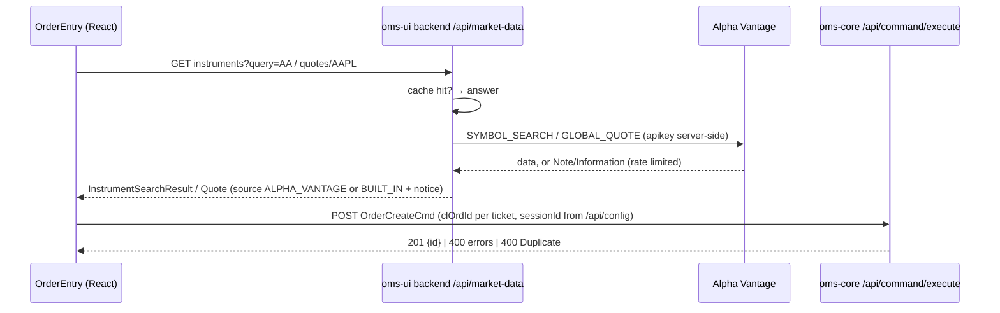

# Design — SPEC-0072: Add an order entry tab to oms-ui

> **Stage 2 of 3 — how.** Concrete enough that the plan can be written without re-reading the
> code, and checked line by line against the architecture policies. Write "None — <reason>" for a
> section that genuinely does not apply.

## Context

**oms-ui** is a Spring Boot 4.1 app (`oms-ui/`, `spring-boot-starter-web`) that builds the React app
(`oms-ui/frontend`, CRA + TypeScript, jest via `react-app-rewired`) into its static resources
(`buildReact` → `copyReactBuild` in `build.gradle`). Its backend has only `ConfigController`
(`GET /api/config`: `appName`, `apiBaseUrl` (oms-core), `streamingUrl`, `maxStreamingRows`, feature
flags), `HealthController` and `WebConfig`. Its standalone build does **not** include
oms-contracts. Its Docker image builds from source inside Docker (`oms-ui/Dockerfile`, compose
`context: ./oms-ui`).

**Frontend.** `App.tsx` has tabs `orders | executions | quotes | quoteRequests` and a REST/streaming
mode switch; blotter views stay mounted once shown (SPEC-0056). `OMSApiService` (singleton over
`ApiClient`, axios with the bearer token from `AuthTokenService`, `baseURL` = oms-core) only reads.
`ConfigService` fetches `${contextPath}/api/config` with `fetch`. Styling: per-component `.scss`
with the design tokens (SPEC-0060). Under `npm start`, CRA proxies to oms-core (`"proxy":
"http://localhost:8090"`), so same-origin calls to oms-ui's backend are not served in that mode.

**oms-core's command API.** `POST /api/command/execute` with `{"type":"OrderCreateCmd",
"version":"1.0.0","order":{…}}`:
- **Contract:** `Order` in `oms-cmd-api.yml` (required `clOrdId`, `sessionId`, `account`,
  `ordType`, `side`, `symbol`, `orderQty` > 0; enums `Side`, `OrdType`, `TimeInForce`, `HandlInst`,
  … in `schema.yml`).
- **Answers:** 201 with `CommandResult {id (orderId), status, message, eventVersion}`. A body that
  breaks the contract gets 400 Problem `urn:oms:error:validation-failed` with
  `errors: {"order.<field>": [msg…]}`. A pipeline refusal gets 400 `CommandResult` with
  `status FAILED` and a message: `ValidateOrderTask` ("Symbol is required", "Limit orders must have
  a price", "Stop orders must have a stop price", …) or `PersistOrderTask`'s
  "Duplicate order for sessionId=… and clOrdId=…".
- **CORS:** `WebConfig` already allows POST from `CORS_ALLOWED_ORIGINS` (incl. `:8080`, `:3000`).

**Contracts.** `oms-contracts` holds `oms-cmd-api.yml`, `oms-query-api.yml`, `schema.yml` and
generates their models (`openApiGenerate*Models`, spring generator 7.24.0, Lombok
`@SuperBuilder @Jacksonized`); services `includeBuild('../oms-contracts')` and generate only their
API interfaces (oms-core: `openApiGenerateCmd/Query`, `globalProperties = [apis: ""]`).
`verifyContracts` fails if a listed service has its own `src/main/openapi|avro`.

**Exchange simulator** prices AAPL 170, MSFT 420, IBM 250, NVDA 120, INTC 86.96 and rejects other
symbols. **Market data:** Alpha Vantage `SYMBOL_SEARCH` (bestMatches: symbol, name, type, region,
currency, …) and `GLOBAL_QUOTE` (price, change, change percent, high, low, previous close, latest
trading day); a rate-limited key gets HTTP 200 with a `Note` or `Information` member instead of
data. Free tier ≈ 25 requests/day, 5/minute.

Knowledge base read: `ui/admin-ui.md`, `domain/interfaces/command-api.md`,
`framework/exception-handling.md`, `infrastructure/local-docker-stack.md`, policies.

## Approach



| Proposal change | Where |
|---|---|
| Market data API spec | new `oms-contracts/src/main/openapi/oms-marketdata-api.yml`; models task `openApiGenerateMarketDataModels` → `org.example.common.model.marketdata` |
| oms-ui backend consumes contracts | `oms-ui/settings.gradle` `includeBuild('../oms-contracts')`; `build.gradle` + `implementation 'org.example.oms:oms-contracts'`, openapi generator plugin, task `openApiGenerateMarketData` (`apis` only) → `org.example.common.api.MarketDataApi` |
| Market data endpoints | `org.example.omsui.marketdata.MarketDataController implements MarketDataApi` |
| Providers | `MarketDataProvider` (interface: `search(query)`, `quote(symbol)`); `AlphaVantageProvider` (Spring `RestClient`); `BuiltInMarketData` (configured list); `MarketDataService` (cache, fallback, source/notice) |
| Cache | `TtlCache<K,V>` (small class, `ConcurrentHashMap` + expiry, `Clock` injected) |
| Config | `oms.ui.market-data.alpha-vantage.api-key: ${ALPHAVANTAGE_API_KEY:}`, `…base-url`, `…search-ttl: PT24H`, `…quote-ttl: PT5M`, `…built-in` list; `oms.ui.order-entry.session-id: ${OMS_UI_SESSION_ID:OMS-UI}` exposed in `/api/config` as `orderEntry.sessionId` |
| Order Entry tab | `App.tsx` tab `orderEntry` ("Order Entry"); `components/OrderEntry.tsx` + `.scss`; `services/orderTicket.ts` (ticket model, validation, command mapping, clOrdId rule); `services/MarketDataService.ts`; `OMSApiService.createOrder` |
| Docker | compose `oms-ui.build: {context: ., dockerfile: oms-ui/Dockerfile}`; `oms-ui/Dockerfile.dockerignore` keeps only `oms-ui/` and `oms-contracts/`; Dockerfile copies both and builds in `/workspace/oms-ui`; `ALPHAVANTAGE_API_KEY` passed through |

## Contract Changes

New `oms-contracts/src/main/openapi/oms-marketdata-api.yml` (OpenAPI 3.0.3, served by oms-ui):

```yaml
openapi: 3.0.3
info:
  title: OMS UI Market Data API
  version: 1.0.0
  description: |
    Instrument lookup and quotes for order entry (SPEC-0072), served by oms-ui's backend from a
    market data provider (Alpha Vantage when configured) or a built-in list. Provider limits and
    failures never fail a request: the built-in data is returned with a notice.
paths:
  /api/market-data/instruments:
    get:
      operationId: searchInstruments
      tags: [MarketData]
      parameters:
        - {name: query, in: query, required: true, schema: {type: string, minLength: 1, maxLength: 40}}
      responses:
        '200': {description: Matching instruments, content: {application/json: {schema: {$ref: '#/components/schemas/InstrumentSearchResult'}}}}
        '400': {description: Invalid query}
  /api/market-data/quotes/{symbol}:
    get:
      operationId: getQuote
      tags: [MarketData]
      parameters:
        - {name: symbol, in: path, required: true, schema: {type: string, minLength: 1, maxLength: 20}}
      responses:
        '200': {description: The latest quote, content: {application/json: {schema: {$ref: '#/components/schemas/Quote'}}}}
        '404': {description: No quote for this symbol from the provider or the built-in list}
components:
  schemas:
    MarketDataSource: {type: string, enum: [ALPHA_VANTAGE, BUILT_IN]}
    Instrument:
      type: object
      required: [symbol]
      properties:
        symbol: {type: string}
        name: {type: string}
        type: {type: string}
        region: {type: string}
        currency: {type: string}
    InstrumentSearchResult:
      type: object
      required: [instruments, source]
      properties:
        instruments: {type: array, items: {$ref: '#/components/schemas/Instrument'}}
        source: {$ref: '#/components/schemas/MarketDataSource'}
        notice: {type: string, description: Why the built-in list was used, when it was}
    Quote:
      type: object
      required: [symbol, source]
      properties:
        symbol: {type: string}
        last: {type: number}
        change: {type: number}
        changePercent: {type: number}
        high: {type: number}
        low: {type: number}
        previousClose: {type: number}
        bid: {type: number, description: Absent when the provider does not supply it}
        ask: {type: number, description: Absent when the provider does not supply it}
        currency: {type: string}
        asOf: {type: string, description: The provider's as-of date or time, as given}
        source: {$ref: '#/components/schemas/MarketDataSource'}
        notice: {type: string}
```

**Compatibility (P-04):** a new, additive spec; no change to existing specs or generated packages.
New generated classes: `org.example.common.model.marketdata.*` (in the oms-contracts jar) and
`org.example.common.api.MarketDataApi` (in oms-ui's build only).

## Data & Persistence

None — no database. The cache is in memory in oms-ui's backend and is lost on restart, which only
costs provider calls.

## Events & Messaging

None — no Kafka. Orders are sent through oms-core's existing command API, which stages its own
events and outbox rows as for any REST client.

## Domain, State & Orchestration

No OMS state machine change. Order entry behaviour (frontend, `services/orderTicket.ts`):

- **Ticket fields:** `symbol`, `side` (BUY, SELL, SELL_SHORT), `ordType` (MARKET, LIMIT, STOP,
  STOP_LIMIT, MARKET_ON_CLOSE), `orderQty`, `price` (LIMIT, STOP_LIMIT), `stopPx` (STOP,
  STOP_LIMIT), `timeInForce` (default DAY), `expireTime` (optional), `settlCurrency`, `account`,
  `exDestination`, `handlInst` (default AUTO), `text`; from the chosen instrument also
  `securityDesc` (its name).
- **Validation (before sending):** symbol and account required; quantity > 0 with at most 8
  decimals; price > 0 when LIMIT or STOP_LIMIT; stopPx > 0 when STOP or STOP_LIMIT; price and stopPx
  hidden and not sent for other types; `expireTime` in the future when given. Errors are shown
  per field and the Submit button stays disabled while any remain.
- **Command:** `{"type":"OrderCreateCmd","version":"1.0.0","order":{…}}` with the fields above, the
  ticket's `clOrdId` and `sessionId` from `/api/config` (`orderEntry.sessionId`), `sendingTime` =
  now. Empty optional fields are omitted.
- **clOrdId rule (AC-4):** generated (`crypto.randomUUID()`, prefixed `UI-`) when the ticket is
  created; kept on every retry of that ticket; replaced only after a successful submit or a
  reset. Submit is disabled while a request is in flight.
- **Answers:**
  - 201: show "Order <orderId> created", offer "New order" (keeps symbol and account) and a link to
    the Orders tab.
  - 400 with `errors`: map `order.<field>` to the form field; others in a banner.
  - 400 `CommandResult` FAILED: the message in a banner. If it is the duplicate refusal for this
    ticket's `clOrdId`, the earlier attempt succeeded: look up the order by `clOrdId` and
    `sessionId` via `/api/query/search` and show it as created.
  - Network error: banner with "Retry" (same clOrdId).
- **Account:** free text; the last five used are remembered in `localStorage` (try/catch) and
  offered as suggestions.

Market data behaviour (backend, `MarketDataService`):

- **search(query):** cache → provider → on `ProviderUnavailable` (no key, HTTP error, timeout,
  `Note`/`Information` body) the built-in list filtered by symbol or name prefix (case-insensitive),
  `source BUILT_IN`, `notice` naming the reason ("Market data provider not configured", "… rate
  limit reached", "… not reachable"). Only provider answers are cached; fallbacks are not, so data
  returns once the provider does.
- **quote(symbol):** same chain; the built-in quote has `last` = the reference price and no
  change/range; unknown symbol everywhere → 404.
- **Alpha Vantage mapping:** `SYMBOL_SEARCH.bestMatches[]` "1. symbol", "2. name", "3. type",
  "4. region", "8. currency"; `GLOBAL_QUOTE["Global Quote"]` "05. price" → last, "09. change",
  "10. change percent" (without %), "03. high", "04. low", "08. previous close", "07. latest trading
  day" → asOf; no bid/ask. An empty `Global Quote` → not found from the provider.
- **Timeouts:** connect 2 s, read 5 s, so a slow provider falls back quickly.

## Alternatives & Decisions

- **Decision: market data through oms-ui's backend (BFF), not from the browser.** Alternative: the
  React app calls Alpha Vantage directly. Rejected: the key would be in the bundle or requests, and
  each browser would spend the shared 25-per-day quota without a shared cache.
- **Decision: models in oms-contracts, interface generated in oms-ui** (approved proposal; P-01,
  P-02), following oms-core's pattern. Alternative: hand-written DTOs in oms-ui. Rejected: spec
  first. **Build change (P-17):** oms-ui includes oms-contracts and adds the openapi generator
  plugin (7.24.0, as elsewhere); `verifyContracts` adds oms-ui to its guarded modules.
- **Decision: oms-ui's Docker build context becomes the repository root** with a
  Dockerfile-specific ignore file (`oms-ui/Dockerfile.dockerignore`, BuildKit) that sends only
  `oms-ui/` and `oms-contracts/`. Alternative: copy a host-built jar like oms-core. Rejected: it
  would change today's one-command `docker compose up --build oms-ui` into a two-step build.
- **Changed during implementation (T-2):** the interface is generated with `useTags: true`, since
  grouping by first path segment named it `ApiApi` (the paths start with `/api`); oms-ui adds
  `spring-boot-starter-validation` (as the other services have) so the generated `@Validated`
  parameter bounds answer 400.
- **Changed during implementation (T-10): a named build context instead of the repository root.**
  The oms-ui image keeps `context: ./oms-ui` and gets oms-contracts as the named context
  `oms-contracts` (compose `additional_contexts`; `COPY --from=oms-contracts`), with an
  `oms-contracts/.dockerignore` for its build output. Simpler than a root context with a
  Dockerfile-specific ignore file, and the Dockerfile stays where it was. Compose v5 builds it through
  Bake, which on this Windows host asks for `--allow=fs.read=oms-uiDockerfile` — as it did before
  this change (probed with the unchanged compose entry): interactive terminals get a prompt; the
  verification used `docker buildx build --build-context oms-contracts=./oms-contracts oms-ui`.
- **Changed after independent review (verify stage):**
  - oms-core words the duplicate refusal "Order creation failed: Duplicate order for sessionId=… and
    clOrdId=…" (CommandDispatcher prefixes PersistOrderTask's reason); the check matches the end of
    the message, and the tests use that exact wording.
  - After a network error the outcome is unknown: the next submit first looks the clOrdId up and shows
    an order found instead of sending (the form may have been edited meanwhile); a failed lookup
    shows "could not confirm", never a guess.
  - A late quote for an earlier symbol is dropped (sequence number, like the lookup).
  - Numbers: at most 15 significant digits, since the command carries JavaScript numbers.
  - Alpha Vantage values are passed as URI variables (encoded; `{…}` in a query no longer 500s);
    an `Error Message` or any answer without `bestMatches`/`Global Quote` is "unavailable" (not cached);
    a blank query never reaches the provider.
- **Decision: a hand-written TTL cache** (`TtlCache`, ~40 lines). Alternative: Spring Cache with
  Caffeine. Rejected: a new dependency for two maps (P-17).
- **Decision: `RestClient`** (in Spring Web, already a dependency) for Alpha Vantage. No new
  dependency.
- **Decision: the built-in list mirrors the exchange simulator's symbols and prices**, configured
  in oms-ui (`application.yml`), with names and USD. Alternative: read the simulator's config.
  Rejected: coupling oms-ui to the simulator's deployment.
- **Decision: frontend calls oms-ui's backend same-origin** (`${contextPath}/api/market-data`, like
  `/api/config`). Under `npm start` the CRA proxy sends it to oms-core, which answers 404; the form
  then shows "market data unavailable" and manual entry works (AC-7's path). No dev proxy change.
- **Decision: a duplicate refusal of this ticket's own `clOrdId` counts as success**, resolved by a
  search; it can only mean an earlier attempt of the same ticket was applied.

## Risks & Mitigations

- **Quota exhaustion (25/day).** Cache (24 h searches, 5 min quotes), lookup only after 2
  characters with a 400 ms debounce, fallback to the built-in list with a notice.
- **Provider response changes.** Mapping isolated in `AlphaVantageProvider`, tested with recorded
  JSON; unknown shapes → `ProviderUnavailable` → fallback, never a 500.
- **Key leakage.** The key is read only by `AlphaVantageProvider`; it is never logged (the request
  URL is logged without query), never in `/api/config` or any model; a test asserts it appears in
  no response.
- **Docker build context change.** The ignore file keeps the context to two folders; verified by
  building the image in the verify stage.
- **Orders for symbols the simulator does not know** are rejected by the simulator; the built-in
  list (the default offline) only offers known ones.
- **Submitting real orders by accident** in a shared environment: the button says "Submit order",
  a summary line ("BUY 100 AAPL LIMIT 170.00 DAY for ACC-1") is shown above it.

## Test Strategy

| AC | Level | Test class#method | What it asserts |
|---|---|---|---|
| AC-1 | unit (jest) | `OrderEntry.test.tsx` › `submits a limit order and shows the new order id` | one POST to `/api/command/execute` with exactly the entered values, `UI-` clOrdId, configured sessionId; "Order ORD-… created" shown |
| AC-1 | unit (jest) | `orderTicket.test.ts` › `maps a ticket to OrderCreateCmd` | the command shape per order type; empty optionals omitted |
| AC-1 | e2e (verify, observed) | running stack, browser: submit from the tab, order appears in the Orders blotter and `/api/query/search?clOrdId=…` | recorded in verification.md with the order id |
| AC-2 | unit (jest) | `orderTicket.test.ts` › `rejects …` cases; `OrderEntry.test.tsx` › `marks invalid fields and sends nothing` | each rule; no POST |
| AC-3 | unit (jest) | `OrderEntry.test.tsx` › `shows oms-core field errors and keeps the input`, `› shows a refusal message` | `errors.order.price` on the price field; banner; values kept; Submit enabled again |
| AC-4 | unit (jest) | `OrderEntry.test.tsx` › `a retry keeps the clOrdId, a new order gets a new one`, `› resolves its own duplicate refusal`, `› sends once on a double click` | same clOrdId on retry; new after success/reset; duplicate → search → shown as created; one POST in flight |
| AC-5 | web-mvc + unit | `MarketDataControllerTest#searchReturnsProviderInstruments`; `AlphaVantageProviderTest#mapsSymbolSearch`; `OrderEntry.test.tsx` › `lookup fills symbol and currency` | provider matches returned with source; field mapping; selection fills symbol and empty currency |
| AC-6 | web-mvc + unit | `MarketDataControllerTest#quoteReturnsProviderQuote`; `AlphaVantageProviderTest#mapsGlobalQuote`; `OrderEntry.test.tsx` › `shows the quote and uses the last price` | quote fields; bid/ask absent → "n/a"; button fills price |
| AC-7 | web-mvc + unit | `MarketDataControllerTest#fallsBackToBuiltInWithoutKey`, `#fallsBackWhenRateLimited`, `#fallsBackWhenUnreachable`, `#keyIsInNoResponse`; `ConfigControllerTest#configHasNoMarketDataKey`; `OrderEntry.test.tsx` › `works when market data is unavailable` | built-in list + notice; manual symbol + submit; key string absent from `/api/config` and market data responses |
| AC-8 | unit | `MarketDataServiceTest#answersRepeatedRequestsFromTheCache`, `#doesNotCacheFallbacks`, `#expiresAfterTtl`; `TtlCacheTest` | provider called once within TTL, again after it |

Contract: `oms-contracts` `./gradlew build` generates the models; oms-ui's build generates
`MarketDataApi` and fails if the controller does not implement it. Docker: the verify stage builds
the oms-ui image once (`docker compose build oms-ui`) to prove the new context.

## Policy Compliance

| Policy | Title | Status | How / Justification |
|---|---|---|---|
| P-01 | Contracts live only in oms-contracts | comply | New spec only in `oms-contracts/src/main/openapi`; `verifyContracts` guards oms-ui too |
| P-02 | Specification before code, generated models only | comply | Spec first; models generated in oms-contracts, interface in oms-ui; the order command uses the existing contract |
| P-03 | Never edit generated code | comply | Regenerate only |
| P-04 | Contracts evolve compatibly | comply | New, additive spec; existing specs untouched |
| P-05 | Every state change is recorded in the event log | n/a | oms-ui changes no order state itself; oms-core records the created orders as always |
| P-06 | Kafka only through the transactional outbox | n/a | No Kafka in oms-ui |
| P-07 | Schema changes through new Liquibase changesets | n/a | No database |
| P-08 | Concurrency and idempotency are explicit | comply | One clOrdId per ticket across retries; oms-core's (sessionId, clOrdId) uniqueness; duplicate refusal resolved; one request in flight |
| P-09 | Commands and queries stay separate | comply | Writes via `/api/command/execute`, reads via the query API; market data is read-only |
| P-10 | State transitions go through the state machine and task pipeline | n/a | No transitions in oms-ui |
| P-11 | Layering and conventions | comply | Controller → service → provider; constructor injection; Lombok; React component + pure ticket module, like existing services |
| P-12 | Jackson 3 only | comply | `tools.jackson` for provider JSON |
| P-13 | Errors and validation follow the framework specs | comply | oms-core's Problem+JSON shown as is; market data errors never 500 (fallback) except 404 for an unknown symbol; generated `@Validated` params → 400 |
| P-14 | Test first, every acceptance criterion is proven by an automated test | comply | Table above; AC-1's end-to-end half is also observed on the running stack |
| P-15 | Observability | comply | Provider calls logged (without the key) with duration and outcome; Micrometer counters `oms.ui.marketdata.requests{source,outcome}` |
| P-16 | Security | comply | Key from an environment variable, server-side only, never logged or returned (tested); query/symbol length-limited in the contract |
| P-17 | Simplicity and dependencies | comply | No new library; build change (contracts include, generator plugin, Docker context) recorded above |
| P-18 | Modules build standalone | comply | oms-ui builds standalone with its included oms-contracts; `spec verify` runs oms-contracts' consumers and oms-ui |
| P-19 | Documentation follows behaviour | comply | KB pages below |

## Knowledge Base Updates

- `ui/admin-ui.md` (or a new `ui/order-entry.md` linked from it): the tab, fields, validation,
  submission, clOrdId rule, market data panel and its fallback.
- `domain/interfaces/` new page for the market data API (oms-ui backend), linked from the
  interfaces index; `domain/interfaces/command-api.md`: oms-ui is a client.
- `infrastructure/local-docker-stack.md`: `ALPHAVANTAGE_API_KEY`, `OMS_UI_SESSION_ID`, the oms-ui
  build context.
- `log.md`: SPEC-0072 entry. `oms-ui/README.md`: configuration.
