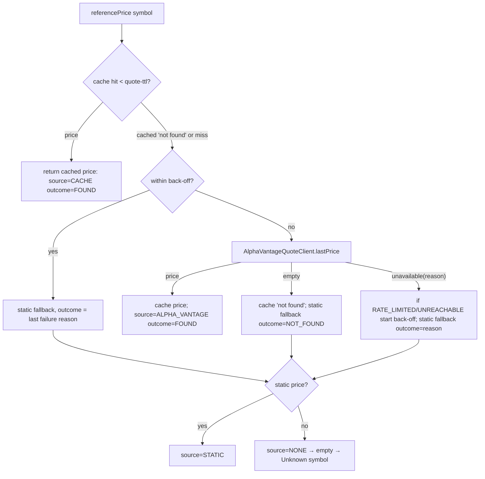

# Design — SPEC-0073: Use Alpha Vantage data in exchange simulator

> **Stage 2 of 3 — how.** Concrete enough that the plan can be written without re-reading the
> code, and checked line by line against the architecture policies. Write "None — <reason>" for a
> section that genuinely does not apply.

## Context

The simulator (`oms-exchange-simulator`, KB [Exchange Simulator](../../../oms-knowledge-base/architecture/context/exchange-simulator.md))
consumes `OrderMessage` from `oms_orders` (`kafka/OrderMessageListener`), hands it to the
single-threaded `engine/ExchangeEngine`, which calls `engine/OrderEvaluator#evaluate` for a new
order and answers with commands through `CommandSink` / `kafka/CommandGateway`.

Today `OrderEvaluator` reads the reference price from `SimulatorProperties#referencePrices`
(`simulator.reference-prices` in `application.yml`, five symbols) and rejects a limit outside
`reference ± price-band-percent` (flat 10 %). `metrics/SimulatorMetrics` counts answers.

**Closest existing example:** oms-ui's market data (SPEC-0072) —
`oms-ui/src/main/java/org/example/omsui/marketdata/AlphaVantageProvider.java` (GLOBAL_QUOTE call,
rate-limit detection via `Note`/`Information`, key never logged, values passed as URI variables),
`TtlCache.java`, `MarketDataService.java` (cache → provider → built-in fallback, metric
`{kind, source, outcome}`), and `AlphaVantageProviderTest` (`MockRestServiceServer`, log appender
asserting the key is never logged). This design is the simulator-side sibling of the quote half of
that, reusing its shapes and names.

Read: KB `domain/interfaces/market-data-api.md`, `architecture/context/exchange-simulator.md`,
`capabilities/exchange-simulation.md`, `domain/concepts/order-lifecycle.md` (mentions the band),
`architecture/patterns/kafka-messaging.md`, `delivery/testing.md`, the policies.

## Approach

New package `org.example.simulator.marketdata`:

| Class | Role |
|---|---|
| `AlphaVantageQuoteClient` | `Optional<BigDecimal> lastPrice(String symbol)` via `GET /query?function=GLOBAL_QUOTE&symbol={s}&apikey={k}`; returns `"05. price"`, empty when `Global Quote` is empty/has no price; throws `ProviderUnavailableException(reason)` when not configured, rate limited (`Note`/`Information`), on HTTP/IO/parse error or an unexpected shape (`Error Message`). Logs function + elapsed ms + exception *type* only. Built from a `RestClient.Builder` (testable with `MockRestServiceServer`). Copied and trimmed from oms-ui's `AlphaVantageProvider`. |
| `ProviderUnavailableException` | `RuntimeException` with `Reason { NOT_CONFIGURED, RATE_LIMITED, UNREACHABLE }`; message never contains provider text. |
| `TtlCache<K,V>` | Copy of oms-ui's class (Clock-based expiry). |
| `ReferencePrices` | Interface `Optional<BigDecimal> referencePrice(String symbol)` — what `OrderEvaluator` depends on. |
| `ReferencePriceService implements ReferencePrices` | cache → Alpha Vantage → static `simulator.reference-prices`; back-off; metric. |
| `MarketDataConfiguration` | `@Configuration` wiring the client (connect 2 s / read 3 s via `SimpleClientHttpRequestFactory`), the service with `Clock.systemUTC()`; logs at startup whether Alpha Vantage is used (never the key). |

**Lookup algorithm** (`ReferencePriceService#referencePrice`, called on the engine thread):



- The cache holds provider answers only, including "not found" (`Optional.empty()`), for
  `quote-ttl` (default 5 min). A cached "not found" goes straight to the static fallback with
  outcome `NOT_FOUND` and makes no request. Fallback results are not cached, so the provider is
  used again as soon as it answers.
- **Back-off:** after `RATE_LIMITED` or `UNREACHABLE`, the provider is not called for
  `provider-backoff` (default 60 s); lookups meanwhile go to the static fallback with the same
  outcome. This bounds how long the single engine thread can wait on a dead provider (at most one
  read timeout per back-off period) and avoids spending quota on rejected calls. `NOT_CONFIGURED`
  never makes a request.
- Symbols are looked up as the order carries them (`OrderMessage.symbol`), trimmed, upper-cased
  for the cache key and the static map.

**Evaluation** (`OrderEvaluator`, still pure apart from the injected `ReferencePrices`): the
checks keep their current order; the reference comes from `ReferencePrices`; the band check is
replaced by two new checks, done for LIMIT only, after `Limit order without price`:

1. **Tick (Reg NMS Rule 612)** — `LimitPriceRules.tickFor(price)`: `0.01` when
   `price ≥ 1.00`, else `0.0001`. Reject when `price.remainder(tick) ≠ 0`:
   `Price <p> is not a multiple of tick <t>` (plain strings, e.g. `Price 170.005 is not a multiple of tick 0.01`).
   Keyed on the limit price itself, as the rule is.
2. **Collar (NYSE LOPP tiers)** — `LimitPriceRules.collarPercent(reference, tiers)`: first tier
   whose `max-reference ≥ reference`, else `default-percent`. `lo = reference × (1 − pct/100)`,
   `hi = reference × (1 + pct/100)`, exact `BigDecimal`. Reject a **buy** with `price > hi`, a
   **sell/sell short** with `price < lo`: `Price <p> outside collar <lo>-<hi>` (stripped plain
   strings, e.g. `Price 175.11 outside collar 164.9-175.1`). The passive side is not collared.

Marketability and fill price are unchanged (fill at reference). `LimitPriceRules` is a small final
class of static functions in `engine`, unit-tested on its own.

**Configuration** (`SimulatorProperties`, `application.yml`):

```yaml
simulator:
  reference-prices: { AAPL: 170.00, … }   # unchanged; now the fallback
  quote-ttl: ${SIMULATOR_QUOTE_TTL:5m}
  provider-backoff: ${SIMULATOR_PROVIDER_BACKOFF:60s}
  alpha-vantage:
    api-key: ${ALPHAVANTAGE_API_KEY:}
    base-url: ${ALPHAVANTAGE_BASE_URL:https://www.alphavantage.co}
  price-collar:
    tiers:
      - { max-reference: 25.00, percent: 10 }
      - { max-reference: 50.00, percent: 5 }
    default-percent: 3
```

`price-band-percent` is removed from the record, `application.yml`, README and KB.
`SimulatorProperties` gets nested records `AlphaVantage(apiKey, baseUrl)` (with a `toString` that
hides the key, as oms-ui's) and `PriceCollar(List<Tier> tiers, BigDecimal defaultPercent)`, with
`@DefaultValue`s matching the YAML so a test that builds the record directly stays short.

**docker-compose.yml** — `oms-exchange-simulator.environment` gains
`ALPHAVANTAGE_API_KEY: ${ALPHAVANTAGE_API_KEY:-}` and
`ALPHAVANTAGE_BASE_URL: ${ALPHAVANTAGE_BASE_URL:-https://www.alphavantage.co}`, as oms-ui gets them.

**Mapping to What Changes:** reference price from Alpha Vantage, unknown-symbol reject, cache,
fallback → `ReferencePriceService` + `AlphaVantageQuoteClient`; tick and collar →
`LimitPriceRules` + `OrderEvaluator`; key never leaks → client logging + reject texts built only
from our own strings; metric → `SimulatorMetrics#referencePriceLookup(source, outcome)`;
band removal → `SimulatorProperties`, `application.yml`.

## Contract Changes

None — the simulator still consumes `OrderMessage` and sends the existing `OrderAcceptCmd`,
`ExecutionCreateCmd`, `OrderRejectCmd`, `OrderCancelCmd`, `OrderCancelRejectCmd`. Reject reasons are
free text (`text`). The Alpha Vantage answer is an external, undocumented-by-us shape parsed into a
`BigDecimal` inside the client; it is not an OMS contract, and oms-ui's `oms-marketdata-api.yml` is
not involved (the simulator does not call oms-ui).

## Data & Persistence

None — the simulator has no database. The quote cache is in memory and lost on restart, which only
costs one fresh request per symbol.

## Events & Messaging

None changed — same topics (`oms_orders` in, `commands` out), keys, headers and commandIds.
Idempotency is unchanged: the engine still evaluates an order only on its first sight in UNACK, so
a redelivered order does not trigger a second lookup or answer. A price change between two
redeliveries therefore cannot produce a second, different answer.

## Domain, State & Orchestration

None in oms-core — no state machine, task pipeline or API change. The simulator's own rules
change as described in Approach (reject reasons for tick and collar; the band reason
`Price <p> outside band <lo>-<hi>` disappears). oms-core records each reject as today
(`OrderRejectCmd.text` → `rejectReason`).

## Alternatives & Decisions

- **Decision — the limit checks live in the simulator (venue side).** Approved in the proposal.
  Rejected: an oms-core pre-trade check (needs market data in oms-core; separate ticket).
- **Decision — a small Alpha Vantage client in the simulator, copied from oms-ui and trimmed to
  `GLOBAL_QUOTE`.** Alternatives: (a) a new shared library module used by both oms-ui and the
  simulator — rejected for now: a new module, publication and composite-build wiring for ~120
  lines, and the two callers need different things (oms-ui maps to the generated `Quote` model with
  search; the simulator needs one price); (b) the simulator asks oms-ui's `/api/market-data/quotes`
  — rejected: makes the venue depend on a UI backend, and inverts the dependency direction. Cost:
  ~150 duplicated lines (client + `TtlCache`); both carry a comment pointing at the other.
- **Decision — no new dependencies.** `RestClient` comes with `spring-boot-starter-web`, already a
  dependency; `MockRestServiceServer` with `spring-boot-starter-test`; the integration stub uses
  the JDK's `com.sun.net.httpserver` as `MockOtlpReceiver` already does. `build.gradle` unchanged.
- **Decision — lookup on the engine thread, bounded by short timeouts + cache + back-off.**
  Alternative: resolve the price on the Kafka listener thread before enqueueing — rejected: the
  listener does not know whether a message is a first-sight new order (engine state), so it would
  look up for echoes too, and it splits evaluation across threads. Worst case with the chosen
  design: one 2 s + 3 s stall per symbol per back-off period, only when the provider is
  misbehaving; acceptable for a development simulator and visible in the metric.
- **Decision — provider wins over the static price; provider "not found" falls back to static.**
  So test and demo symbols configured in `reference-prices` stay tradable even if Alpha Vantage does
  not know them, and AAPL trades at the market price shown in order entry (AC-2).
- **Decision — tick size keyed on the limit price** (Rule 612 wording), not on the reference.
- **Decision — collar tiers configurable, tick rule fixed.** The tiers are venue policy that users
  may want to tune; the tick rule is regulation.
- **Decision — tests are isolated from a developer's real `ALPHAVANTAGE_API_KEY`.** Environment
  variables outrank `application.properties` files, so a properties file cannot do it.
  `AbstractKafkaIntegrationTest`'s `@DynamicPropertySource` (which outranks the environment) sets
  `simulator.alpha-vantage.api-key` to empty and `simulator.alpha-vantage.base-url` to
  `http://127.0.0.1:9`. `AlphaVantageKafkaIntegrationTest` registers the stub's URL and a fake key
  in its own `@DynamicPropertySource`; Spring applies the subclass's registrations after the base
  class's, so they win. If that ever stopped holding, the test fails loudly because the stub gets no
  request. Unit tests construct objects directly and never read the environment. Rejected: a
  `src/test/resources/config/application.properties` (outranked by env, so it gives no protection).

## Risks & Mitigations

| Risk | Mitigation |
|---|---|
| Engine thread stalls on a slow provider, delaying all orders | connect 2 s / read 3 s, cache, 60 s back-off after a failure (Approach); unit test asserts no second request during back-off |
| Free quota (~25/day) exhausted by many symbols | 5-min cache incl. "not found"; back-off on rate limit; static fallback keeps the venue answering; metric outcome `RATE_LIMITED` shows it |
| Free quote is end-of-day/delayed, so the "market" is stale | Accepted: it is the price order entry shows the trader, which is what matters for consistency |
| API key leaks via logs, exception messages or reject texts | log exception type only; URI variables; `toString` hides key; reject texts built from our own strings; AC-8 tests with an answer that echoes the key |
| Existing tests or the load suite suddenly hit the real API when a developer has the key in env | base integration test forces an empty key; load suite runs against compose — with a key set, MARKET orders on AAPL fill at the real price, which the suite does not assert |
| Collar rejects orders that passed before (3 % above $50 vs 10 %) | Intended; the passive side is no longer rejected at all; documented in KB and README; tiers configurable |
| Removing `price-band-percent` breaks a deployment that sets it | Only the simulator reads it; Spring ignores unknown properties; compose does not set it |

## Test Strategy

All in `oms-exchange-simulator/src/test/java/org/example/simulator/`. Unit tests use a mutable
`Clock`, `SimpleMeterRegistry` and `MockRestServiceServer`; the integration test extends
`AbstractKafkaIntegrationTest` (Testcontainers Kafka; this module has no Postgres) and points the
client at `marketdata/StubAlphaVantage` (JDK `HttpServer`, records requests, canned answers per
symbol).

| AC | Level | Test class#method | What it asserts |
|---|---|---|---|
| AC-1 | integration | `kafka/AlphaVantageKafkaIntegrationTest#symbolOnlyKnownToAlphaVantage_fillsAtItsLastPrice` | stub quotes `GOOGL` 141.80 (not in reference-prices) → `OrderAcceptCmd` then `ExecutionCreateCmd` with `lastPx` 141.80 |
| AC-1 | unit | `marketdata/AlphaVantageQuoteClientTest#globalQuote_returnsLastPrice` | `"05. price"` parsed to BigDecimal; request has function, symbol, apikey |
| AC-2 | unit | `marketdata/ReferencePriceServiceTest#providerPriceWinsOverStaticPrice` | AAPL static 170.00, provider 189.50 → 189.50, source `ALPHA_VANTAGE` |
| AC-2 | integration | `kafka/AlphaVantageKafkaIntegrationTest#knownSymbol_fillsAtProviderPriceNotStatic` | AAPL MARKET fills at the stub's 189.50 |
| AC-3 | unit | `marketdata/AlphaVantageQuoteClientTest#emptyGlobalQuote_isNotFound` | `{"Global Quote":{}}` → empty |
| AC-3 | integration | `kafka/AlphaVantageKafkaIntegrationTest#symbolUnknownToProviderAndStatic_isRejected` | stub empty quote for `ZZZZ` → `OrderRejectCmd` text `Unknown symbol ZZZZ` |
| AC-4 | unit | `marketdata/ReferencePriceServiceTest#notConfigured_usesStaticWithoutRequest`, `#rateLimited_fallsBackToStatic`, `#unreachable_fallsBackToStatic`, `#unavailableAndNotStatic_isEmpty`, `#backoff_skipsProviderUntilItExpires` | static price used with the reason; empty when in neither; no request during back-off, one after |
| AC-4 | unit | `marketdata/AlphaVantageQuoteClientTest#noteAnswer_isRateLimited`, `#informationAnswer_isRateLimited`, `#serverError_isUnreachable`, `#errorMessageAnswer_isUnreachable`, `#notConfigured_makesNoRequest` | each failure mapped to its reason |
| AC-4 | integration | `kafka/AlphaVantageKafkaIntegrationTest#providerRateLimited_staticSymbolStillTrades` | stub answers `Note` for MSFT → fill at static 420.00 |
| AC-4 | integration | existing `kafka/ExchangeSimulatorKafkaIntegrationTest` (no key) | unchanged behaviour without a key: AAPL fills at 170, ZZZZ rejected |
| AC-5 | unit | `marketdata/ReferencePriceServiceTest#cachedWithinTtl_noSecondRequest_refetchedAfterTtl`, `#notFoundIsCachedToo` | provider called once within TTL, again after the clock passes TTL |
| AC-5 | integration | `kafka/AlphaVantageKafkaIntegrationTest#secondOrderSameSymbol_usesCache` | two orders for `KO` → stub saw exactly one `GLOBAL_QUOTE` request for KO |
| AC-6 | unit | `engine/LimitPriceRulesTest#tickIsOneCentFromOneDollar_otherwiseHundredthOfACent`; `engine/OrderEvaluatorTest#subPennyLimitAboveOneDollar_rejected`, `#fourDecimalLimitBelowOneDollar_accepted_fiveDecimalsRejected` | exact reject text `Price 170.005 is not a multiple of tick 0.01`; 0.1234 accepted, 0.12345 rejected with tick 0.0001 |
| AC-7 | unit | `engine/LimitPriceRulesTest#collarTiers` ; `engine/OrderEvaluatorTest#buyCollar_perTier` (parameterized 20/40/170 → 22.00✓ 22.01✗, 42.00✓ 42.01✗, 175.10✓ 175.11✗), `#sellCollar_perTier` (18.00✓ 17.99✗, 38.00✓ 37.99✗, 164.90✓ 164.89✗), `#passiveBuyFarBelowReference_acceptedAndRests` | reject text `Price <p> outside collar <lo>-<hi>`; accepted ones marketable; passive buy 100.00 vs 170.00 accepted, not marketable |
| AC-7 | integration | `kafka/ExchangeSimulatorKafkaIntegrationTest#limitThroughCollar_rejected` (new) | AAPL static 170, BUY LIMIT 175.11 → `OrderRejectCmd` with the collar text |
| AC-8 | unit | `marketdata/AlphaVantageQuoteClientTest` (`@AfterEach` log appender: no line contains the key; answers in `#noteAnswer…`/`#errorMessageAnswer…` echo the key) ; `#exceptionsNeverCarryTheKey` | key absent from logs and exception messages |
| AC-8 | integration | `kafka/AlphaVantageKafkaIntegrationTest` (`@AfterEach` over all its tests: every command received and the captured simulator log lines contain no key; stub's rate-limit and error answers echo the key) | key absent from Kafka commands, reject texts and logs |
| AC-9 | unit | `marketdata/ReferencePriceServiceTest#lookupsCountedBySourceAndOutcome` | counter `simulator.reference.price.lookups` with tags `source` ∈ CACHE/ALPHA_VANTAGE/STATIC/NONE, `outcome` ∈ FOUND/NOT_FOUND/NOT_CONFIGURED/RATE_LIMITED/UNREACHABLE, counts match |
| AC-9 | integration | `kafka/AlphaVantageKafkaIntegrationTest#lookupMetricOnPrometheusEndpoint` | `/actuator/prometheus` has `simulator_reference_price_lookups_total{outcome="FOUND",source="ALPHA_VANTAGE"}`, `{source="CACHE"…}`, `{source="STATIC",outcome="RATE_LIMITED"}` and `{source="NONE",outcome="NOT_FOUND"}` after the scenarios above |

Existing `OrderEvaluatorTest` band tests (`…outside band…`) are rewritten to the collar; existing
`ExchangeEngineTest` / metrics tests are adapted only for the new constructor.

## Policy Compliance

| Policy | Title | Status | How / Justification |
|---|---|---|---|
| P-01 | Contracts live only in oms-contracts | n/a | No contract added or changed; no `src/main/openapi` or `src/main/avro` in the simulator |
| P-02 | Specification before code, generated models only | n/a | No API or message change; the Alpha Vantage JSON is an external provider's answer parsed inside the client, as oms-ui does |
| P-03 | Never edit generated code | comply | Nothing under `build/generated*` touched |
| P-04 | Contracts evolve compatibly | n/a | No contract change |
| P-05 | Every state change is recorded in the event log | n/a | No oms-core state change path is touched; rejects still flow through `OrderRejectCmd` into oms-core's normal pipeline |
| P-06 | Kafka only through the transactional outbox | n/a | Applies to oms-core's command path; the simulator keeps publishing through its existing `CommandGateway`, unchanged |
| P-07 | Schema changes through new Liquibase changesets | n/a | No database |
| P-08 | Concurrency and idempotency are explicit | comply | Engine still evaluates only on first sight of an UNACK order (no second lookup/answer on redelivery); cache is a `ConcurrentHashMap`, accessed from the engine thread; commandIds unchanged |
| P-09 | Commands and queries stay separate | n/a | No API |
| P-10 | State transitions go through the state machine and task pipeline | n/a | No oms-core state transitions |
| P-11 | Layering and conventions | comply | New `org.example.simulator.marketdata` package mirroring oms-ui's `marketdata`; constructor injection; config record; Lombok `@Slf4j` |
| P-12 | Jackson 3 only | comply | Client parses with `tools.jackson.databind.json.JsonMapper`, as oms-ui |
| P-13 | Errors and validation follow the framework specs | comply | No REST API; provider failures are caught and mapped to a fallback (never swallowed silently: logged + counted); every order still gets an answer |
| P-14 | Test first, every acceptance criterion is proven by an automated test | comply | Test Strategy maps every AC to unit and integration tests written before the code (plan orders tests first) |
| P-15 | Observability | comply | New counter `simulator.reference.price.lookups{source,outcome}`; provider calls logged with function and latency; order logs keep `orderId` MDC; no change to Kafka tracing |
| P-16 | Security | comply | Key only from env `ALPHAVANTAGE_API_KEY`, never in code/config files, never logged or returned; `symbol` passed as a URI variable (encoded); AC-8 tests |
| P-17 | Simplicity and dependencies | comply | No new dependency or build change; small local client instead of a new shared module (decision recorded); no order book or LULD |
| P-18 | Modules build standalone | comply | Only oms-exchange-simulator code changes; `./gradlew check` there; no contract change, so no consumer impact |
| P-19 | Documentation follows behaviour | comply | KB pages below updated in this ticket; simulator README updated; OpenWiki pages not hand-edited |

## Knowledge Base Updates

- `architecture/context/exchange-simulator.md` — §4 economics: reference price from Alpha Vantage
  with cache/back-off/static fallback; tick and collar rules replace the band, reject reasons
  table; §5 configuration (new properties, `price-band-percent` removed, `ALPHAVANTAGE_API_KEY`);
  §6 example orders; §7 the new metric. Bump `updated`.
- `capabilities/exchange-simulation.md` — the price-check and reference-data bullets, if it lists
  the band.
- `domain/concepts/order-lifecycle.md` — replace the mention of the price band with the tick/collar
  rules (link to the simulator page).
- `domain/interfaces/market-data-api.md` — note that the exchange simulator uses the same provider
  and key for its reference prices (and that the two caches are separate).
- `oms-exchange-simulator/README.md` (module doc, not KB) — configuration table.
