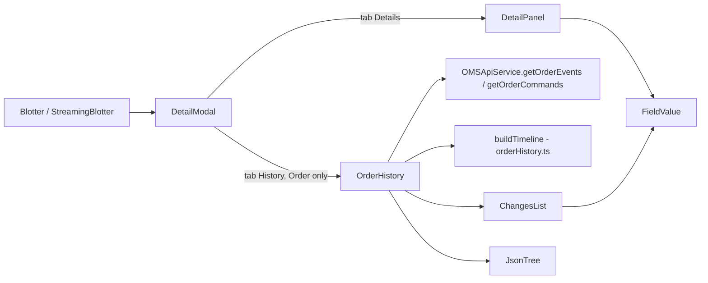

# Design — SPEC-0074: Show command and event history in order detail

> **Stage 2 of 3 — how.** Concrete enough that the plan can be written without re-reading the
> code, and checked line by line against the architecture policies. Write "None — <reason>" for a
> section that genuinely does not apply.

## Context

- **The endpoints exist** (SPEC-0049) in `oms-contracts/src/main/openapi/oms-query-api.yml`, served
  by oms-core:
  - `GET /api/query/orders/{orderId}/events` → `OrderEventDto[]`, in ascending `version`. Its fields:
    - `orderId`, `version`, `event`, `commandId`, `resultingState`, `timeStamp`, `correlationId`,
      `causationId`, `principal` and `source`;
    - the JSON content: `transaction` (the causing command), `orderSnapshot` (the order after the
      change) and `changes` (`{"<field>": {"from": …, "to": …}}`, the jsonb column).
  - `GET /api/query/orders/{orderId}/commands` → `CommandLogEntryDto[]`, oldest first. Its fields
    are `commandId`, `type`, `orderId`, `receivedAt`, `source`, `principal`, `outcome`
    (applied, refused or failed), `reason` and `eventVersion` (set when applied).
- **oms-ui never calls them.** Its order details are a modal:
  - `oms-ui/frontend/src/components/DetailModal.tsx` renders `DetailPanel.tsx`, the current fields in
    groups.
  - It is opened from `Blotter.tsx:376` and `StreamingBlotter.tsx`, with `domainObject` set to
    `'Order'` or `'Execution'` and `data` set to the row (`data.orderId` is the business id).
- **The REST access pattern to follow** is `OMSApiService.ts`: a singleton over `ApiClient` (axios),
  with `get('/api/query/…')`. Its tests (`OMSApiService.test.ts`) mock `ApiClient` and assert the
  path and params. The UI's types are hand-written TypeScript in `src/types/types.ts` (`Order`,
  `Execution`).
- **The value formatting to reuse** is in `DetailPanel.formatValue` (`DetailPanel.tsx:236`): enum
  badges, prices and quantities (`fieldFormat.ts`), ISO instants (`DateTimeService`), and null as
  "—". It is a closure inside `DetailPanel`.
- **Tests:** jest and React Testing Library, through `react-scripts` / `react-app-rewired`. The module
  verify is `npm test -- --watchAll=false` plus `gradlew -p .. check`.
- **KB read:** `ui/admin-ui.md` (the oms-ui specification: detail modal, keyboard, formatting) and
  `ui/design-system.md`.

## Approach

1. **Types** (`src/types/types.ts`): `OrderEventEntry` and `CommandLogEntry`, mirroring
   `OrderEventDto` and `CommandLogEntryDto`. Unknown fields are allowed, as in `Order`.
2. **Client** (`OMSApiService.ts`): two methods, each returning an array (an empty array for a null
   body), and letting HTTP and network errors propagate:
   - `getOrderEvents(orderId)` → `GET /api/query/orders/{encodeURIComponent(orderId)}/events`;
   - `getOrderCommands(orderId)` → `GET /api/query/orders/{…}/commands`.
3. **Timeline** (`src/services/orderHistory.ts`, pure): `buildTimeline(events, commands)` returns
   `TimelineEntry[]`, which is `{ kind: 'event', event, command? }` or `{ kind: 'command', command }`.
   - **Joining.** A command with `eventVersion` joins the event of that version. Without one, a
     command with `outcome === 'APPLIED'` joins by `commandId` when an event has that `commandId`.
     A joined command is not an entry of its own (AC-2).
   - **Unjoined commands** (refused, failed, or applied without a matching event) become entries of
     their own (AC-3).
   - **Order.** Events stay in ascending `version`. Each unjoined command is inserted before the
     first event whose `timeStamp` is later than its `receivedAt`, or at the end. Unjoined commands
     keep their order relative to each other.
4. **`FieldValue`** (`src/components/FieldValue.tsx`): `formatValue` moves out of `DetailPanel` into
   a component, `<FieldValue field value domainObject />`, with identical output. `DetailPanel` uses
   it, and so does the history's changes list, so a change's old and new values are formatted
   exactly as in the detail panel (AC-4). The existing `DetailPanel` tests prove nothing changed.
5. **`JsonTree`** (`src/components/JsonTree.tsx`): a small recursive renderer for any JSON value
   (AC-5):
   - **Objects and arrays** render as a button with `aria-expanded`, the key, and a size hint
     (`{3}` or `[2]`). They are collapsed by default, except the root when `defaultExpanded` is set.
     A native `<button>` toggles on Enter and Space.
   - **Leaves** render as `key: value`, with one class per type (`json-string`, `json-number`,
     `json-boolean`, `json-null`), so strings show quoted and null shows as `null`.
   - **Copy.** A "Copy JSON" button calls `navigator.clipboard.writeText(JSON.stringify(value,
     null, 2))`.
6. **`OrderHistory`** (`src/components/OrderHistory.tsx`):
   - **Fetching.** On mount it fetches both lists in parallel (`Promise.all`), then renders
     `buildTimeline`.
   - **States:** loading; error, with the message and a **Retry** button that fetches again (AC-6);
     empty, "No history recorded for this order" (AC-7). A **Refresh** button in the header fetches
     again (AC-8).
   - **Event entries** show the version, event, resulting state (as a badge), time (via
     `DateTimeService`), source and principal. With a joined command they also show its type and
     outcome. They show `changes` as a `ChangesList` (field, from, to via `FieldValue`, absent `from`
     shown as empty, AC-4), and two expanders, "Command" for `transaction` and "Order snapshot",
     each a `JsonTree` (AC-5).
   - **Command entries** carry the class `history-entry--refused` (or `--failed`), with type,
     outcome, reason, time, source and principal (AC-3).
   - **Layout.** Entries are an ordered list (`<ol>`); styles follow the design system.
7. **`DetailModal`:**
   - When `domainObject === 'Order'` it shows a tab list (`role="tablist"`, tabs "Details" and
     "History"). Details is selected by default.
   - `OrderHistory` is mounted only while History is selected, so nothing is fetched until then
     (AC-8). It keeps its state when the user switches tabs and comes back.
   - For any other `domainObject` (Execution, or none) the modal is unchanged and has no tabs (AC-9).

## Contract Changes

None. `getOrderEvents` and `getOrderCommands` are used as they are; their DTOs already carry every
field shown.

## Data & Persistence

None: read-only use of existing query endpoints.

## Events & Messaging

None: the UI reads history and appends nothing.

## Domain, State & Orchestration

None: no state change, command or validation.

## Alternatives & Decisions

- **D1 — Where:** a History tab in the existing detail modal, for orders only.
  - Rejected: a separate route or page, which would be a second order screen to keep in sync.
  - Rejected: appending the history below the field groups. A long history would bury the order's
    current state.
- **D2 — Joining events and commands:** by `eventVersion`, falling back to `commandId`.
  - Rejected: two separate lists. Every applied change would show twice, with its cause in another
    list.
  - Rejected: joining by time, which is ambiguous for commands logged in the same millisecond.
- **D3 — JSON rendering:** our own small `JsonTree` component, about 80 lines.
  - Rejected: a dependency (`react-json-view` and similar). They are unmaintained or heavy for
    React 19, and P-17 asks for the smallest change. The needs are modest: collapsible, typed and
    keyboard-accessible.
  - No new dependency is added.
- **D4 — Formatting reuse:** extract `formatValue` into a `FieldValue` component, rather than
  duplicating the rules. One set of rules, as SPEC-0059 requires.
- **D5 — Loading:** lazily, when the History tab is first selected, and kept while the modal is
  open. No live updates (out of scope); Refresh re-fetches.
- **D6 — UI types are hand-written,** following the existing convention in `src/types/types.ts`.
  P-02's "generated models only" governs the Java models in `org.example.common.model.*`; oms-ui has
  no TypeScript generation.

- **Changed during implementation:**
  - **Outcome class names come from lookup tables** (`ENTRY_CLASS`, `OUTCOME_CLASS` in `OrderHistory.tsx`), not template strings. The SPEC-0058 style rules check that every CSS class is rendered somewhere, and they can only see literal names. An unknown outcome gets the plain class.
  - **No `font` shorthand.** Buttons use `font-family: inherit` and a font-size token, as the SPEC-0058 style rules require.
  - **`FieldValue.tsx` is a module of functions** (`formatFieldValue`, `enumBadge`, `enumLabel`), not a `<FieldValue>` component. Both callers need the value as a node, and an unused wrapper component was dropped after review.
  - **After the independent review:**
    - a field the change cleared (`to` null) shows the detail panel's "—"; only an absent old value stays empty;
    - string leaves in the JSON tree are JSON-escaped;
    - a refresh keeps the current history in view ("Refreshing…"), so expanded entries don't collapse and nothing flashes.
  - **`capabilities/admin-ui.md`** also gets a sentence on the History view and lists the new tests under Verification.

## Risks & Mitigations

- **Large snapshots.** Each event carries a full order snapshot, about 2 KB. JSON trees start
  collapsed, so tens of events render cheaply. An order's history is tens of events.
- **The `FieldValue` extraction could change the detail panel.** The existing `DetailPanel` tests,
  including `DetailPanel.gridParity.test.tsx`, run unchanged and must pass.
- **The clipboard API is missing** in non-secure contexts and in jsdom. The copy button catches the
  failure and shows "Copy failed". Tests mock `navigator.clipboard`.
- **Clock skew** between `receivedAt` (command boundary) and `timeStamp` (event) could misplace a
  refused command by a few milliseconds. That is acceptable for display. Events keep version order,
  which is authoritative.
- **An archived order's** history lists are empty, which shows the empty state. Archived orders are
  not listed in the blotters anyway (out of scope).

## Test Strategy

| AC | Level (unit / web-mvc / integration / e2e) | Test class#method | What it asserts |
|---|---|---|---|
| AC-1 | unit (service) + component | `OMSApiService.test.ts#getOrderEvents / getOrderCommands`; `OrderHistory.test.tsx#lists events oldest first with their metadata` | the two GET paths with an encoded orderId; one entry per event in ascending version, each with version, event, resulting state, time, source and principal |
| AC-2 | unit + component | `orderHistory.test.ts#joins an applied command to its event`; `OrderHistory.test.tsx#shows the causing command on its event` | a command with `eventVersion` n is on entry n (type and outcome) and not an entry of its own; the `commandId` fallback |
| AC-3 | unit + component | `orderHistory.test.ts#places refused and failed commands by receivedAt`; `OrderHistory.test.tsx#shows a refused command as its own entry` | position by time among events; type, outcome and reason shown; the `history-entry--refused` class |
| AC-4 | component | `OrderHistory.test.tsx#lists changed fields with old and new values` | name, from and to; price and quantity formatting as in `fieldFormat`; an absent `from` is empty, not "null" |
| AC-5 | component | `JsonTree.test.tsx` (`renders typed leaves`, `collapses nested nodes until expanded`, `toggles with the keyboard`, `copies the raw JSON`) | type classes, `aria-expanded` false then true, Enter and Space toggle, `clipboard.writeText` gets the JSON text |
| AC-6 | component | `OrderHistory.test.tsx#shows an error with retry and recovers` | a rejected request shows the error and Retry; Retry calls both endpoints again and renders the history |
| AC-7 | component | `OrderHistory.test.tsx#shows an empty state` | empty arrays → the empty-state message, no list |
| AC-8 | component | `DetailModal.test.tsx#fetches history only when the History tab is selected`; `OrderHistory.test.tsx#refresh fetches again` | no service calls until History is selected; Refresh calls both endpoints again |
| AC-9 | component | `DetailModal.test.tsx#offers no History tab for an execution` | an Execution modal has no tablist and no History |
| AC-10 | review | `ui/admin-ui.md`; `okf-check` | the page describes sources, joining, JSON rendering, on-demand loading and the archived-order limit |

The existing `DetailPanel.test.tsx` and `DetailPanel.gridParity.test.tsx` cover the `FieldValue`
extraction (no change in output).

## Policy Compliance

| Policy | Title | Status | How / Justification |
|---|---|---|---|
| P-01 | Contracts live only in oms-contracts | n/a | No contract change |
| P-02 | Specification before code, generated models only | comply | No API change; the endpoints are already specified. The UI types mirror the DTOs, hand-written per oms-ui convention (D6) |
| P-03 | Never edit generated code | comply | No generated code touched |
| P-04 | Contracts evolve compatibly | n/a | No contract change |
| P-05 | Every state change is recorded in the event log | n/a | Read-only; no state change |
| P-06 | Kafka only through the transactional outbox | n/a | No messaging |
| P-07 | Schema changes through new Liquibase changesets | n/a | No schema change |
| P-08 | Concurrency and idempotency are explicit | n/a | Read-only GETs; refresh is idempotent |
| P-09 | Commands and queries stay separate | comply | Uses the query API only |
| P-10 | State transitions go through the state machine and task pipeline | n/a | No transition |
| P-11 | Layering and conventions | comply | Service call in `OMSApiService`, pure logic in `services/orderHistory.ts`, rendering in components; follows the existing `OMSApiService` and component patterns |
| P-12 | Jackson 3 only | n/a | Frontend only |
| P-13 | Errors and validation follow the framework specs | comply | API errors are shown in the view (error state with retry), never swallowed |
| P-14 | Test first, every acceptance criterion is proven by an automated test | comply | AC-1 to AC-9 by jest and RTL tests written first; AC-10 by review and `okf-check` |
| P-15 | Observability | n/a | Display only; the endpoints' server-side metrics and traces are unchanged |
| P-16 | Security | comply | No secrets. JSON is rendered as text nodes (no `dangerouslySetInnerHTML`), so payload content can't inject markup. Reads go through the existing authorised `ApiClient` |
| P-17 | Simplicity and dependencies | comply | No new library; a small in-house `JsonTree` (D3) |
| P-18 | Modules build standalone | comply | oms-ui `npm test` and `gradlew check` pass on their own |
| P-19 | Documentation follows behaviour | comply | `ui/admin-ui.md` updated (below) |

## Knowledge Base Updates

- `oms-knowledge-base/ui/admin-ui.md`: a section on the order History view:
  - its two sources and the join;
  - the refused and failed entries;
  - the changes list and the JSON tree;
  - on-demand loading, refresh and the error and empty states;
  - that archived orders' history is not available there (SPEC-0052, SPEC-0021).
