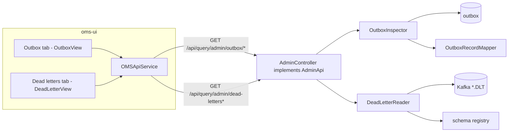

# Design — SPEC-0075: Add outbox and dead-letter screens to oms-ui

> **Stage 2 of 3 — how.** Concrete enough that the plan can be written without re-reading the
> code, and checked line by line against the architecture policies. Write "None — <reason>" for a
> section that genuinely does not apply.

## Context

- **The outbox** (`oms-core/.../model/OutboxMessage.java`, table `outbox`) is drained by
  `service/OutboxRelay.java`. A published row is deleted, so the table holds only what is still to
  be published. Its columns:
  - `id`, `aggregate_type` (ORDER, EXECUTION, ORDER_EXECUTION or PROJECTION), `aggregate_id` (the
    Kafka key), `topic`, `order_id`, `exec_id` and `aggregate_version`;
  - `payload_type`, `payload` (Avro bytes) and `payload_schema_id`, for PROJECTION rows;
  - `order_payload` and `execution_payload` (jsonb), on legacy rows;
  - `created_at`, `attempts` and `last_error`.
- **Its states,** as the relay applies them (`OutboxRepository.claimPending`, with
  `kafka.outbox.max-attempts`, default 10):
  - **stuck:** `attempts >= max`;
  - **held:** not stuck, but another row with the same `topic` and `aggregate_id` is stuck;
  - **pending:** neither.
  - The gauges are `oms.outbox.stuck` (`countByAttemptsGreaterThanEqual`) and `oms.outbox.oldest.age`
    (`findOldestPendingCreatedAt`: the oldest row with `attempts < max`, so pending or held).
- **Payload decoding:** `OutboxRecordMapper.toRecord(row)` decodes a payload-carrying row into its
  Avro record. Pointer rows (ORDER and EXECUTION since SPEC-0047) carry none.
- **Dead letters:** `config/KafkaConsumerConfig.commandErrorHandler` uses a
  `DeadLetterPublishingRecoverer`.
  - It writes the original value bytes to `<record.topic()>.DLT`, on the same partition, with
    Spring's headers (`KafkaHeaders.DLT_EXCEPTION_FQCN`, `DLT_EXCEPTION_MESSAGE`,
    `DLT_EXCEPTION_CAUSE_FQCN`, `DLT_ORIGINAL_TOPIC`, `DLT_ORIGINAL_PARTITION`,
    `DLT_ORIGINAL_OFFSET` and `DLT_ORIGINAL_TIMESTAMP`).
  - Values are Confluent-framed Avro (magic byte 0 and a schema id), or whatever bytes arrived.
  - `CommandDeadLetterIntegrationTest` produces such records: an unhandled type, an unknown type and
    garbage bytes.
- **Kafka access:**
  - Spring Boot's `KafkaAdmin` bean (used by `KafkaTopicsConfig`) and `KafkaProperties`, with
    `spring.kafka.bootstrap-servers`;
  - the schema registry URL in `spring.kafka.consumer.properties.schema.registry.url` (`mock://oms-it`
    in tests);
  - `kafka.enabled` switches messaging on and off.
- **The query API** (`oms-contracts/.../oms-query-api.yml`, v2.6.0):
  - oms-core generates one interface per tag (`SearchApi`, `OrdersApi` and `ExecutionsApi` under
    `org.example.common.api`). Controllers such as `OrderEventController implements OrdersApi` are
    mapped under `/api/query`.
  - Models go to `org.example.common.model.query`, and paging uses `PageMetadata`.
  - `GlobalExceptionHandler` answers `ProblemDetail`.
- **oms-ui:**
  - tabs in `App.tsx` (`TabType`);
  - REST access through `OMSApiService`;
  - `JsonTree.tsx` (SPEC-0074) for JSON;
  - `FieldValue.tsx` formatting, and the design-system style rules (SPEC-0058).
- **KB read:**
  - `domain/model/outbox-message.md`, `FR-024-retry-failed-publication.md`,
    `capabilities/event-publication.md`;
  - `architecture/concepts/event-streaming.md`, `ui/admin-ui.md`, `domain/interfaces/query-api.md`.
- **The closest examples:**
  - `OrderEventController`, `OrderEventReadService` and their mappers, for a read endpoint;
  - `CommandDeadLetterIntegrationTest`, for dead letters;
  - `OrderHistory.tsx`, for a UI view with loading, error, empty and refresh states.

## Approach



1. **Contract** (oms-query-api.yml, v2.7.0, tag `Admin`): five GET paths and their schemas (see
   Contract Changes). `openApiGenerateQuery` generates `AdminApi`.
2. **`org.example.oms.admin.OutboxInspector`** (`@Service`, read-only transactions):
   - **Reads.** `summary()`, `page(state, page, size)` and `get(id)`, through native SQL with
     `JdbcTemplate`. The state is computed by one SQL `CASE`, the same predicates as the relay's
     (below), so the screen and the relay never disagree.
   - **Max attempts.** `maxAttempts` comes from `kafka.outbox.max-attempts`, the property the relay
     reads.
   - **`get(id)`:**
     - a PROJECTION or legacy row: decoded with `OutboxRecordMapper.toRecord`, and the Avro
       record's JSON text (`SpecificRecord.toString()`) parsed into a Jackson 3 `JsonNode`;
     - a pointer row: no payload, so the response carries `orderId`, `execId` and
       `aggregateVersion`;
     - decoding fails: `payload` is null and `payloadError` holds the message.
3. **`org.example.oms.admin.DeadLetterReader`** (`@Service`):
   - **`topics()`.** An `AdminClient` created per call from `KafkaAdmin.getConfigurationProperties()`,
     with `request.timeout.ms` 5000 and `default.api.timeout.ms` 8000. It lists the topic names
     ending in `.DLT` (internal topics excluded), describes them, and sums
     `latest - earliest` over the partitions, using `listOffsets` with `OffsetSpec.earliest()` and
     `latest()`.
   - **`records(topic, limit)`:**
     - **Guards.** It rejects a topic not ending in `.DLT` (400), and one that doesn't exist (404).
     - **The consumer.** A `KafkaConsumer<byte[], byte[]>` with bootstrap servers from
       `KafkaProperties`, **no `group.id`** and `enable.auto.commit=false`. It is assigned every
       partition, and each partition is seeked to `max(earliest, latest - limit)`.
     - **Reading.** It polls until each partition reaches its end offset or 8 s pass, then sorts by
       timestamp descending and takes `limit`.
     - **Side effects.** Without a group, nothing is committed or registered (AC-8).
   - **Decoding a value:**
     - Confluent-framed (byte 0 = 0, length > 5): `KafkaAvroDeserializer`, configured with the
       registry URL and `specific.avro.reader=false`, gives a `GenericRecord`. Its `toString()` JSON
       becomes `payload` (`payloadFormat: AVRO`).
     - Otherwise, valid UTF-8 without control characters becomes `payloadText` (`TEXT`).
     - Otherwise hex becomes `payloadText` (`BINARY`). An empty value is `EMPTY`.
     - A failed Avro decode falls back to BINARY, with `payloadError`.
   - **Headers.** The Spring DLT headers are decoded: strings as UTF-8, the original partition as a
     4-byte int, the offset and timestamp as 8-byte longs. All headers also appear as a
     string map, with binary ones in hex.
   - **Kafka errors.** A Kafka timeout, an unreachable broker, or `kafka.enabled=false` raises
     `DeadLetterUnavailableException`.
4. **`AdminController implements AdminApi`** (`@RequestMapping("/api/query")`): delegates and maps to
   the generated DTOs, through a MapStruct mapper `AdminDtoMapper`, as the other read endpoints do.
5. **`GlobalExceptionHandler`:**
   - `DeadLetterUnavailableException` → 503 `ProblemDetail`, with the cause in `detail`;
   - `NoSuchElementException` (unknown outbox id or DLT topic) → 404;
   - a bad topic or state → 400 through the existing `IllegalArgumentException` handler.
6. **oms-ui:**
   - **Types** in `types.ts`: `OutboxSummary`, `OutboxMessageEntry`, `OutboxMessageDetail`,
     `DeadLetterTopic` and `DeadLetterRecord`. Five `OMSApiService` methods.
   - **`OutboxView.tsx`:**
     - summary tiles: pending, stuck, held, and oldest waiting age, with a short explanation of
       stuck and held;
     - a state filter (All, Pending, Stuck, Held) and a paged table (state badge, id, topic, key,
       order, exec, type, attempts/max, created, last error);
     - a row opens a detail panel with every field and the payload as a `JsonTree`, or the pointer
       fields;
     - loading, error with Retry, empty ("Outbox is empty: every message has been published") and
       Refresh states.
   - **`DeadLetterView.tsx`:**
     - the topic list with counts; the selected topic's latest records (time, key, original
       topic/partition/offset, exception class and message);
     - a record opens a detail panel with the decoded payload (`JsonTree`, or the text) and every
       header;
     - loading, error with Retry, empty and Refresh states.
   - **`App.tsx`:** two tabs, "Outbox" and "Dead letters", each mounted when first shown.

**Mapping the proposal's What Changes:**

| What Changes | Where |
|---|---|
| Operator API | contract, `AdminController`, `OutboxInspector`, `DeadLetterReader` |
| Outbox tab | `OutboxView` |
| Dead letters tab | `DeadLetterView` |
| Reading changes nothing | read-only SQL; a consumer with no group and no commit |

## Contract Changes

Additive, in `oms-contracts/src/main/openapi/oms-query-api.yml`: `info.version` goes from 2.6.0 to
2.7.0, and the description gets an "Operations" paragraph. Paths, all tag `Admin`, are relative,
like the others, and served under `/api/query`:

```yaml
  /admin/outbox/summary:
    get:
      operationId: getOutboxSummary
      summary: Counts of outbox messages by state
      tags: [Admin]
      responses:
        '200': { content: { application/json: { schema: { $ref: '#/components/schemas/OutboxSummaryDto' } } } }
  /admin/outbox/messages:
    get:
      operationId: getOutboxMessages
      summary: Outbox messages, oldest first
      tags: [Admin]
      parameters:
        - { name: state, in: query, required: false, schema: { $ref: '#/components/schemas/OutboxState' } }
        - { name: page, in: query, required: false, schema: { type: integer, minimum: 0, default: 0 } }
        - { name: size, in: query, required: false, schema: { type: integer, minimum: 1, maximum: 200, default: 50 } }
      responses:
        '200': { content: { application/json: { schema: { $ref: '#/components/schemas/PagedOutboxMessageDto' } } } }
        '400': { description: Invalid state, page or size }
  /admin/outbox/messages/{id}:
    get:
      operationId: getOutboxMessage
      tags: [Admin]
      parameters:
        - { name: id, in: path, required: true, schema: { type: integer, format: int64 } }
      responses:
        '200': { content: { application/json: { schema: { $ref: '#/components/schemas/OutboxMessageDetailDto' } } } }
        '404': { description: No such message (published meanwhile) }
  /admin/dead-letters:
    get:
      operationId: getDeadLetterTopics
      summary: Dead-letter topics (ending in .DLT) and their record counts
      tags: [Admin]
      responses:
        '200': { content: { application/json: { schema: { type: array, items: { $ref: '#/components/schemas/DeadLetterTopicDto' } } } } }
        '503': { description: Kafka unreachable or disabled (problem detail) }
  /admin/dead-letters/{topic}/records:
    get:
      operationId: getDeadLetterRecords
      summary: Latest records of one dead-letter topic, newest first; reads without consuming
      tags: [Admin]
      parameters:
        - { name: topic, in: path, required: true, schema: { type: string, pattern: '.+\.DLT$' } }
        - { name: limit, in: query, required: false, schema: { type: integer, minimum: 1, maximum: 500, default: 50 } }
      responses:
        '200': { content: { application/json: { schema: { type: array, items: { $ref: '#/components/schemas/DeadLetterRecordDto' } } } } }
        '400': { description: Not a dead-letter topic, or invalid limit }
        '404': { description: No such topic }
        '503': { description: Kafka unreachable or disabled (problem detail) }
```

**Schemas:**
- `OutboxState`: enum `PENDING | STUCK | HELD`.
- `OutboxSummaryDto`: `pending`, `stuck`, `held` and `maxAttempts` (integer); `oldestWaitingCreatedAt`
  (date-time, nullable); `oldestWaitingAgeSeconds` (integer, nullable; pending or held, as
  `oms.outbox.oldest.age`).
- `OutboxMessageDto`:
  - `id` (int64), `state`, `aggregateType`, `topic`, `key` (the `aggregate_id`);
  - `orderId`, `execId`, `aggregateVersion`, `payloadType`;
  - `createdAt`, `attempts`, `maxAttempts`, `lastError`.
- `OutboxMessageDetailDto`: `allOf` `OutboxMessageDto`, plus `payload` (object, nullable),
  `payloadSchemaId` (nullable) and `payloadError` (nullable).
- `PagedOutboxMessageDto`: `content` (an array of `OutboxMessageDto`) and `page` (`PageMetadata`).
- `DeadLetterTopicDto`: `topic`, `partitions` and `records` (int64).
- `DeadLetterRecordDto`:
  - where the record is: `topic`, `partition`, `offset` (int64), `timestamp` (date-time), `key`
    (nullable);
  - where it came from: `originalTopic`, `originalPartition`, `originalOffset`,
    `originalTimestamp`, all nullable;
  - why it failed: `exceptionClass`, `exceptionMessage` and `causeClass`, all nullable;
  - its value: `payloadFormat` (enum `AVRO | TEXT | BINARY | EMPTY`), `payload` (object,
    nullable), `payloadText` (nullable), `payloadError` (nullable);
  - `headers` (a map of string to string).

**Compatibility:** additive only. There are new paths and schemas, and no change to existing ones.
The generated models are new classes in `org.example.common.model.query`, plus a new `AdminApi`
interface in oms-core. Consumers that only use models (oms-streaming-service, oms-mcp-server)
recompile unchanged.

## Data & Persistence

- **No schema change.** Read-only queries on `outbox` (P-07 n/a).
- **The state SQL,** with `:max` as `kafka.outbox.max-attempts`:

  ```sql
  CASE WHEN o.attempts >= :max THEN 'STUCK'
       WHEN EXISTS (SELECT 1 FROM outbox s WHERE s.topic = o.topic AND s.aggregate_id = o.aggregate_id
                    AND s.attempts >= :max) THEN 'HELD'
       ELSE 'PENDING' END
  ```

  - **Filtering by state** wraps it in a subquery. Paging is `ORDER BY o.id LIMIT/OFFSET`, with a
    `count(*)` of the same filter.
  - **The summary** is one query: `count(*) FILTER (WHERE state = …)` and `min(created_at)` over the
    non-stuck rows.
  - **Indexes:** `idx_outbox_topic_aggregate_id` (changelog 009) serves the `EXISTS`, the relay's
    own check. The outbox is small (only unpublished rows), so no new index is needed.
- **No locks.** The reads run in `@Transactional(readOnly = true)`, never `FOR UPDATE`, so the relay's
  claims never wait on them.

## Events & Messaging

- **Nothing written.** No event, outbox row or Kafka record is produced (P-05 and P-06 n/a).
- **Reading `.DLT` topics:**
  - assigned partitions and no group, so no offset commit and no consumer-group membership, and a
    rebalance of the command listener can't be triggered;
  - the consumer and admin client are short-lived, closed after each request;
  - the DLT is read as raw bytes, never handed to a listener.

## Domain, State & Orchestration

- **No state machine or command change.** "State" here is the outbox message's delivery state,
  derived on read and never stored.
- **Validation:**
  - `state` must be one of the enum values;
  - `page >= 0`, and `1 <= size <= 200`;
  - `1 <= limit <= 500`;
  - `topic` must end in `.DLT` and exist.

  Otherwise 400 or 404 `ProblemDetail`, through `GlobalExceptionHandler` (P-13).

## Alternatives & Decisions

- **D1 — Paths under the query API** (`/api/query/admin/…`, tag `Admin`), not a separate
  `oms-admin-api.yml` served at `/api/admin`.
  - The proposal named `/api/admin/…` as an assumption. A separate spec needs new generator tasks
    in oms-contracts and oms-core and a second base path.
  - These are read-only queries, so the query API (P-09) is their natural home. The tag keeps them
    separate in the generated code (`AdminApi`).
  - Reversible: a later write-capable admin API (resend, replay) can move them with its own spec.
- **D2 — Not actuator endpoints.** The UI needs typed, specified responses (P-02), and
  `ProjectionsEndpoint` sets no precedent for UI-facing reads.
- **D3 — The state is derived in SQL** with the relay's predicates, not stored. A stored state would
  be a second source of truth that the relay must keep updating.
  - Rejected: reusing `claimPending`. It locks rows (`PESSIMISTIC_WRITE`) and applies version-order
    rules that aren't states.
- **D4 — A short-lived consumer without a group** for DLT reads.
  - Rejected: a `@KafkaListener` on the DLT, which would consume the records and track offsets.
  - Rejected: a long-lived shared consumer, which isn't thread-safe and holds connections.
  - Per-request cost: tens of milliseconds to connect, acceptable for an operator screen.
- **D5 — Avro decoding through the registry, generically** (`GenericRecord`). The DLT may hold
  commands whose type this service doesn't know; that is one reason they were dead-lettered.
  Specific classes would fail for exactly those.
- **D6 — Read-only** (the approved proposal). Resend and replay go to a follow-up ticket.
- **Dependencies (P-17):** none new. kafka-clients, Confluent's Avro serde, Spring Kafka and
  MapStruct are already in oms-core. oms-ui reuses `JsonTree` (SPEC-0074).
- **Depends on SPEC-0074's files** (`JsonTree.tsx`, `FieldValue.tsx`), which are uncommitted in the
  same tree. Commit SPEC-0074 before or together with this ticket.

- **Changed during implementation:**
  - **`AvroJson`** (`org.example.oms.admin.AvroJson`, with `AvroJsonTest`) turns Avro records into JSON. Avro's `toString()` writes timestamps and dates unquoted, which isn't JSON. `AvroJson` walks the record by its schema: decimals become numbers, timestamps and dates ISO text, enums names, bytes hex. Logical values that a registry-decoded generic record still holds raw (bytes, longs, ints) are decoded from the schema. Both the outbox detail and the dead-letter reader use it.
  - **`AdminDtoMapper`** has its own `Instant` → `OffsetDateTime` method instead of `uses = QueryOrderDtoMapper.class`, so it has no dependencies and the web-MVC test can instantiate it.
  - **The KB page for dead letters** is `architecture/patterns/kafka-messaging.md`, which describes the listener's retry and dead-letter path. `architecture/concepts/event-streaming.md` is about the trade blotter's streaming and was not the right page.
  - **Styles:** `Operations.scss` holds the layout both tabs share, imported by each view; `OutboxView.scss` and `DeadLetterView.scss` hold the rest. State and outcome classes are literal, for the SPEC-0058 style rules.

  - **After the independent review:**
    - **Registry lookups are bounded twice.** The deserializer has 2 s HTTP connect and read timeouts, and once the request's 8 s deadline has passed, values are no longer decoded but shown as hex with the reason. A silent registry can't hold a request either.
    - **Not found has its own type.** `AdminNotFoundException` (a `NoSuchElementException`) maps to 404, and is thrown only by the operator API. A `NoSuchElementException` from a bug elsewhere stays a 500.
    - **A message published between the inspector's two reads** answers 404, not a pointer message.
    - **The Outbox table** has an Exec column, and Type shows the projection's message type (falling back to the aggregate type).
    - **The detail ignores stale answers:** only the message opened last is shown.
    - **`OutboxMessageDetailDto` repeats `OutboxMessageDto`'s fields** instead of `allOf`, which the generator renders awkwardly with `@SuperBuilder`. The two schemas are kept in step in the contract.
    - **Kafka client settings: follow-up.** The reader builds its admin and consumer clients from `spring.kafka.bootstrap-servers` only, not the full Spring Kafka properties. That is fine for this stack, which has no Kafka security, but must change when TLS or SASL is added.

## Risks & Mitigations

- **A DLT read on a broker in trouble could hang a request thread.** All Kafka calls are bounded
  (admin 8 s, poll loop 8 s), so the answer is 503 within 10 s (AC-9). A unit test with an
  unreachable bootstrap address checks the bound.
- **Large DLT payloads:** `limit` is at most 500, and records are not bigger than the broker allows
  (1 MB by default). This is acceptable for an operator screen.
- **Payload exposure:** command payloads include order details, already readable through the query
  API. No new class of data is exposed, and there is no auth in the stack (proposal, Out of scope).
- **Consistency of counts and pages:** rows are published (deleted) between the summary and the
  list. The screen shows a snapshot, and Refresh re-reads. A detail request for a row published
  meanwhile answers 404, shown as "published meanwhile".
- **Testing pending rows:** a committed pending row would be published or exhausted by the relay
  while a test runs. Classification tests therefore insert and query inside one rolled-back
  transaction, which the relay never sees. Stuck and held rows (which the relay leaves alone) are
  committed for the gauge comparison.

## Test Strategy

| AC | Level (unit / web-mvc / integration / e2e) | Test class#method | What it asserts |
|---|---|---|---|
| AC-1 | integration + component | `OutboxInspectorIntegrationTest#summaryCountsStatesAndMatchesTheGauges`; `OutboxView.test.tsx#shows the summary` | counts of pending, stuck and held over known rows; stuck equals `oms.outbox.stuck`; the age agrees with `oms.outbox.oldest.age` (±1 s); the tiles show the four figures |
| AC-2 | integration | `OutboxInspectorIntegrationTest#derivesStuckHeldAndPendingLikeTheRelay` | STUCK, HELD and PENDING as specified; every field populated |
| AC-3 | integration + web-mvc + component | `OutboxInspectorIntegrationTest#filtersByStateOldestFirstAndPages`; `AdminControllerWebMvcTest#rejectsInvalidStatePageOrSize`; `OutboxView.test.tsx#filters by state` | the filter, `id` order, page and size and the total; 400 for size 201 and an unknown state; the UI filter calls with `state` |
| AC-4 | component | `OutboxView.test.tsx#shows that an empty outbox has published everything` | the empty-state message, counts at 0 |
| AC-5 | integration + component | `OutboxInspectorIntegrationTest#detailDecodesAPayloadAndShowsAPointer`, `#unknownIdIs404`; `OutboxView.test.tsx#opens a message with its payload` | a PROJECTION row's payload as JSON; a pointer row's order, exec and version with no payload; 404; the UI shows a JsonTree or the pointer fields |
| AC-6 | integration + component | `DeadLetterReaderIntegrationTest#listsDeadLetterTopicsWithCounts`; `DeadLetterView.test.tsx#lists topics with counts` | `commands.DLT` listed with a count equal to the records produced (the difference before and after); non-DLT topics absent |
| AC-7 | integration + component | `DeadLetterReaderIntegrationTest#readsRecordsWithFailureDetailsAndDecodedPayload`; `DeadLetterView.test.tsx#shows a topic's records and a record's payload` | unknown-type Avro → `AVRO` with JSON payload; garbage → `BINARY` hex; original topic, partition and offset; exception class and message; newest first; `limit` respected |
| AC-8 | integration | `DeadLetterReaderIntegrationTest#readingTwiceIsIdempotentAndCommitsNothing` | identical results twice; `AdminClient.listConsumerGroups` unchanged |
| AC-9 | unit + web-mvc + component | `DeadLetterReaderTest#unreachableBrokerFailsWithinTheBound`; `AdminControllerWebMvcTest#kafkaUnavailableIs503Problem`; `DeadLetterView.test.tsx#shows an error with retry` | an exception within 10 s at `127.0.0.1:1`; 503 `application/problem+json` with the cause; the UI error and Retry; the Outbox tab unaffected (`App` test) |
| AC-10 | component | `DeadLetterView.test.tsx#shows an empty state` | no topics, or no records: the empty message, no table |
| AC-11 | review | the KB pages listed below; `okf-check` | each page describes the new view and API |

Supporting tests:
- `OMSApiService.test.ts`: the five paths and params.
- `AdminControllerWebMvcTest#rejectsANonDeadLetterTopic`: 400.
- `App.*.test.tsx`: the tabs exist and are mounted on demand.

## Policy Compliance

| Policy | Title | Status | How / Justification |
|---|---|---|---|
| P-01 | Contracts live only in oms-contracts | comply | New paths and schemas in `oms-contracts/src/main/openapi/oms-query-api.yml` only |
| P-02 | Specification before code, generated models only | comply | Contract first (T-1), then regeneration; DTOs are generated `org.example.common.model.query` classes and `AdminApi`; oms-ui types mirror them by hand, per convention |
| P-03 | Never edit generated code | comply | Only regenerated |
| P-04 | Contracts evolve compatibly | comply | Additive: new paths and schemas; minor version 2.7.0 |
| P-05 | Every state change is recorded in the event log | n/a | No state change; read-only |
| P-06 | Kafka only through the transactional outbox | n/a | Nothing published; DLT reads only |
| P-07 | Schema changes through new Liquibase changesets | n/a | No schema change |
| P-08 | Concurrency and idempotency are explicit | comply | Read-only, lock-free reads (no `FOR UPDATE`) that never block the relay; idempotent GETs; a DLT read with no consumer group commits nothing (AC-8) |
| P-09 | Commands and queries stay separate | comply | Query API only; no writes (D1, D6) |
| P-10 | State transitions go through the state machine and task pipeline | n/a | No transition |
| P-11 | Layering and conventions | comply | Controller → service (`OutboxInspector`, `DeadLetterReader`) → repository/JDBC and Kafka clients; MapStruct mapper; package `org.example.oms.admin` |
| P-12 | Jackson 3 only | comply | Payload JSON parsed with `tools.jackson.databind` |
| P-13 | Errors and validation follow the framework specs | comply | `ProblemDetail` through `GlobalExceptionHandler`: 400 (validation), 404 (unknown id or topic), 503 (Kafka unavailable) |
| P-14 | Test first, every acceptance criterion is proven by an automated test | comply | See Test Strategy; each slice red first |
| P-15 | Observability | comply | Spring MVC request metrics and traces cover the endpoints. `DeadLetterReader` logs Kafka failures at WARN, with the topic. The screens complement `oms.outbox.stuck` and `oms.outbox.oldest.age`, not replace them |
| P-16 | Security | comply | No secrets; Kafka and registry settings from existing config. The topic is validated (only `*.DLT`, must exist), so arbitrary topics can't be read. Payloads render as text (JsonTree). No entitlements exist to respect (proposal) |
| P-17 | Simplicity and dependencies | comply | No new dependency; D1 avoids new generator tasks |
| P-18 | Modules build standalone | comply | oms-contracts, oms-core, oms-ui and the contract consumers verified by `spec verify` |
| P-19 | Documentation follows behaviour | comply | KB pages below |

## Knowledge Base Updates

- `domain/model/outbox-message.md`: stuck and held messages are visible in oms-ui's Outbox tab, and
  through `GET /api/query/admin/outbox/*`.
- `capabilities/functional-requirements/FR-024-retry-failed-publication.md`: operators find stuck
  messages there. Replay and removal are still manual (follow-up ticket).
- `capabilities/event-publication.md`: the operator view.
- `architecture/concepts/event-streaming.md`: dead-letter topics, their headers, and the Dead
  letters tab and API (read without consuming).
- `ui/admin-ui.md`: the Outbox and Dead letters tabs, and the OMS API Service endpoints.
- `domain/interfaces/query-api.md`: the Admin endpoints.
