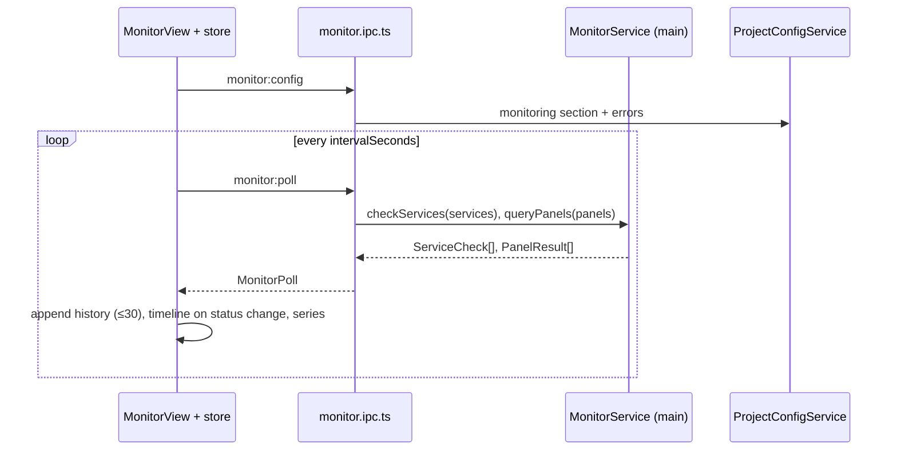

# Design — SPEC-0076: Make developer cockpit a standalone generic tool

> **Stage 2 of 3 — how.** Concrete enough that the plan can be written without re-reading the
> code, and checked line by line against the architecture policies. Write "None — <reason>" for a
> section that genuinely does not apply.

## Context

The cockpit is an Electron app (`developer-cockpit/`): main process services under
`src/main/services`, IPC handlers in `src/main/ipc/*.ipc.ts`, shared types in `src/shared`, React
views and zustand stores under `src/renderer`. Tests are Vitest (`test/main`, `test/renderer`,
`test/shared`); `npm run typecheck` and `npm test` are the module's verify commands.

Configuration today is one per-user file, `~/.developer-cockpit/config.json`, read by
`src/main/services/ConfigService.ts` and typed by `src/shared/types/config.ts` (`DEFAULT_CONFIG`).
`ConfigService.load()` writes the full defaults to disk on first start, so every user file already
holds the OMS defaults.

OMS knowledge in `src/` (found with `grep -rniE "\boms\b|oms[-_]|omsCore|OmsHttp|OmsHealth" src`):

| Where | What is OMS-specific |
|---|---|
| `shared/types/config.ts` | `infrastructure.omsCoreUrl`, KB root `oms-knowledge-base`, contract paths in `oms-contracts`, `LEGACY_SPECS_PATHS` |
| `main/services/MonitorService.ts`, `ipc/monitor.ipc.ts`, `shared/types/monitor.ts`, `shared/prometheusParser.ts`, `renderer/stores/monitor.ts`, `renderer/views/monitor/*` | One service (oms-core actuator), six tiles that parse `oms-*` metric names (SPEC-0053) |
| `main/services/CodeGenService.ts`, `shared/types/specs.ts` | Two hard-coded Gradle tasks for oms-contracts and oms-core |
| `main/services/WatcherService.ts` | Watched paths `oms-contracts/src/main`, `oms-core/src`, … |
| `main/services/ApiCatalogService.ts`, `OmsHttpService.ts`, `ipc/apiExplorer.ipc.ts`, `shared/apiExplorer.ts`, `renderer/stores/apiExplorer.ts`, `renderer/lib/api-schema.ts`, `api-templates.ts`, `views/api-explorer/*` | The command API convention (`oms-cmd-api.yml`, `Command` discriminator, `/api/command/execute`), the query API filter vocabulary, the Orders tab and order follow-up (SPEC-0007, SPEC-0008, SPEC-0035) |
| `main/ai/AiService.ts`, `McpToolRegistry.ts`, `storyboards/StoryboardAiService.ts` | Prompts naming "an order management system (OMS)" and `oms-knowledge-base/` citations |
| `shared/kbPath.ts`, `renderer/lib/kbChatSources.ts`, `stores/kbChat.ts` | `oms-knowledge-base/` bundle prefix for citations |
| `main/services/kbLayout.ts`, `storyboards/LinkIndexService.ts` | `ORDER_STATE_DOC = domain/model/order-state.md` |
| `main/storyboards/StoryboardService.ts`, `shared/types/storyboards.ts` | Library `oms-storyboard.excalidrawlib`, default root `oms-knowledge-base/storyboards` |
| `main/menu.ts` | "OMS Documentation" → `http://localhost:8080/swagger-ui.html` |
| `main/services/SpecCli.ts`, `OkfCli.ts` | Fixed paths `specs/tools/spec.mjs`, `tools/okf-check/okf-check.mjs` (a convention, not OMS logic, but must be configurable) |
| Comments and placeholders | `NewTicketDialog`, `NewStoryWizard` (lane "OMS"), `SettingsView`, `ContractsView`, `RequirementsView`, `CapabilitiesTab`, `types/docker.ts`, `types/kb.ts`, `types/requirements.ts`, `kbChatTrace.ts`, `KbChatTools.ts` |

Closest existing examples followed:
- **Main-process HTTP that never throws**: `MonitorService` / `OmsHttpService` (timeout, 5 MB cap,
  typed `{ ok, error }` results, `[monitor] GET … ms` log line). The new monitoring and HTTP
  services keep this seam (`fetch` and `timeoutMs` injectable).
- **Polling store**: `renderer/stores/monitor.ts` (interval, in-flight guard, last good sample kept
  when a poll fails).
- **Env/config overlay**: `resolveStoryboardsConfig` in `ConfigService.ts`.
- **Validation with zod** (already a dependency): `src/shared/storyboards/validate.ts`.

Knowledge base read: `tools/developer-cockpit.md`, `delivery/spec-driven-development.md`,
`infrastructure/local-docker-stack.md`, `capabilities/non-functional-requirements/NFR-007-observability.md`.
Ports and services: root `docker-compose.yml` (17 services).

## Approach

### 1. Project configuration: `cockpit.yaml`

A project commits `cockpit.yaml` at its workspace root. New module `src/shared/projectConfig.ts`
holds the zod schema, the inferred `ProjectConfig` type and `parseProjectConfig(text, file)`.
New service `src/main/services/ProjectConfigService.ts` reads the file (and re-reads it when the
watcher reports a change), returning:

```ts
interface ProjectConfigResult {
  file: string;              // absolute path of cockpit.yaml
  present: boolean;          // false → empty project defaults, no error
  config: ProjectConfig;     // validated config, or the defaults when invalid/absent
  errors: { path: string; message: string }[];  // e.g. { path: 'monitoring.services[2].check.url', message: 'Required' }
}
```

A file that fails YAML parsing or the schema yields `errors` (the YAML error with its line, or each
zod issue with its dotted path) and the empty defaults; it never throws (AC-5).

Schema (all sections optional; defaults in brackets):

```yaml
project:
  name: <string>                       # ["this project"] used in prompts, titles, the story wizard
  description: <string>                # [""] one sentence, appended to AI system prompts
knowledgeBase:
  root: <path>                         # ["docs"]
  checkScript: <path>                  # ["tools/okf-check/okf-check.mjs"]
  stateDiagramDoc: <path>              # [none] KB-relative doc whose stateDiagram feeds storyboard links
specs:
  cli: <path>                          # ["specs/tools/spec.mjs"]
  openApiPaths: [<path>]               # [[]]
  avroPaths: [<path>]                  # [[]]
codegen:                               # [[]] tasks shown in the Contracts view
  - id: <string>
    name: <string>
    description: <string>
    cwd: <path>                        # workspace-relative
    command: [<argv>]                  # e.g. ["./gradlew", "build"]
    windowsCommand: [<argv>]           # optional; used on win32
    inputs: <string>                   # optional, shown on the card
watch: [<path>]                        # [[]] extra watched paths (specs/changes, specs/archive, KB root are always watched)
links:                                 # [[]] Help menu and Monitoring header links
  - { label: <string>, url: <http(s) url> }
storyboards:
  roots: [<path>]                      # [["<knowledgeBase.root>/storyboards"]]
  library: <file name>                 # ["storyboard.excalidrawlib"] under <root>/_library
apiExplorer:
  templateSources: [<path>]            # [[]] .http files
  apis:                                # [[]]
    - name: <string>
      spec: <path to OpenAPI yml>
      baseUrl: <http(s) url>           # prefix for the spec's paths
monitoring:
  intervalSeconds: <5..300>            # [10]
  prometheusUrl: <http(s) url>         # optional; Prometheus-compatible HTTP API base (…/api/v1 is appended)
  services:
    - name: <string, unique>
      group: <string>                  # ["Services"]
      check:
        kind: http | spring-actuator | tcp
        url: <http(s) url>             # http, spring-actuator
        host: <string>                 # tcp
        port: <1..65535>               # tcp
        timeoutMs: <100..30000>        # [3000]
      metricsUrl: <http(s) url>        # optional; Prometheus text endpoint for scrape panels
      links: [{ label, url }]          # optional
  panels:
    - title: <string>
      type: stat | timeseries | bars
      unit: count | ms | s | percent | bytes | perMinute   # [count]
      source:
        kind: promql
        query: <PromQL>                # stat/bars: instant query; timeseries: range over the last 15 min, step 30 s
      # or
      source:
        kind: scrape
        service: <name of a service with metricsUrl>
        metric: <metric name>          # e.g. oms_orders_by_state
        labels: { <label>: <value> }   # optional exact-match filter
        by: <label>                    # bars: one bar per value of this label
        quantile: <0..1>               # histogram: read <metric>_bucket and interpolate
        rate: true                     # stat/timeseries: per-minute rate between polls (counters)
      by: <label>                      # bars from promql: the label naming each bar
```

Precedence (`ConfigService.getConfig()` keeps its signature): `DEFAULT_CONFIG` < user
`config.json` < `cockpit.yaml` for the project-owned settings (KB root, contract paths, storyboard
roots, API template sources). Personal settings (theme, font, AI provider and keys, SCM, Docker)
stay user-only. `ConfigService` gains `getProject(): ProjectConfigResult`. Settings shows a
**Project** card: the file path, "valid / N errors / not found" with the error list (AC-5), and the
project-owned fields from `cockpit.yaml` as read-only.

Removed from the user config type: `infrastructure.omsCoreUrl`, `LEGACY_SPECS_PATHS` and
`migrateConfig` (the oms-core → oms-contracts path migration). Stale keys in an existing
`config.json` are ignored on load (the merge only copies known keys from now on).

Defaults lose their OMS values: `knowledgeBase.rootPath: 'docs'`, `specs.openApiPaths: []`,
`specs.avroPaths: []`, storyboard roots derived from the KB root.

### 2. Generic Monitoring



**Main process.** `MonitorService` is rewritten around the config (same never-throw seam):
- `checkService(service): Promise<ServiceCheck>` with
  `{ name, status: 'UP'|'DOWN'|'UNKNOWN', latencyMs, checkedAt, reason?, target, components? }`:
  - `http`: GET; status < 400 → UP, otherwise DOWN with `HTTP <code>`.
  - `spring-actuator`: GET JSON; body `status` UP → UP; DOWN / OUT_OF_SERVICE → DOWN; anything
    else or an unparseable body → UNKNOWN. Components (`db`, `diskSpace`, …) are returned.
  - `tcp`: `net.connect(port, host)`; connected → UP; error or timeout → DOWN with the reason.
  - Unreachable or timed out → DOWN, reason `not reachable: <cause>` / `timeout after N ms` (AC-2).
- `queryPanel(panel, scrapes)`: `PanelResult = { title, ok, error?, value?, bars?, series? }`:
  - `promql`: `GET <prometheusUrl>/api/v1/query?query=…` (stat, bars) or
    `/api/v1/query_range?query=…&start&end&step=30` (timeseries). Reads the standard
    `{ status: 'success', data: { resultType, result } }` shape; `status: 'error'` → `error`.
    Stat = the first sample's value (sum if several); bars = one bar per `metric[by]`;
    timeseries = the first series' points.
  - `scrape`: the service's `metricsUrl` is fetched once per poll (shared by all its panels) and
    parsed by the generic parser below. Stat = sum of matching samples, or the interpolated
    quantile of `<metric>_bucket` when `quantile` is set; bars = sum per `by` label value.
    `rate` and scrape timeseries are derived in the renderer from successive values.
  - A failing source (no `prometheusUrl`, unknown service, HTTP error, unreachable) → `ok: false`
    with an error naming it; other panels are unaffected (AC-4).
- `poll(monitoring)`: runs all checks and panels in parallel (`Promise.all`), logs one line
  `[monitor] poll services=N up=M panels=K failed=F <ms>ms`.

`src/shared/prometheusParser.ts` becomes generic: `parsePrometheusText(raw): Sample[]`
(`{ name, labels, value }`, comments, `NaN`, `+Inf`, escaped label values) plus helpers
`sumMatching(samples, metric, labels)`, `groupBy(samples, metric, label, labels)` and
`histogramQuantile(samples, metric, q, labels)` (the existing bucket interpolation, moved).

IPC (`src/main/ipc/monitor.ipc.ts`, types in `src/shared/types/monitor.ts`):
- `monitor:config` → `{ file, present, monitoring, errors }`.
- `monitor:poll` → `{ checks: ServiceCheck[], panels: PanelResult[], at }`. Always resolves.

**Renderer.** `stores/monitor.ts` keeps, per service, a ring of the last 30 checks
(`{ status, latencyMs, at }`), a timeline of status changes (newest first, max 50 entries: the
first poll records no change; later UP↔DOWN/UNKNOWN changes record `{ service, from, to, at, reason }`),
and per scrape-timeseries/rate panel a ring of 30 values. Polls are guarded against overlap and
restart when the interval changes; a failed IPC call keeps the last poll and shows "connection lost".

Views under `src/renderer/views/monitor/`:
- `MonitorView.tsx`: header (title, project name, "N of M up", last updated, Refresh, project
  links), config error banner, empty state when `services` and `panels` are both empty
  ("No services configured — add a `monitoring` section to <file>").
- `ServiceBoard.tsx` → one `ServiceTile.tsx` per service, grouped by `group` in config order:
  status badge, target, latency, reason when DOWN, actuator components, links,
  `Sparkline.tsx` (latency of the ring, inline SVG polyline) and `HistoryStrip.tsx` (one cell per
  check, coloured by status).
- `StatusTimeline.tsx`: the status changes, with time and reason.
- `PanelGrid.tsx` → `StatPanel`, `BarsPanel`, `TimeseriesPanel` (inline SVG, `formatValue(unit)`).

Removed: `HealthTile`, `OrdersByStateTile`, `OrderEventsTile`, `TimeToAckTile`,
`TimeToMarketTile`, `OutboxTile`, `RawPrometheusPane` and their tests.

### 3. Removing the rest of the OMS logic

- **Code generation**: `CodeGenService` takes `ProjectConfig.codegen`; `CodeGenTask` gets `cwd`,
  `command`, `windowsCommand?`, `inputs?` instead of `module`/`gradleTasks`/`inputSpec`. It spawns
  `command[0]` with the rest as arguments in `cwd` (`windowsCommand` on win32), as today with
  `shell: false`; on win32 a `.bat`/`.cmd` first argument still runs through `ComSpec /d /s /c` as
  today. No tasks → the Contracts view says none are configured.
- **Watcher**: watched paths = `specs/changes`, `specs/archive`, the KB root,
  `ProjectConfig.watch`, the API template sources' folders and `cockpit.yaml` itself.
- **AI prompts**: `AiService`, `McpToolRegistry` and `StoryboardAiService` build their system
  prompts from `project.name`, `project.description` and the KB root folder name (citations as
  `<kbRoot>/<path>`).
- **KB citations**: `kbPath.ts` exports `kbPrefix(root)` and `toKbPath(p, prefix)`;
  `kbChatSources.ts` builds its citation regex from the prefix; `kbChat.ts` reads the prefix from
  the config store.
- **KB layout**: `ORDER_STATE_DOC` is removed from `kbLayout.ts`; `LinkIndexService` takes
  `stateDiagramDoc?` from options and skips transition links when it is absent. The capability
  folders stay as the knowledge-base layout convention (not OMS logic).
- **Storyboards**: library file from `storyboards.library`; roots from `storyboards.roots`.
- **CLIs**: `SpecCli` uses `specs.cli`; `OkfCli` uses `knowledgeBase.checkScript`.
- **Menu**: Help lists `ProjectConfig.links`; nothing when empty.
- **Wording**: comments, placeholders and labels say "the project" or use `project.name`
  (e.g. the story wizard's second lane is `{ id: 'system', label: project.name }`).

### 4. Generic API Explorer

The OMS command convention is replaced by plain OpenAPI. Tabs: **Operations**, **Templates**,
**History** (the Orders tab and order follow-up are removed, as approved in the proposal).

- `ApiCatalogService` → `load(apis)` returns, per configured API, its operations
  `{ api, operationId, method, path, summary, pathParams, queryParams, requestSchema?, variants? }`.
  It reuses the existing `$ref`/`allOf` resolver, now following refs into sibling files of the
  spec (any file name, not `schema.yml`). A request schema with an OpenAPI `discriminator.mapping`
  (or a `oneOf` of refs) yields `variants` keyed by mapping name; picking one builds its body, so
  the OMS command API still works through its spec.
- `OmsHttpService` → `HttpRequestService`: `send({ method, url, headers, body, confirmedHost })`
  against an absolute URL (api `baseUrl` + path with path params encoded, plus query params).
  Same safeguards: http(s) only, 10 s timeout, 5 MB cap, non-local hosts need `confirmedHost`.
- Renderer: `stores/apiExplorer.ts` keeps operation selection, path/query param inputs, the body
  editor (built with `buildTemplate`/`checkBody` from `api-schema.ts`, minus `orderIdOf` and
  `namesOrder`), send, templates (`.http` files, unchanged parsing; a template request runs as
  written, its URL resolved against the first api `baseUrl` when relative) and history
  (`ApiHistoryService` unchanged).
- Removed: `FILTER_FIELDS`, `toSearchParams`, `SEARCH_PATH`, `eventsPath`, `OrderFollowUp`,
  `OrdersTab.tsx`, `OrderFollowUp.tsx`, `orderToTemplate`, `useOrderAsTemplate`, and their tests.
- The OMS `.http` files move from `developer-cockpit/api-templates/` to `tools/api-templates/` in
  the OMS repository and are listed in its `cockpit.yaml`.

### 5. OMS `cockpit.yaml` (OMS repository root)

`project` OMS; KB `oms-knowledge-base` with `stateDiagramDoc: domain/model/order-state.md`;
contracts in `oms-contracts/src/main/{openapi,avro}`; the two code-generation tasks (oms-contracts
`./gradlew build`; oms-core `./gradlew openApiGenerateCmd openApiGenerateQuery`, with `gradlew.bat`
on Windows); watch `oms-contracts/src/main`, `oms-core/src`, `oms-streaming-service/src`,
`oms-ui/frontend/src`; storyboard library `oms-storyboard.excalidrawlib`; API Explorer apis for
the command (`http://localhost:8090/api/command`) and query (`http://localhost:8090/api/query`)
specs; links (Grafana, Swagger UI, Alloy UI).

Monitoring, `prometheusUrl: http://localhost:9009/prometheus` (Mimir), all 17 compose services:

| Group | Service | Check |
|---|---|---|
| Application | oms-core | spring-actuator `http://localhost:8090/actuator/health` (metricsUrl `/actuator/prometheus`) |
| Application | streaming-service | spring-actuator `http://localhost:8092/actuator/health` |
| Application | exchange-simulator | spring-actuator `http://localhost:8094/actuator/health` |
| Application | mcp-server | spring-actuator `http://localhost:8091/actuator/health` |
| Application | oms-ui | http `http://localhost:8080/` |
| Messaging | broker | tcp `localhost:9092` |
| Messaging | schema-registry | http `http://localhost:8081/subjects` |
| Messaging | control-center | http `http://localhost:9021/` |
| Data | postgres | tcp `localhost:5432` |
| Data | postgres-replica | tcp `localhost:5433` |
| Data | pgadmin | http `http://localhost:5050/misc/ping` |
| Observability | grafana | http `http://localhost:3000/api/health` |
| Observability | grafana-mcp | tcp `127.0.0.1:8096` |
| Observability | loki | http `http://localhost:3100/ready` |
| Observability | alloy | http `http://localhost:12345/-/ready` |
| Observability | mimir | http `http://localhost:9009/ready` |
| Observability | tempo | http `http://localhost:3200/ready` |

Panels (the former tiles, PromQL against Mimir, using the metric names in CLAUDE.md):
- **Orders by state**: bars, `sum by (state) (oms_orders_by_state)`, by `state`.
- **Order events / min**: timeseries, `sum(rate(oms_order_events_total[1m])) * 60`, unit perMinute.
- **Time to ack p99**: stat, `histogram_quantile(0.99, sum by (le) (rate(oms_order_time_to_ack_seconds_bucket[5m])))`, unit s.
- **Time to market p99**: stat, same over `oms_order_time_to_market_seconds_bucket`, unit s.
- **Outbox pending**: stat, `sum(oms_outbox_pending)`.
- **Outbox stuck**: stat, `sum(oms_outbox_stuck)`.

The exact metric names are confirmed against Mimir (`/prometheus/api/v1/label/__name__/values`) or
oms-core's `/actuator/prometheus` during implementation; the panel queries use what is really
exported.

### 6. New home

1. `git subtree split --prefix=developer-cockpit HEAD` → a commit holding the cockpit's committed
   history (18 commits touch it) with paths at the root. No local branch is created.
2. `git push https://github.com/tbaderts/developer-cockpit.git <split>:refs/heads/main`.
3. Clone the new repo into the scratchpad, replace its tree with this ticket's working copy of
   `developer-cockpit/` (excluding `node_modules`, `dist`, and the `api-templates/` folder that
   moved to OMS), add `README.md` (what the tool is, prerequisites, `cockpit.yaml` reference) and
   `examples/cockpit.yaml` (a generic two-service example, no OMS), commit
   `feat: project configuration and generic monitoring` with the Co-Authored-By trailer, push.
4. In the clone: `npm ci && npm run typecheck && npm test` (AC-8).

Before step 2 the split history is scanned for secrets (`git log -p <split> | grep -iE "api[_-]?key|secret|token|password"`
reviewed by hand); a hit blocks the ticket.

`developer-cockpit/` stays in the OMS repository for this ticket (proposal → out of scope); its
README gets a line pointing to the new home.

## Contract Changes

None — no OpenAPI or Avro change. The OMS command and query specs are only read by the cockpit.
The new `cockpit.yaml` format is the tool's own configuration; it is new, so there is nothing to
stay compatible with. The user `config.json` loses `infrastructure.omsCoreUrl`; old files still
load (unknown keys ignored).

## Data & Persistence

None — no database. On disk: `cockpit.yaml` (read only by the tool), the unchanged user
`config.json` and `api-explorer-history.json`. History entries written by the old explorer
(`{ type: 'command' | 'search' | … }`) are still listed; entries the new UI cannot re-open show
their request and response read-only.

## Events & Messaging

None — the cockpit does not use Kafka or the outbox. Its internal websocket event bus gains no new
event types; a `cockpit.yaml` change arrives as the existing file-change event and makes the
config reload.

## Domain, State & Orchestration

None — no OMS state machine or task pipeline. The only state is the monitor store's per-service
status and history (UP / DOWN / UNKNOWN, see Approach §2). Configuration errors are reported as
data (`errors[]`), not thrown.

## Alternatives & Decisions

- **D-1 Project config in `cockpit.yaml` at the workspace root, overriding the user file for
  project settings.** Rejected: keeping everything in `~/.developer-cockpit/config.json` (not
  shareable or versioned with the project; every OMS developer would hand-copy 17 services);
  JSON (no comments, and the OMS sample benefits from them). YAML via the existing `yaml`
  dependency, validated with the existing `zod`. No new dependency.
- **D-2 Panels are declarative (PromQL or scrape), not plugins.** Rejected: a plugin/JS-module
  mechanism (would let project logic back into the tool and needs sandboxing); PromQL-only (OMS
  host-native runs have no Mimir, and the scrape path is what the old tiles did). Rejected:
  embedding Grafana panels (iframe CSP, auth); Grafana is linked instead.
- **D-3 Charts are small inline SVG components.** Rejected: adding a chart library (recharts,
  chart.js) for a sparkline, bars and a line (P-17).
- **D-4 History lives in memory** (30 checks per service, 50 timeline entries). Rejected: persisting
  to disk or a TSDB; out of scope in the proposal, and Mimir/Grafana already keep history.
- **D-5 API Explorer becomes OpenAPI-operation based**, with discriminator variants. Rejected:
  keeping the command/query convention behind a config flag (still OMS logic in the tool); dropping
  the explorer to `.http` templates only (loses schema-driven bodies). Consequence (approved in the
  proposal): the Orders tab, order follow-up and "use order as template" go away.
- **D-6 Move with history via `git subtree split` and push**, then one commit with the uncommitted
  ticket work in a scratch clone. Rejected: a plain copy (loses history); `git filter-repo` (not
  installed, rewrites more than needed); committing in the OMS repo first (commits are the
  maintainer's call).
- **D-7 `developer-cockpit/` stays in the OMS repo until a follow-up chore**, because this ticket's
  verify runs the module there and `specs/config.json` is human-owned.
- **D-8 Remove `infrastructure.omsCoreUrl` and the legacy path migration** rather than renaming
  them: the API base URLs now come per API from `cockpit.yaml`.

## Risks & Mitigations

| Risk | Mitigation |
|---|---|
| Existing user `config.json` files hold the OMS defaults and would override the project file | `cockpit.yaml` wins for project-owned settings (Approach §1); a ConfigService test loads a user file with OMS paths plus a project file and asserts the project values. |
| A slow or dead service blocks the poll | Per-check timeout (default 3 s), all checks in parallel, polls never overlap. |
| PromQL/metric names in the OMS sample do not match what is exported | Confirmed against Mimir or `/actuator/prometheus` during implementation; a panel with no data shows "no data", not an error. |
| Pushing private material to GitHub | Secret scan of the split history and of the scratch tree before pushing; `.env` is ignored; the push only happens after the proposal approval that authorised it. |
| Losing API Explorer features OMS users rely on | Approved trade-off; OMS commands still reachable as an operation with variants, and order/lifecycle requests as `.http` templates. |
| The large removal breaks unrelated views | Typecheck plus the full Vitest suite after each slice; the AC-6 scan test guards regressions. |
| e2e (Playwright) specs reference removed views | They are not part of the module's verify; they are updated where they touch removed features, and the remainder is listed as a follow-up. |

## Test Strategy

| AC | Level (unit / web-mvc / integration / e2e) | Test class#method | What it asserts |
|---|---|---|---|
| AC-1 | unit (main) + component | `test/main/MonitorService.test.ts#httpCheck_upBelow400_downOtherwise`, `#actuatorCheck_mapsStatusAndComponents`, `#tcpCheck_upWhenPortAccepts` (local `net.Server`), `test/renderer/MonitorView.test.tsx#showsOneTilePerServiceGroupedWithUpCount` | Status per check kind; tiles grouped as configured; header "2 of 3 up". |
| AC-2 | unit (main) + store | `MonitorService.test.ts#unreachableOrTimeout_isDownWithReasonAndTarget`, `#oneFailingService_othersStillChecked`, `test/renderer/monitor-store.test.ts#statusChange_addsTimelineEntryWithTime` | DOWN with reason and URL; other results present; UP→DOWN entry with its time; no entry on the first poll. |
| AC-3 | store + component | `monitor-store.test.ts#historyKeepsLast30Checks`, `test/renderer/MonitorTiles.test.tsx#tileShowsSparklineAndHistoryStrip` | Ring capped at 30; sparkline polyline points and strip cells match the history. |
| AC-4 | unit (main) + component | `MonitorService.test.ts#promqlStatBarsAndRange_fromStubbedApi`, `#scrapePanels_sumGroupQuantile`, `#failingPanelSource_errorOnlyOnThatPanel`, `test/shared/prometheusParser.test.ts#parsesTextFormat`, `MonitorTiles.test.tsx#panelsRenderStubValues` | Values from the stubbed Prometheus API and text endpoint; a failing panel carries its error while the others have values. |
| AC-5 | unit + component | `test/shared/projectConfig.test.ts#invalidEntries_reportedWithPath`, `#yamlSyntaxError_reportedWithLine`, `test/main/ProjectConfigService.test.ts#absentFile_defaultsWithoutError`, `MonitorView.test.tsx#configErrorBanner_namesFileAndPath`, `#emptyState_namesFile`, `test/renderer/SettingsView.test.tsx#projectCard_showsValidationErrors` | Errors with file and dotted path; app views still render; empty state names the file. |
| AC-6 | unit (scan) + unit | `test/main/noProjectSpecifics.test.ts#srcHasNoOmsReferences`, `test/main/ConfigService.test.ts#projectFileOverridesUserProjectSettings`, `test/main/CodeGenService.test.ts#tasksComeFromProjectConfig`, `test/main/WatcherService.test.ts#watchesConfiguredPaths`, `test/main/AiService.test.ts#systemPromptNamesConfiguredProject`, `test/main/menu.test.ts#helpMenuListsProjectLinks` (fixture project "Acme Shop") | No `oms` word or `oms-`/`oms_` prefix in `src/`; defaults, prompts, menu, watcher paths and tasks come from a non-OMS fixture `cockpit.yaml`. |
| AC-7 | unit | `test/main/omsSampleConfig.test.ts#omsCockpitYaml_validCoversComposeAndFormerTiles` | Reads `../cockpit.yaml` and `../docker-compose.yml` (skipped with a clear reason when the cockpit is not inside the OMS checkout, i.e. in the new repo): schema-valid, one service per compose service, panels for orders by state, order events, time to ack p99, time to market p99 and outbox. |
| AC-8 | integration (manual command, evidence) | `git clone https://github.com/tbaderts/developer-cockpit.git` + `npm ci && npm run typecheck && npm test` in the clone; `git log --oneline | wc -l` ≥ 19; README contains a `cockpit.yaml` section | Fresh clone builds and passes; history carried over; README documents the config. Output recorded in verification.md. |

## Policy Compliance

| Policy | Title | Status | How / Justification |
|---|---|---|---|
| P-01 | Contracts live only in oms-contracts | n/a | No contract added or moved; the cockpit only reads the specs. |
| P-02 | Specification before code, generated models only | n/a | No API models; the cockpit's own config format is specified in this design (schema in Approach §1) before code. |
| P-03 | Never edit generated code | n/a | No generated code involved. |
| P-04 | Contracts evolve compatibly | n/a | No OpenAPI/Avro change. |
| P-05 | Every state change is recorded in the event log | n/a | No order state touched. |
| P-06 | Kafka only through the transactional outbox | n/a | No Kafka use. |
| P-07 | Schema changes through new Liquibase changesets | n/a | No database. |
| P-08 | Concurrency and idempotency are explicit | n/a | No persistence; the only concurrency (overlapping polls) is guarded by the store's in-flight flag. |
| P-09 | Commands and queries stay separate | n/a | No OMS API change. |
| P-10 | State transitions go through the state machine and task pipeline | n/a | No order transitions. |
| P-11 | Layering and conventions | comply | Main services + IPC handlers + shared types + zustand stores + views, as the existing cockpit modules; the never-throw HTTP seam of `MonitorService`/`OmsHttpService` is kept. |
| P-12 | Jackson 3 only | n/a | TypeScript module, no Java. |
| P-13 | Errors and validation follow the framework specs | n/a | No OMS API errors. Config validation reports every problem as data with its path; no swallowed exceptions (each catch returns a typed error). |
| P-14 | Test first, every acceptance criterion is proven by an automated test | comply | Vitest tests per AC (Test Strategy), written before each slice; AC-8 proven by running the suite in a fresh clone. |
| P-15 | Observability | comply | Main-process log lines `[monitor] poll …` and `[config] cockpit.yaml …` (valid / N errors), following the existing `[monitor]`/`[okf-cli]` lines; no new runtime flows in OMS services. |
| P-16 | Security | comply | No secrets in `cockpit.yaml` (URLs only); all HTTP and TCP from the main process to configured targets only, http(s) URLs validated; API requests to non-local hosts still need confirmation; YAML parsed with `yaml`'s default (no custom tags/code); split history and tree scanned for secrets before the push. |
| P-17 | Simplicity and dependencies | comply | No new dependency (`yaml`, `zod` present; charts are inline SVG, D-3); removes the OMS-only code paths instead of flagging them. |
| P-18 | Modules build standalone | comply | `npm run typecheck` and `npm test` in `developer-cockpit/`, and again in a fresh clone of the new repository (AC-8). No Gradle module touched. |
| P-19 | Documentation follows behaviour | comply | KB pages below updated in this ticket; the cockpit's own README rewritten for the new home. |

## Knowledge Base Updates

- `oms-knowledge-base/tools/developer-cockpit.md`: the cockpit is an external tool
  (github.com/tbaderts/developer-cockpit) configured by the OMS `cockpit.yaml`; new Monitoring
  description; API Explorer is OpenAPI-operation based; `repo:` sources that move are replaced by
  the OMS-side files (`cockpit.yaml`, `tools/api-templates/`).
- `oms-knowledge-base/tools/index.md`: entry text and link note for the new home.
- `oms-knowledge-base/delivery/spec-driven-development.md`: where the cockpit comes from and that
  it reads `specs/tools/spec.mjs` through `cockpit.yaml`.
- `oms-knowledge-base/infrastructure/local-docker-stack.md`: the cockpit's Monitoring covers every
  compose service via `cockpit.yaml`.
- `oms-knowledge-base/capabilities/non-functional-requirements/NFR-007-observability.md`: the
  Monitoring view reference (service board and panels instead of the six oms-core tiles).
- `oms-knowledge-base/log.md`: one entry for the change.

### Changed during implementation

- **D-9 The test suite becomes self-contained (T-26).** Found while doing T-11: about 20 test files
  read the surrounding OMS checkout through `REPO_ROOT = dirname(developer-cockpit)` (the spec
  toolkit in `specs/`, `tools/okf-check`, `oms-knowledge-base`, the contracts). In a fresh clone
  of the new repository that parent is not a repository, so AC-8 could not pass. Decision:
  - the spec toolkit the ticket tests run (`specs/tools`, `specs/templates`, `specs/policies`,
    `specs/config.json`) is copied into `test/fixtures/spec-toolkit/` and the workspace fixture
    uses that copy (a snapshot; it is refreshed by hand when the toolkit changes);
  - `REPO_ROOT` becomes the git repository that contains the cockpit (the OMS checkout today, the
    cockpit repository after the move), found the way `detectWorkspaceRoot` does;
  - tests that read a host project's content (the `okf-check` CLI, the knowledge-base corpus, the
    storyboard corpus, the contracts) run when that content exists next to the cockpit and are
    skipped with a stated reason otherwise. API Explorer tests move to fixture specs in T-15–T-17.
  Rejected: skipping every test that touches `specs/` (would leave the spec-ticket features
  untested in the new repository); moving the spec toolkit into the cockpit as product code (out of
  scope in the proposal).
- **D-10 Smaller changes made while implementing and after the review.**
  - The default knowledge-base root is `knowledge-base`, not `docs`: a dedicated name does not
    collide with a project's ordinary `docs/` folder, and the test fixtures could use it.
  - In the OMS `cockpit.yaml`, oms-mcp-server is checked by TCP (it has no actuator and its MCP
    endpoint answers only POST); Loki and Mimir by their build-info endpoints (their `/ready`
    reports 503 while the ingester settles).
  - The OMS panels read oms-core's `/actuator/prometheus` where the metric is there (orders by
    state, events, outbox including the oldest age that the old Outbox tile showed), so host-native
    runs keep their KPIs; only the two p99 panels need Mimir, where the histograms are. The raw
    Prometheus pane is not replaced (Grafana Explore covers it).
  - The knowledge server URL moved from a built-in default (oms-mcp-server's port) to
    `knowledgeBase.serverUrl` in `cockpit.yaml`; its three MCP tools are documented in the README as
    the knowledge-server protocol.
  - API Explorer: redirects are returned, not followed (they could bypass the host confirmation),
    and credential header values are not written to the history.
  - The unused Settings fields `infrastructure.prometheusUrl/grafanaUrl/lokiUrl` are removed; any
    setting the cockpit no longer has is dropped from `config.json` on load.
  - `oms-knowledge-base/storyboards/order-lifecycle/place-and-fill-order/story.card.yaml` was
    re-pinned: its corpus check (a cockpit test) was already red when the ticket started, because
    SPEC-0071 and SPEC-0073 moved the cited simulator and streaming code.
