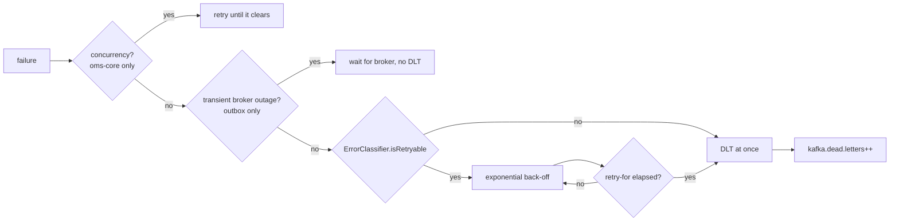

# Design — SPEC-0077: Dead-letter and retry policy for every Kafka client

> **Stage 2 of 3 — how.** Concrete enough that the plan can be written without re-reading the
> code, and checked line by line against the architecture policies. Write "None — <reason>" for a
> section that genuinely does not apply.

## Context

The six Kafka clients and what they do on a failure today:

| Service | Client | Code | Today |
|---|---|---|---|
| oms-core | command consumer | `config/CommandListener.java`, `config/KafkaConsumerConfig.java#commandErrorHandler` | `DefaultErrorHandler`, `ExponentialBackOff(500 ms ×2)` with `maxAttempts=4`; not retryable: `DeserializationException`, `IllegalArgumentException`; concurrency failures retried without limit via `CommandBackOffs` (SPEC-0048); recoverer → `<topic>.DLT` with the original bytes (values are consumed as `byte[]`, decoded by `CommandDecoder`) |
| oms-core | outbox producer | `service/OutboxRelay.java`, `service/MessagePublisher.java`, `model/OutboxMessage.java`, `repository/OutboxRepository.java#claimPending` | A *transient* failure (a Kafka `RetriableException` or an `IOException` in the cause chain: broker or registry unreachable) costs nothing and is retried on every drain. Any other failure increments `attempts`; at `kafka.outbox.max-attempts` (10) the row is *stuck* and holds its aggregate's later rows. Failed rows are retried on the next drain (every 200 ms), without backoff |
| oms-exchange-simulator | order consumer | `kafka/OrderMessageListener.java` | Boot's default `DefaultErrorHandler`: 9 retries without backoff, then logged and **skipped**; values are deserialized by `ErrorHandlingDeserializer(KafkaAvroDeserializer)` into `OrderMessage` |
| oms-exchange-simulator | command producer | `kafka/CommandGateway.java#send`, `engine/ExchangeEngine.java#send` | Synchronous `send().get(timeout)` on the engine thread; a failure is logged and the command **dropped** |
| oms-streaming-service | order and execution consumers | `config/KafkaConfig.java`, `service/KafkaEventStreamProvider.java` | Reactor Kafka `KafkaReceiver` with `KafkaAvroDeserializer`; a failing record errors the whole flux, `retryWhen` re-subscribes from the last committed offset and fails again on the same record: a poison record stops the stream forever |

Also relevant: `admin/DeadLetterReader.java` (SPEC-0075) lists every topic ending in `.DLT` and
decodes each record's value (Avro by its schema id, else text) and Spring's `kafka_dlt-*` headers;
`admin/OutboxInspector.java` and `oms-query-api.yml` (`OutboxState` PENDING/STUCK/HELD,
`maxAttempts`) describe the outbox to oms-ui. `config/KafkaTopicProvisioner.java` creates oms-core's
topics at startup. SPEC-0075 is done but its code is not yet committed; this ticket builds on the
working tree.

Closest examples followed: `KafkaConsumerConfig#commandErrorHandler` (error handler, recoverer,
byte-array template), `CommandDecoder` (decode after consuming bytes), `KafkaTopicProvisioner`
(admin-client provisioning), `OutboxRelay#isTransient` (cause-chain classification).

Tests: `integration/CommandDeadLetterIntegrationTest`, `CommandRetryBudgetIntegrationTest`,
`OutboxHoldIntegrationTest`, `OrderVersionIntegrationTest#kafkaFillRetriedAfterAConflict`
(oms-core, `AbstractKafkaPostgresIntegrationTest`/`AbstractFillFlowIntegrationTest`);
`AbstractKafkaIntegrationTest` (simulator, Testcontainers Kafka + `mock://` registry); the
streaming service has no Kafka integration test yet (spring-kafka-test is on its test classpath).

KB read: `architecture/patterns/kafka-messaging.md`, `capabilities/event-publication.md`, FR-024,
`domain/model/outbox-message.md`, `framework/exception-handling.md`, `delivery/testing.md`.

## Approach

### 1. One policy, the same in every service

Each service gets a small package `…kafka.errors` (`org.example.oms.kafka.errors`,
`org.example.simulator.kafka.errors`, `org.example.streaming.kafka.errors`) with the same four
types. They are copied, not shared (see D-3):

- `ErrorPolicyProperties` — `@ConfigurationProperties("kafka.error-policy")`:
  `serviceName` (required; `oms-core`, `oms-exchange-simulator`, `oms-streaming-service`),
  `retryFor` (`Duration`, default `PT2M`), `initialInterval` (`PT0.5S`), `maxInterval` (`PT30S`),
  `multiplier` (`2.0`). Validated: `maxInterval` ≤ `retryFor`, `maxInterval` < `max.poll.interval.ms`
  (5 min) so a back-off sleep never costs a consumer its group membership.
- `ErrorClassifier.isRetryable(Throwable)` — walks the cause chain (guarding self-causes). **Not
  retryable** when any cause is:
  - unreadable or unwritable data: Spring `DeserializationException`, Kafka
    `org.apache.kafka.common.errors.SerializationException`, `RecordTooLargeException`,
    `InvalidTopicException`, Spring `MessageConversionException`, Avro `AvroRuntimeException`
    that is not caused by an `IOException`;
  - programming errors: `NullPointerException`, `ClassCastException`, `IllegalArgumentException`
    (with `NumberFormatException`), `ArrayIndexOutOfBoundsException`, `UnsupportedOperationException`;
  - permission errors: Kafka `AuthorizationException` (topic, group, cluster, transactional id),
    `SecurityException`, `java.nio.file.AccessDeniedException`, an `SQLException` with SQLState
    `42501` (insufficient privilege), Spring Security's `AccessDeniedException` when on the classpath
    (matched by class name, no dependency).
  Everything else is retryable, including `IllegalStateException`, timeouts and I/O. oms-core keeps
  its concurrency classification on top (D-5).
- `DeadLetters` — `topicFor(sourceTopic) = sourceTopic + "." + serviceName + ".DLT"`; builds the
  failure headers with Spring's names, so SPEC-0075's reader shows them for every service:
  `kafka_dlt-exception-fqcn`, `-message`, `-stacktrace` (bounded to 8 KB), `-cause-fqcn`,
  `kafka_dlt-original-topic`, `-partition`, `-offset`, `-timestamp` (the last three for consumers
  only), plus `dlt-source: consumer|producer` and `dlt-service: <serviceName>`.
- `DeadLetterMetrics` — counter `kafka.dead.letters` with tags `service`, `topic` (the source topic),
  `side` (`consumer`/`producer`), `exception` (simple class name of the root cause).

Each service also has `DeadLetterTopicProvisioner`: at startup it describes each source topic its
clients use and creates `<topic>.<service>.DLT` with the same partition count (consumer recoverers
publish to the same partition number), replication from the existing topic provisioning setting.
A creation race (`TopicExistsException`) is fine; an unreachable broker is logged and retried by the
first dead letter (the producer auto-creates nothing: `allow.auto.create.topics` stays as today).

### 2. Consumers

**oms-core command consumer** (`KafkaConsumerConfig#commandErrorHandler`):
- Recoverer destination `DeadLetters.topicFor(record.topic())` → `commands.oms-core.DLT`, same
  partition; records `DeadLetterMetrics`; adds `dlt-source`/`dlt-service` headers (via
  `DeadLetterPublishingRecoverer#setHeadersFunction`).
- Back-off by classification instead of `addNotRetryableExceptions`: `setBackOffFunction((record,
  failure) -> concurrency ? concurrencyBackOff : retryable ? windowBackOff : NO_RETRY)` where
  `windowBackOff = ExponentialBackOff(initialInterval, multiplier)` with `maxInterval` and
  `maxElapsedTime = retryFor`, and `NO_RETRY = new FixedBackOff(0, 0)`. Precedence: concurrency
  first (SPEC-0048 unchanged), then the classifier.
- `kafka.consumer.retry-attempts` / `retry-initial-interval-ms` are removed in favour of
  `kafka.error-policy.*`; `concurrency-*` settings stay.

**Simulator order consumer:** values are consumed as `byte[]` (value deserializer
`ByteArrayDeserializer`, key `StringDeserializer`, no `ErrorHandlingDeserializer`) and decoded in a
new `OrderMessageDecoder` (wraps `KafkaAvroDeserializer` with the registry settings), like
oms-core's `CommandDecoder`; a decode failure throws a `DeserializationException`. A new
`KafkaErrorHandlingConfig` defines the `DefaultErrorHandler` bean (Boot applies a
`CommonErrorHandler` bean to its auto-configured listener factory) with a
`DeadLetterPublishingRecoverer` over a byte-array `KafkaTemplate<String, byte[]>` (not a bean, as in
oms-core) and the same back-off function without the concurrency branch. Destination
`oms_orders.oms-exchange-simulator.DLT`.

**Streaming service consumers:** both receivers consume `byte[]` values
(`ByteArrayDeserializer`); a new `AvroRecordDecoder` decodes them (`KafkaAvroDeserializer`,
specific reader). `KafkaEventStreamProvider` processes each record through a new
`RecordErrorPolicy.process(record, handler)`:

```java
receiver.receive()
    .concatMap(record -> policy.process(record, r -> emit(decode(r))))   // keeps per-partition order
    .subscribe(...)
```

`process` runs the handler; a retryable failure is retried with
`Retry.backoff(Long.MAX_VALUE, initialInterval).maxBackoff(maxInterval)` bounded by `retryFor`
(`Mono.defer(...).retryWhen(...).timeout(...)`-free: a `retryWhen` filter that stops once
`retryFor` has elapsed since the first failure); a non-retryable or exhausted failure is sent to the
DLT by `StreamingDeadLetterPublisher` (a reactor `KafkaSender<byte[], byte[]>` with the original
key and value bytes and the headers above) and counted. The offset is acknowledged only after the
handler succeeded or the dead letter was acknowledged; if the DLT send itself fails, the error
propagates and the existing `retryWhen` re-subscription (kept as the last resort for broker
outages) replays from the last committed offset, so nothing is skipped. Destinations
`oms_orders.oms-streaming-service.DLT`, `oms_executions.oms-streaming-service.DLT`.

`DeadLetterReader` in oms-core is exempt: it reads with assigned partitions and no commits, so it has
nothing to dead-letter.

### 3. Producers

The producer's own retry is the retry window for broker-side failures: each service sets
`delivery.timeout.ms = retryFor` (and `request.timeout.ms` ≤ it, `retries` unbounded) on its
producer, so a retriable send error (not enough replicas, leader moving, broker unreachable) is
retried inside the client with back-off for up to the window, keeping order (idempotence is on).
Non-retriable errors (serialization, authorization, record too large) fail at once.

**oms-core outbox** (`OutboxRelay#apply`, `OutboxMessage`, `OutboxRepository`):
- *Transient* failures (broker or registry unreachable) stay exactly as today: no attempt counted,
  sent again on the next drain, never dead-lettered (AC-6: dead-lettering is impossible while the
  broker is down, and the outbox is the durable store).
- A failure that is **not retryable** (`ErrorClassifier`) is dead-lettered at once.
- Any other failure records `first_failed_at` (when null), increments `attempts` and sets
  `next_attempt_at = now + backoff(attempts)` (same exponential back-off); `claimPending` skips rows
  whose `next_attempt_at` is in the future, and holds their aggregate as now. When
  `now - first_failed_at ≥ retryFor`, the row is dead-lettered.
- **Dead-lettering a row:** `OutboxDeadLetterPublisher` sends to `<topic>.oms-core.DLT`, key =
  aggregate id. The value is the row's Avro record serialized with the outbox's own serializer when
  that works (so SPEC-0075's reader shows it decoded), otherwise a JSON document of the row (id,
  topic, aggregate, version, payload type, the order or execution payload or base64 bytes) with
  `content-type: application/json`. On acknowledgement the row gets `parked_at = now` and
  `dead_letter_topic`; it is **not deleted** and keeps holding its aggregate's later rows (proposal
  decision). If the DLT send fails transiently the row is left as it is (retried next drain); if it
  fails otherwise, the row is parked with `dead_letter_topic = null` and the error in `last_error`
  (the *stuck* case of today). An operator deletes or replays a parked row (SPEC-0075 follow-up).
- `kafka.outbox.max-attempts` stays as a backstop (default raised to 50, D-6): a row reaching it is
  dead-lettered like one past the window.
- `claimPending`, the hold, `countByAttemptsGreaterThanEqual` (gauge `oms.outbox.stuck`),
  `findOldestPendingCreatedAt` and `OutboxInspector` use `parked_at IS NOT NULL` instead of
  `attempts >= maxAttempts`. The API states keep their names: STUCK = parked, HELD = behind a parked
  row; `maxAttempts` is still reported (the backstop).

**Simulator command gateway** (`CommandGateway`, `ExchangeEngine#send`):
- `send` becomes asynchronous: it returns after handing the record to the producer and handles the
  outcome in the future's callback, so a retry window of minutes never blocks the engine thread.
  Commands of one order keep their order (same key, idempotent producer, in-flight ≤ 5).
- On failure (non-retryable at once, or retryable after the producer's `delivery.timeout.ms`), the
  command is dead-lettered by `CommandDeadLetterPublisher` to `commands.oms-exchange-simulator.DLT`:
  the Avro bytes if serialization succeeds (with the same registry settings as the command
  producer), else the command's Avro JSON (`SpecificRecord#toString`) as text. If the dead letter
  also fails, the error is logged with the order id and the counter
  `kafka.dead.letters.failed{service, topic}` incremented; the order stays as it is in the OMS, as
  after a dropped venue connection today.
- The metrics counted by the engine (`metrics::ack` etc.) move to the success callback.

### 4. Coverage guard (AC-9)

`KafkaClientCoverageTest` in each module scans `src/main/java` for `@KafkaListener`,
`KafkaTemplate`, `KafkaReceiver`, `KafkaSender`, `new KafkaProducer`, `new KafkaConsumer`,
`KafkaConsumer<` and `ReactiveKafka`, and compares the files found with a table in the test:
each file either names how it is covered (and a second assertion checks it: the listener factory's
`CommonErrorHandler` is the policy handler in a context test; the producer files reference
`ErrorClassifier`/`DeadLetters`) or is listed as exempt with a reason (`DeadLetterReader`, the
dead-letter publishers themselves). A new client without an entry fails the test with a message
that says what to do.

### 5. Configuration (AC-10)

Every service's `application.yml` gets the same block (values via env vars with these defaults):

```yaml
kafka:
  error-policy:
    service-name: <service>
    retry-for: ${KAFKA_RETRY_FOR:PT2M}            # retryable failures, then the DLT
    initial-interval: ${KAFKA_RETRY_INITIAL:PT0.5S}
    max-interval: ${KAFKA_RETRY_MAX:PT30S}
    multiplier: 2.0
```

and its producer properties `delivery.timeout.ms`/`request.timeout.ms` derived from `retry-for`
(set in a `ProducerFactory` customizer, so one setting drives both).



## Contract Changes

No schema or path change. Description updates in `oms-contracts/src/main/openapi/oms-query-api.yml`
(non-breaking, P-04 compatible):

```yaml
    OutboxState:
      description: >-
        Where an outbox message stands (SPEC-0075, SPEC-0077). PENDING: being sent or retried.
        STUCK: dead-lettered (or refused by its dead-letter topic) and no longer sent; it holds the
        later messages of its aggregate. HELD: not stuck, but waiting behind a stuck message.
      enum: [PENDING, STUCK, HELD]
    # OutboxSummary.maxAttempts / OutboxMessageView.maxAttempts:
        maxAttempts:
          description: kafka.outbox.max-attempts, the backstop after which a failing message is
            dead-lettered even within the retry window (SPEC-0077).
```

Generated classes change only in Javadoc. Avro: none — dead letters carry the original bytes.

## Data & Persistence

New changelog `oms-core/src/main/resources/db/changelog/020-outbox-dead-letter.yaml`, included last
in `db.changelog-master.yaml`; 001–019 untouched (P-07):

- changeset `020-1`: `outbox` add columns `first_failed_at timestamptz NULL`,
  `next_attempt_at timestamptz NULL`, `parked_at timestamptz NULL`,
  `dead_letter_topic varchar(255) NULL`.
- changeset `020-2`: backfill `parked_at = now()` where `attempts >= 10` (rows stuck under the old
  rule stay stuck; `dead_letter_topic` stays null: they were never dead-lettered).
- changeset `020-3`: index `idx_outbox_parked` on `(topic, aggregate_id) WHERE parked_at IS NOT NULL`
  for the hold sub-query.
- Rollback: drop the index and columns (the backfill is not reversed: `attempts` is unchanged, so
  the old rule still finds the same rows).

`OutboxMessage` gets the four fields and methods `recordRetryableFailure(error, now, backOff)`,
`recordTransientFailure` (unchanged), `park(deadLetterTopic, error, now)`. Concurrency: rows are
changed only by the single drainer inside its claiming transaction (SPEC-0048), as today.

## Events & Messaging

- No new `order_events` entries (no order state changes, P-05).
- New dead-letter topics, created at startup with the partitions of their source:
  `commands.oms-core.DLT`, `oms_orders.oms-core.DLT`, `oms_executions.oms-core.DLT`,
  `oms_orders.oms-exchange-simulator.DLT`, `commands.oms-exchange-simulator.DLT`,
  `oms_orders.oms-streaming-service.DLT`, `oms_executions.oms-streaming-service.DLT`.
  `commands.DLT` is no longer written; existing records stay readable on SPEC-0075's screen.
- The outbox remains the only way order and execution events reach Kafka (P-06). Its dead letters
  are published by the relay after the outbox send failed, not from the command path.
- Idempotency: a record dead-lettered and then reprocessed after a crash (between DLT send and
  offset commit) can appear twice on a DLT — acceptable for an inspection topic; the consumers'
  normal processing keeps its existing idempotency (commands by `commandId`, P-08).
- Ordering: consumers process a partition in order and a retried record holds its partition until
  it succeeds or is dead-lettered, as today; the outbox keeps per-aggregate order (parked rows hold
  later rows).

## Domain, State & Orchestration

None — no order state machine or task pipeline change. The only new state is an outbox row's:
`pending → (retrying with next_attempt_at) → parked (dead-lettered | refused)`; it is internal to
the relay and reported through the existing STUCK/HELD states. No API error responses change.

## Alternatives & Decisions

- **D-1 Time window via exponential back-off with `maxElapsedTime`, not a count.** The goal asks for
  time. Rejected: keeping attempt counts (the outbox's 10 attempts at a 200 ms poll lasted ~2 s).
- **D-2 Producers rely on the Kafka client's own retries (`delivery.timeout.ms = retryFor`)** for
  broker-side retriable errors. Rejected: an application retry loop around `send` (re-sending after
  the client gave up can reorder records of one key and duplicates idempotence's work).
- **D-3 The classifier and helpers are copied into each service** (four small classes, ~200 lines),
  with one test suite copied alongside so the lists cannot drift silently (the coverage test of each
  module also asserts the classifier's table). Rejected: a shared library module (none exists; the
  only shared module, oms-contracts, holds contracts only, P-01); putting it in oms-contracts.
- **D-4 Consumers read `byte[]` and decode in code** (simulator, streaming service), as oms-core
  already does, so a dead letter carries exactly what arrived and a decode failure is an ordinary
  per-record failure. Rejected: `ErrorHandlingDeserializer` + republishing the decoded object (the
  DLT would hold a re-encoded value under a new subject); not possible in Reactor Kafka anyway.
- **D-5 Precedence: concurrency (oms-core) → transient broker outage (outbox) → classifier.**
  Keeps SPEC-0048 and SPEC-0026 behaviour exactly.
- **D-6 `kafka.outbox.max-attempts` stays as a backstop, default 50** (back-off makes ~10 attempts
  fit in 2 minutes; 50 only triggers if the window is set very long). Rejected: removing it (the
  API reports `maxAttempts`; removing the field would break the contract).
- **D-7 Parked outbox rows are kept and hold their aggregate** (approved in the proposal).
- **D-8 `IllegalStateException` is retryable.** The proposal named "IllegalStateException from
  mapping"; the class is too broad (Spring transaction and JDBC failures use it, and
  `CommandRetryBudgetIntegrationTest` relies on it being retryable), so only the precise
  programming-error classes are non-retryable.
- **D-9 The simulator's command send becomes asynchronous** so the window does not stall the
  single-threaded engine. Rejected: a synchronous retry loop (every order would wait).
- **D-10 Streaming dead letters through a reactor `KafkaSender`** already on the classpath
  (reactor-kafka). No new dependency anywhere (P-17).

## Risks & Mitigations

| Risk | Mitigation |
|---|---|
| A 2-minute retry blocks a partition (every later command/order of that partition waits) | Configurable per service; non-retryable failures no longer use the window at all; documented in the Kafka pattern page |
| A back-off sleep longer than `max.poll.interval.ms` evicts the consumer | `maxInterval` validated < 5 min; Spring sleeps between polls within the interval |
| Dead-lettering hides a systemic fault (everything goes to the DLT) | `kafka.dead.letters` metric per service/topic/exception; SPEC-0075 screen lists the topics with counts |
| Renaming `commands.DLT` loses operators' bookmark | Old topic remains listed; KB and log entry say where dead letters go now |
| Async simulator sends reorder an order's commands | Same key → same partition; idempotent producer with ≤ 5 in flight keeps order; integration test sends ack then fills and checks order on the topic |
| Outbox migration marks rows stuck wrongly | Backfill uses the old rule (`attempts >= 10`, the default); a test applies it to rows below and above |
| Streaming service replays on DLT failure | Only the last-resort path; offsets acknowledged only after success or a dead letter, so nothing is skipped |

## Test Strategy

| AC | Level (unit / web-mvc / integration / e2e) | Test class#method | What it asserts |
|---|---|---|---|
| AC-1 | integration | oms-core `CommandErrorPolicyIntegrationTest#retryableFailureRetriedThenProcessedOnce`; simulator `OrderListenerErrorPolicyIntegrationTest#retryableFailureRetriedThenProcessedOnce`; streaming `StreamErrorPolicyIntegrationTest#retryableFailureRetriedThenEmittedOnce` (orders and executions) | handler called n+1 times, effect once, no DLT record, offset committed after success |
| AC-2 | integration | same classes `#retryableFailurePastWindowDeadLettered` (window 2 s) | record on `<topic>.<service>.DLT` with original key/value bytes, `kafka_dlt-*` headers (fqcn, message, original topic/partition/offset), `dlt-source=consumer`; next record processed |
| AC-3 | integration + unit | same classes `#nonRetryableFailureDeadLetteredAtOnce` (NPE, `SQLException("42501")`, undecodable bytes); `ErrorClassifierTest#classifiesTable` in each module | handler called exactly once; DLT record; table of exceptions → retryable flag |
| AC-4 | integration | streaming `StreamErrorPolicyIntegrationTest#poisonRecordDeadLetteredAndStreamContinues` | garbage bytes on `oms_orders` land on `oms_orders.oms-streaming-service.DLT`; a later valid `OrderMessage` reaches a subscriber |
| AC-5 | integration | oms-core `CommandErrorPolicyIntegrationTest#concurrencyConflictNeverDeadLettered`; existing `OrderVersionIntegrationTest#kafkaFillRetriedAfterAConflict` | conflict retried past a 2 s window, applied, nothing on the DLT |
| AC-6 | integration + unit | oms-core `OutboxDeadLetterIntegrationTest#transientOutageNeverDeadLettered`, `#retryableFailureThenSuccessDeliveredOnce`; simulator `CommandGatewayIntegrationTest#pausedBrokerDeliveredOnceWithinWindow`; `ErrorPolicyPropertiesTest#producerDeliveryTimeoutFollowsRetryFor` (each module) | record delivered once after the failure clears; no DLT; producer `delivery.timeout.ms` = window |
| AC-7 | integration + unit | oms-core `OutboxDeadLetterIntegrationTest#nonRetryableSendDeadLetteredAndAggregateHeld`, `#retryableFailurePastWindowDeadLettered`, `#deadLetterRefusedLeavesRowStuck`; simulator `CommandGatewayTest#nonRetryableSendDeadLettered`, `#deadLetterFailureCountedAndLogged` | DLT record with headers and `dlt-source=producer`; row parked with `dead_letter_topic`, later rows of the aggregate not sent, other aggregates sent; API state STUCK/HELD |
| AC-8 | integration | `DeadLetterTopicsIntegrationTest#provisionedWithSourcePartitions` in each module; metric assertions in the AC-2/3/7 tests (`kafka.dead.letters{service,topic,side,exception}`) | DLT topics exist with ≥ source partitions after startup; counter incremented once per dead letter |
| AC-9 | unit | `KafkaClientCoverageTest#everyKafkaClientIsCoveredOrExempt` in each module, plus `#listenerFactoryUsesThePolicy` (context) in oms-core and the simulator | scan finds exactly the known clients; a planted unlisted client (fixture string) is reported |
| AC-10 | unit | `ErrorPolicyPropertiesTest#defaultsAndBinding` in each module | yml binds `kafka.error-policy.*`, defaults PT2M/PT0.5S/PT30S/2.0 in all three, validation rejects maxInterval ≥ 5 min |

Migration: `OutboxDeadLetterMigrationIntegrationTest#stuckRowsStayStuck` (rows with attempts 3 and
10 before 020 → only the second parked). Existing tests updated: `CommandDeadLetterIntegrationTest`,
`CommandRetryBudgetIntegrationTest` (window instead of count), `DeadLetterReaderIntegrationTest`,
`OutboxHoldIntegrationTest`, `OutboxInspectorIntegrationTest`, simulator
`ExchangeSimulatorKafkaIntegrationTest` (byte-array consumer).

## Policy Compliance

| Policy | Title | Status | How / Justification |
|---|---|---|---|
| P-01 | Contracts live only in oms-contracts | comply | Only description changes in `oms-contracts/.../oms-query-api.yml`; no service gains a contract folder |
| P-02 | Specification before code, generated models only | comply | Contract descriptions updated first; no hand-written API models |
| P-03 | Never edit generated code | comply | Regenerated by `./gradlew build` in oms-contracts |
| P-04 | Contracts evolve compatibly | comply | Descriptions only; enum, fields and types unchanged |
| P-05 | Every state change is recorded in the event log | n/a | No order state changes; outbox row state is delivery bookkeeping |
| P-06 | Kafka only through the transactional outbox | comply | Events still only via the relay; dead letters are failure copies published by the relay/consumers, never from the command path |
| P-07 | Schema changes through new Liquibase changesets | comply | New `020-outbox-dead-letter.yaml`; 001–019 untouched |
| P-08 | Concurrency and idempotency are explicit | comply | Single drainer (SPEC-0048) changes outbox rows; consumer idempotency unchanged; duplicate DLT copies after a crash accepted (Events & Messaging) |
| P-09 | Commands and queries stay separate | comply | Query API descriptions only; no new paths |
| P-10 | State transitions go through the state machine and task pipeline | n/a | No order transitions |
| P-11 | Layering and conventions | comply | Config classes in `config`/`kafka.errors`, services stay thin; constructor injection, Lombok; follows `KafkaConsumerConfig`/`KafkaTopicProvisioner` |
| P-12 | Jackson 3 only | comply | The outbox's JSON dead-letter document uses `tools.jackson` |
| P-13 | Errors and validation follow the framework specs | comply | No API error change; failures are classified, never swallowed — each ends retried, delivered or dead-lettered and logged |
| P-14 | Test first, every acceptance criterion is proven by an automated test | comply | Test Strategy: one or more automated tests per AC, written before each slice; streaming gets its first Kafka integration tests (embedded Kafka) |
| P-15 | Observability | comply | `kafka.dead.letters` and `kafka.dead.letters.failed` counters; ERROR log per dead letter with topic/partition/offset or orderId; trace context kept (template/sender observation on) |
| P-16 | Security | comply | No secrets; stack traces in headers bounded to 8 KB; permission errors are dead-lettered rather than retried against the broker |
| P-17 | Simplicity and dependencies | comply | No new dependency (spring-kafka, reactor-kafka, kafka-clients already present); per-service copies justified in D-3 |
| P-18 | Modules build standalone | comply | `./gradlew check` in oms-contracts (consumers), oms-core, oms-streaming-service, oms-exchange-simulator |
| P-19 | Documentation follows behaviour | comply | KB pages below |

## Knowledge Base Updates

- `architecture/patterns/kafka-messaging.md`: the error policy (classification table, retry window,
  DLT naming and headers, metric, how to add a client so the coverage test passes).
- `capabilities/event-publication.md` and `capabilities/functional-requirements/FR-024-retry-failed-publication.md`:
  outbox retry window, back-off, dead-lettering, parked rows holding their aggregate.
- `domain/model/outbox-message.md`: the new columns and the parked state.
- `architecture/context/exchange-simulator.md`: byte-array order consumer, async command sends,
  its two DLTs.
- `architecture/context/streaming-service.md`: per-record error handling, its two DLTs.
- `domain/interfaces/query-api.md` and `ui/admin-ui.md` (SPEC-0075 pages): STUCK means dead-lettered;
  the DLT topics now listed.
- `log.md`: entry.

### Changed during implementation

- **D-11 The simulator's engine still counts its answers when it hands them to the gateway**, not
  when the broker acknowledges them. `CommandSink` returns nothing, and moving the counts to the
  delivery callback would change that interface for every engine test. A command that then fails is
  counted by `kafka.dead.letters{side=producer}` (or `kafka.dead.letters.failed`), so the totals stay
  explainable. The gateway itself is asynchronous as designed (D-9).
- **D-12 The simulator's dead-letter template is held by a `DeadLetterProducer` bean, not a
  `KafkaTemplate` bean**: a second template bean switches off Boot's auto-configured one, which the
  command gateway uses. (oms-core declares its own template, so it was not affected.)
- **D-13 A (de)serialization or Avro error caused by I/O is retryable** (the schema registry being
  unreachable, not bad data); found while writing the simulator's decoder, applied to every copy of
  `ErrorClassifier` and pinned in `ErrorClassifierTest`.
- **D-14 oms-streaming-service gets Testcontainers test dependencies** (`org.testcontainers:junit-jupiter`
  and `kafka`, 1.21.4, as in the other modules) instead of spring-kafka-test's embedded broker: the
  module has no spring-kafka on its classpath and the error policy must be proven against a real
  broker. Test scope only (two `testImplementation` lines in `oms-streaming-service/build.gradle`).
- **D-15 The outbox's dead letters are sent through `MessagePublisher`** (P-06, policy rule R04):
  `OutboxDeadLetterPublisher` decides what to send (the Avro record, or a JSON document) and what the
  outcome means, but sends through a `DeadLetterSender` interface that `MessagePublisher` implements
  (it now also holds the `deadLetterTemplate`). So the outbox reaches Kafka through one component
  only, as P-06 says. Found by the first `spec verify`, like SPEC-0047's R04 finding.
- **D-16 `DeadLetters.stackTrace` builds the trace from the frames** instead of
  `printStackTrace(PrintWriter)` (P-15, rule R08): same format (failure, `at` frames, `Caused by:`),
  at most 20 frames per throwable so the causes always fit in the same 8 KB bound (the old trace
  could be cut off before them), pinned by `stackTraceIncludesFramesAndCauses` in every copy.
- **D-17 `DeadLetterTopicProvisioner` waits for a topic created a moment ago**: describing a source
  topic just created (by oms-core, or by a test) can briefly fail with
  `UnknownTopicOrPartitionException`; it is retried within the provisioning timeout, as
  `KafkaTopicProvisioner` already does. Found when `StreamErrorPolicyIntegrationTest.provisionedWithSourcePartitions`
  failed in a full `check` run.

From the independent review (verify stage):
- **D-18 Dead-letter topics are provisioned per source, and retried until the source exists.** On a
  fresh stack oms-core creates its topics only after Liquibase, and the simulator and streaming
  service may start first. Startup waits at most 5 s; a source still missing is retried every 10 s on
  a daemon thread (stopped on close), and one missing source no longer holds up the others
  (`DeadLetterTopicsIntegrationTest#aSourceCreatedLaterIsProvisionedThen`).
- **D-19 The outbox's Avro dead letter is serialized under the source topic's subject** and sent as
  bytes, as the simulator does: services run with `auto.register.schemas=false` and only the source
  subjects are registered, so serializing under `<topic>.oms-core.DLT-value` would always fall back
  to JSON. `DeadLetterSender` keeps one method, `sendBytes`.
- **D-20 The simulator handles a send's outcome on a virtual thread**, not on the producer's network
  thread that completes the future, so a dead letter that blocks (registry, metadata) cannot stall
  other sends (`CommandGatewayTest#deadLetteringRunsOffTheCompletingThread`).
- **D-21 `max-interval <= retry-for` is validated** (when `retry-for` > 0), as Approach §1 says,
  and **a transient outbox failure ends the current run of failures** (`first_failed_at` and
  `next_attempt_at` cleared), so a broker outage does not use up the window of a row that failed
  before it (`OutboxMessageRetryWindowTest`).
- Accepted, documented: a dead-letter send that times out locally (10 s) is treated as `Unreachable`
  and retried on a later drain, but the producer may still deliver it, so the DLT can hold a
  duplicate; changelog 020's backfill parks rows at the old default of 10 attempts, whatever
  `OUTBOX_MAX_ATTEMPTS` a deployment used. Both are in the KB (Event Publication).
