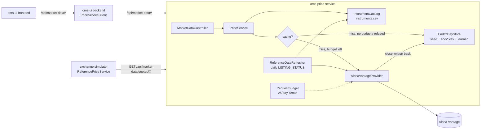

# Design — SPEC-0079: Add price service with static fallback data

> **Stage 2 of 3 — how.** Concrete enough that the plan can be written without re-reading the
> code, and checked line by line against the architecture policies. Write "None — <reason>" for a
> section that genuinely does not apply.

## Context

Market data today (SPEC-0072, SPEC-0073) comes from two separate Alpha Vantage clients on one key.

**oms-ui backend** (`oms-ui/src/main/java/org/example/omsui/marketdata/`):
- `MarketDataController implements MarketDataApi` serves `/api/market-data/instruments` and
  `/api/market-data/quotes/{symbol}`. `MarketDataApi` is generated in oms-ui from
  `oms-contracts/src/main/openapi/oms-marketdata-api.yml` (task `openApiGenerateMarketData`); the
  models come from the oms-contracts jar (`org.example.common.model.marketdata`).
- `MarketDataService` answers from its `TtlCache`, then `AlphaVantageProvider`, then
  `BuiltInMarketData` (five symbols in `oms.ui.market-data.built-in`).
- `AlphaVantageProvider` uses `SYMBOL_SEARCH` and `GLOBAL_QUOTE`, maps a 200 with `Note` or
  `Information` to `RATE_LIMITED`, and never logs the key.
- `MarketDataExceptionHandler` answers 400 Problem+JSON.
- Counter `oms.ui.marketdata.requests{kind,source,outcome}`.

**oms-exchange-simulator**
(`oms-exchange-simulator/src/main/java/org/example/simulator/marketdata/`):
- `ReferencePriceService implements ReferencePrices`: its own `TtlCache`, then
  `AlphaVantageQuoteClient` (`GLOBAL_QUOTE` "05. price"), then the static
  `simulator.reference-prices`.
- It backs off for `provider-backoff` after a rate limit or outage, because lookups run on the
  matching engine's single thread.
- Metrics come from `SimulatorMetrics.referencePriceLookup(source, outcome)`.

**Compose** passes `ALPHAVANTAGE_API_KEY` and `ALPHAVANTAGE_BASE_URL` to both `oms-ui` and
`exchange-simulator`.

**Closest examples:**
- The new module follows **oms-exchange-simulator**: a standalone Spring Boot build with
  `includeBuild('../oms-contracts')`, its own wrapper, the same Dockerfile shape, actuator and
  Prometheus.
- Its API layer follows **oms-ui's market data package**: a generated `MarketDataApi`
  implementation and a Problem+JSON handler. The Alpha Vantage client and the stub server for
  tests (`StubAlphaVantage`) are moved, not rewritten.

**Read:**
- `oms-knowledge-base/domain/interfaces/market-data-api.md`
- `architecture/context/exchange-simulator.md` §4.1
- `ui/order-entry.md`
- `infrastructure/local-docker-stack.md`
- `framework/exception-handling.md`
- `specs/policies/architecture-policies.md`
- SPEC-0073's design and verification

## Approach

A new Spring Boot service, **`oms-price-service`** (port **8098**, package `org.example.price`). It is
the only Alpha Vantage client. oms-ui and the simulator become its clients.



### oms-price-service (new module)

Classes, by layer:

- **`PriceServiceApplication`**: `@SpringBootApplication`, `@EnableScheduling`,
  `@ConfigurationPropertiesScan`.
- **`config.PriceProperties`**: a record bound to `oms.price`:
  - `alphaVantage.apiKey`: env `ALPHAVANTAGE_API_KEY`, default empty.
  - `alphaVantage.baseUrl`: default `https://www.alphavantage.co`.
  - `budget.daily`: default `25`.
  - `budget.perMinute`: default `5`.
  - `budget.resetZone`: default `UTC`.
  - `quoteTtl`: default `PT15M`.
  - `reference.refreshInterval`: default `P1D`.
  - `dataDir`: env `PRICE_DATA_DIR`, default `./data`.
  - `eod.reloadInterval`: default `PT1M`.
- **`config.PriceConfiguration`**: builds the `RestClient` (connect 2 s, read 5 s), the provider,
  the budget, the catalog, the store, the service and `Clock.systemUTC()`. On startup it logs
  whether the provider is configured, never the key.
- **`api.MarketDataController implements MarketDataApi`**: thin, delegates to `PriceService`.
  An empty `Optional` answers 404.
- **`api.PriceExceptionHandler`**:
  - 400 `urn:oms:error:validation-failed` for `ConstraintViolationException`, copied from oms-ui's
    `MarketDataExceptionHandler`;
  - 404 `urn:oms:error:not-found` for an unknown symbol, through `ResponseStatusException`.
- **`provider.MarketDataProvider`** (interface):
  - `isConfigured()`;
  - `List<Instrument> listings()`, from Alpha Vantage `LISTING_STATUS` (CSV);
  - `Optional<Quote> quote(String symbol)`.

  Both data methods throw `ProviderUnavailableException(reason)`, with reason `NOT_CONFIGURED`,
  `RATE_LIMITED` or `UNREACHABLE`.
- **`provider.AlphaVantageProvider`**: moved from oms-ui.
  - `quote` is unchanged (`GLOBAL_QUOTE`; `asOf` = "07. latest trading day").
  - `search` is replaced by `listings()`: `function=LISTING_STATUS`, `state=active`.
    - It parses CSV with header `symbol,name,exchange,assetType,ipoDate,delistingDate,status` into
      `Instrument(symbol, name, type = assetType, region = exchange, currency = "USD")`.
    - A JSON body (`Note`, `Information`, `Error Message`) instead of CSV means rate limited or
      unusable, as for quotes.
  - Key handling is unchanged: URI variables, never logged, provider messages not passed on.
- **`provider.ProviderUnavailableException`**: moved from oms-ui.
- **`budget.RequestBudget`**: counts the service's own provider requests. It is thread-safe
  (`synchronized`) and runs on an injected `Clock`.
  - `boolean tryAcquire()` takes one request if the daily and the per-minute windows both have
    room.
    - The daily window resets at the next 00:00 in `resetZone`.
    - The per-minute window is a sliding 60 s window of acquisition instants.
  - `void exhaust()`: the provider said it is rate limited, so the daily window counts as spent
    until its reset.
  - `int remainingToday()` feeds the gauge.
- **`reference.InstrumentCatalog`**: the instrument list in memory, loaded from
  `<dataDir>/instruments.csv`, else the classpath seed `seed/instruments.csv`.
  - `search(query)` is case-insensitive over symbol and name. It ranks an exact symbol, then a
    symbol prefix, then a name containing the query, then alphabetically. It answers at most 25.
  - `replace(List<Instrument>)` writes `instruments.csv` atomically (temp file, then
    `Files.move(ATOMIC_MOVE)`) and swaps the in-memory list.
  - `age()` is the file's last-modified age, or infinite when only the seed exists.
- **`reference.ReferenceDataRefresher`**: `@Scheduled(fixedDelayString = "PT1H", initialDelay = 10 s)`.
  - It refreshes only if the provider is configured, `catalog.age() > refreshInterval`, and
    `budget.tryAcquire()` succeeds.
  - Then it calls `provider.listings()` and `catalog.replace(...)`.
  - On `ProviderUnavailableException` it keeps the list and logs the reason. `RATE_LIMITED` also
    calls `budget.exhaust()`.
  - The method is public, so tests call it directly.
- **`eod.EndOfDayStore`**: `Map<String, Close>` with `Close(symbol, LocalDate date,
  BigDecimal close, BigDecimal previousClose, String currency, Origin origin)`.
  - Sources, merged with **origin precedence first, then the most recent date**:
    1. `SEED`: classpath `seed/eod-prices.csv`, the simulator's five demo prices. It never wins
       over the other origins.
    2. `FILE`: every `<dataDir>/eod/*.csv` supplied by the operator.
    3. `LEARNED`: `<dataDir>/learned-closes.csv`, written by the service.

    `FILE` and `LEARNED` compete by date.
  - **Format** (header required, UTF-8): `symbol,date,close[,previousClose[,currency]]`, with
    `date` as ISO `yyyy-MM-dd`.
    - Each malformed row (wrong column count, bad number or date, blank symbol) is skipped.
    - Skipped rows are logged as `file:line reason`, plus one summary line with the counts per
      file.
  - `reloadIfChanged()`: `@Scheduled(fixedDelayString = "${oms.price.eod.reload-interval:PT1M}")`.
    It reloads when any file's last-modified time or the set of files changed. It also runs at
    startup.
  - `record(Quote)`: after a live quote with `last` and `asOf`, it upserts a `LEARNED` close and
    rewrites `learned-closes.csv` atomically. Writes are `synchronized`.
- **`service.PriceService`**:
  - **`search(query)`**: answers `InstrumentSearchResult(catalog.search(q), source = REFERENCE_DATA)`
    and never touches the provider or the budget.
  - **`quote(symbol)`**, with the symbol upper-cased:
    1. A `TtlCache` hit (provider answers only, including "no quote") answers at once.
    2. Otherwise, under a single-flight lock (`synchronized` on the miss path, so concurrent asks
       for one symbol buy one request; provider calls are few by design), it re-checks the cache.
    3. If the provider is not configured, it answers from the end-of-day store (notice: no live
       provider configured).
    4. If `budget.tryAcquire()` fails, it answers from the store (notice: provider limit reached).
    5. Otherwise it calls `provider.quote`.
       - A quote is cached, written to `store.record` and answered with source `ALPHA_VANTAGE`.
       - "No quote" is cached as empty, then the store is tried with no notice, else 404.
       - `RATE_LIMITED` calls `budget.exhaust()`, then answers from the store (notice: limit
         reached).
       - `UNREACHABLE` answers from the store (notice: provider unreachable), with no back-off
         beyond the budget.
    6. A store answer is a `Quote` with:
       - `source = END_OF_DAY`;
       - `last = close`, `previousClose`;
       - `change` and `changePercent` computed when `previousClose` is present;
       - `asOf = date`, `currency`;
       - the notice.

       It is not cached, so live data returns as soon as budget allows. No entry in the store
       means empty, which answers 404.
  - **Metrics:**
    - `oms.price.requests{kind=search|quote|refresh, source, outcome}`;
    - outcome: `CACHE`, `PROVIDER`, `NOT_FOUND`, `NOT_CONFIGURED`, `BUDGET_SPENT`, `RATE_LIMITED`
      or `UNREACHABLE`;
    - gauge `oms.price.provider.budget.remaining` from `budget.remainingToday()`.
- **`util.TtlCache`** (moved from oms-ui) and **`util.Csv`**: a minimal RFC-4180 line splitter
  (quoted fields, doubled quotes), used by the catalog, the store and `listings()`.
- **Resources:**
  - `application.yml`: port 8098, the `oms.price` defaults, actuator `health,info,prometheus`, and
    the OTLP block as in the simulator.
  - `seed/instruments.csv` and `seed/eod-prices.csv`: AAPL 170.00, MSFT 420.00, IBM 250.00,
    NVDA 120.00 and INTC 86.96, the simulator's values, dated 2026-11-26.
- **Build:** `build.gradle` (as the simulator's, plus `org.openapi.generator` 7.24.0 and the
  `openApiGenerateMarketData` task copied from oms-ui), `settings.gradle`
  (`includeBuild('../oms-contracts')`), the wrapper, `Dockerfile` (port 8098), `README.md`. Root
  `settings.gradle` gets `includeBuild('oms-price-service')`.

### oms-ui

- **Removed:** `AlphaVantageProvider`, `BuiltInMarketData`, `MarketDataService`,
  `MarketDataProvider`, `ProviderUnavailableException`, `TtlCache`, and their tests;
  `oms.ui.market-data.alpha-vantage.*`, `search-ttl`, `quote-ttl` and `built-in`.
- **`PriceServiceClient`** (new), on a `RestClient` with base URL `oms.ui.market-data.price-service-url`
  (env `PRICE_SERVICE_URL`, default `http://localhost:8098`), connect 2 s and read 5 s:
  - `search(query)` and `quote(symbol)` return the generated models;
  - 404 maps to empty;
  - a connection failure, timeout or 5xx throws `PriceServiceUnavailableException`.
- **`MarketDataController`** delegates to the client.
  - `MarketDataExceptionHandler` adds 503 `urn:oms:error:price-service-unavailable` (Problem+JSON).
  - The frontend already treats any non-200 as "Market data unavailable: enter the symbol by
    hand" (`MarketDataService.ts`).
  - Validation stays on oms-ui's generated interface, so a bad query never leaves oms-ui.
- **`MarketDataConfiguration` and `MarketDataProperties`** shrink to the client and the URL.
- **Frontend:**
  - `MarketDataSource` adds `'END_OF_DAY' | 'REFERENCE_DATA'`.
  - `OrderEntry.tsx` labels `END_OF_DAY` as `End-of-day close` and shows `asOf`, which it already
    renders.
  - `ALPHA_VANTAGE` keeps its label; `BUILT_IN` keeps its label for old answers.

### oms-exchange-simulator

- **`AlphaVantageQuoteClient` → `PriceServiceQuoteClient`**: `GET {url}/api/market-data/quotes/{symbol}`.
  - Timeouts: connect 2 s, read 3 s, unchanged.
  - Body read as the generated `Quote`; returns `Optional<BigDecimal>` of `last`.
  - 404 maps to empty. A connection failure, timeout, 5xx or JSON error throws
    `ProviderUnavailableException(UNREACHABLE)`.
  - `isConfigured()` is true when the URL is set.
- **`ReferencePriceService`** keeps its cache, back-off and static fallback. `Source.ALPHA_VANTAGE`
  becomes `Source.PRICE_SERVICE`, and the logs name the price service.
- **`SimulatorProperties`**: `alphaVantage` is replaced by `priceService.url` (env
  `SIMULATOR_PRICE_SERVICE_URL`, default empty, meaning static prices only, as with no key today).
  `reference-prices`, `quote-ttl` and `provider-backoff` stay.
- **Tests:**
  - `StubAlphaVantage` is replaced by `StubPriceService` (same `HttpServer` pattern, answering
    `/api/market-data/quotes/{symbol}`).
  - `AlphaVantageKafkaIntegrationTest` becomes `PriceServiceKafkaIntegrationTest`.
  - `AlphaVantageQuoteClientTest` becomes `PriceServiceQuoteClientTest`.
  - `ReferencePriceServiceTest` is updated.

### Compose and environment

- **New service `price-service`:**
  - `image oms-price-service:latest`, `build ./oms-price-service`, port `8098:8098`;
  - env `ALPHAVANTAGE_API_KEY`, `ALPHAVANTAGE_BASE_URL`, `PRICE_DATA_DIR=/data` and the OTLP
    anchor;
  - volume `price-data:/data`, `depends_on: alloy`.
- **`oms-ui`:** `PRICE_SERVICE_URL=http://price-service:8098` and `depends_on: price-service`.
- **`exchange-simulator`:** `SIMULATOR_PRICE_SERVICE_URL=http://price-service:8098`.
- **Removed:** both Alpha Vantage variables from oms-ui and the simulator.

**What Changes → where:**

| What Changes | Where |
|---|---|
| New price service, sole key holder and caller | `oms-price-service`, compose |
| Reference data from a file | `InstrumentCatalog`, `ReferenceDataRefresher`, seed |
| End-of-day prices from a file | `EndOfDayStore`, seed, `PriceService` write-back |
| Request budget | `RequestBudget`, `PriceService`, refresher |
| oms-ui forwards, labels EOD | `PriceServiceClient`, controller, handler, `OrderEntry.tsx` |
| Simulator via price service | `PriceServiceQuoteClient`, `ReferencePriceService`, properties |
| Contract enum values | `oms-marketdata-api.yml` |
| Metrics | `PriceService`, `RequestBudget` gauge |
| Knowledge base | see Knowledge Base Updates |

## Contract Changes

`oms-contracts/src/main/openapi/oms-marketdata-api.yml`. The version goes up one minor step, and
the description of `MarketDataSource` and the 404 text change accordingly:

```yaml
    MarketDataSource:
      type: string
      description: >
        Where the data came from. ALPHA_VANTAGE: a live provider answer. END_OF_DAY: the last known
        close from the price service's end-of-day store (asOf is its date). REFERENCE_DATA: the
        price service's instrument list. BUILT_IN: no longer produced (SPEC-0079); kept so older
        answers still parse.
      enum:
        - ALPHA_VANTAGE
        - BUILT_IN
        - END_OF_DAY
        - REFERENCE_DATA
```

- **Compatibility (P-04): additive.** No value is removed or renamed, and no field changes.
- **Generated code:** `org.example.common.model.marketdata.MarketDataSource` gains two constants.
- **Consumers:** oms-ui (interface and models), the simulator (`Quote` model, new use) and the
  price service. oms-core, oms-streaming-service and oms-mcp-server don't use this spec but build
  against the jar, and verify covers them through `impacts`.
- No Avro change. No path or parameter change: the price service serves the same two paths.

## Data & Persistence

None in PostgreSQL. No entity, no Liquibase changelog.

The price service keeps three files in `dataDir`, a docker volume `price-data` in compose:
- `instruments.csv`: written by the refresher, atomically.
- `learned-closes.csv`: written on every live quote, atomically.
- `eod/*.csv`: written only by the operator, read-only to the service.

The classpath seeds are read-only.
- **Losing the volume** loses nothing that can't be rebuilt: the seeds remain, the listing is
  re-fetched, and closes are re-learned.
- **Concurrency:** one writer per file, writes `synchronized` in the owning class, atomic move. A
  reader never sees a half-written file.

## Events & Messaging

None. No order state changes, no `order_events`, no outbox, no Kafka in the price service. The
simulator's Kafka flow is unchanged; only where its reference price comes from changes.

## Domain, State & Orchestration

None for orders: no state machine transition or task pipeline step changes.

**Validation and errors (P-13):**
- **Price service:** the generated `@Validated` interface checks `query` (1–40 characters). A
  violation is 400 Problem+JSON `urn:oms:error:validation-failed`, and an unknown symbol is 404.
- **oms-ui:** validation stays on its own generated interface. It adds 503 Problem+JSON when the
  price service cannot be reached.
- **Exceptions:**
  - a provider failure is never an error for the caller;
  - nothing is swallowed silently: every fallback is counted and logged at `warn` with the reason;
  - the key is never in a log line.

## Alternatives & Decisions

- **Provider: stay with Alpha Vantage, behind `MarketDataProvider`.** Approved with the proposal.
  - Finnhub (60 calls a minute), Twelve Data and Tiingo were considered.
  - With reference data and closes served locally, a few quotes a day suffice, and free Alpha
    Vantage quotes are end-of-day anyway.
  - The second adapter is a follow-up, recommended in the assessment page.
- **New module rather than in oms-ui's backend.** Approved.
  - The simulator must not depend on the UI application.
  - One service means one key, one cache and one budget.
- **Files, not PostgreSQL.**
  - A table would add a database dependency, a datasource and Liquibase to a service whose data is
    a disposable cache plus operator-supplied files.
  - Rejected for simplicity (P-17). A volume keeps the data across restarts.
- **Self-enforced budget as well as reacting to the provider's `Note`.**
  - Reacting alone wastes a request on each refusal, and leaves the per-minute limit to luck.
  - Counting alone breaks when the key is also used elsewhere.
  - Both are used. Daily reset at 00:00 UTC (approved assumption), configurable.
- **Origin precedence in the end-of-day store (`SEED` < `FILE` / `LEARNED`, then by date).**
  - "Most recent date wins" alone would let the seed's fixed date beat a real close learned from an
    earlier trading day.
  - Changed from the proposal's AC-6 wording only for the seed, which is not "a source" in AC-6's
    sense. For operator files and learned closes, the most recent date wins, as AC-6 says.
- **oms-ui forwards with a `RestClient`, not a gateway** (Spring Cloud Gateway) or a reverse proxy.
  - Rejected: a new dependency for two GET endpoints.
  - The browser keeps one origin (approved assumption).
- **No CSV library.** Commons CSV was considered. The three formats are simple, and a 30-line
  quoted-field splitter with its own tests is smaller than a dependency (P-17).
- **The simulator keeps its own short cache and back-off.** Its lookups run on the engine thread,
  so a slow price service must not hold up the venue for more than one read timeout per back-off
  period (SPEC-0073's reasoning still holds).
- **No automatic EOD downloads** (Stooq zips, vendor bulk APIs). Out of scope by the proposal:
  terms unclear, no API.
- **New dependencies / build changes (P-17):**
  - A new module `oms-price-service`, using the same Spring Boot 4.1.0, dependency-management and
    openapi-generator 7.24.0 versions already used by oms-ui and the simulator.
  - `includeBuild('oms-price-service')` in the root `settings.gradle`.
  - The simulator now uses the `oms-contracts` marketdata models it already has on its classpath.
  - No new third-party library anywhere.
- **Spec config:** agents cannot edit `specs/config.json`. The `oms-price-service` module entry
  (verify `./gradlew build`) and its addition to `oms-contracts`' `impacts` must be added by a
  human before implementation. The plan's first task checks it.

**Changed during implementation, after the independent review (2026-11-26):**
- **Per-symbol single flight** instead of one lock for the whole miss path. Under one lock, a slow
  provider call for one symbol held up every other quote. The simulator's 3 s read timeout could
  then fire on a request the service could have answered from the store.
- **Provider timeouts reduced to connect 1 s / read 2 s**, below the simulator's read timeout.
- **The budget persists** in `<dataDir>/budget.txt` (`yyyy-MM-dd,used`). A restart no longer hands
  out the day's 25 requests again or forgets a rate limit (AC-5's intent).
- **No provider request** for a blank symbol, or, once a listing is downloaded, for a symbol not
  listed: new outcome `NOT_LISTED`. This saves budget on mistyped and test symbols such as ZZZZ.
- **Seed closes say they are demo prices** in the notice. Their date would otherwise present a
  made-up close as a real one.
- **Contract text** (`oms-marketdata-api.yml`) rewritten for the price service, with the 503 that
  oms-ui answers declared on both paths. Descriptions only; the generated code is unchanged.
- **Robustness:** `eod/` is created at startup; temp files are removed when a write fails; a list
  that cannot be written is counted as `FAILED` instead of escaping the scheduled job.
- **Not changed: tracing of provider calls (P-15).** The static `RestClient.builder()` is used, as
  in oms-ui and the simulator, so provider calls carry no client spans. The server-side request
  spans and the request metrics remain. Recorded as a follow-up.

## Risks & Mitigations

- **Budget drift.** Another user of the same key spends the quota, so the service's count is
  optimistic.
  - The provider's `Note` makes the service exhaust the budget at once (AC-5), so at most one
    wasted request a day.
- **The listing is big** (about 12,000 rows, about 600 KB) and searched linearly.
  - That's microseconds to milliseconds per search, held in memory once.
  - A test asserts a search over 12,000 instruments answers in under 50 ms.
- **Stale closes look live.** Every `END_OF_DAY` answer carries `asOf` and the source, and order
  entry labels it.
  - The simulator uses it as a reference price, as SPEC-0073 already did with the static prices.
- **A corrupt operator file.** Row-level skipping with logged line numbers, and the rest of the
  file still loads (AC-6).
- **Price service down at startup of its clients:**
  - oms-ui answers 503, and order entry allows typing the symbol by hand;
  - the simulator uses its static prices and backs off.
  - Neither fails to start.
- **Key leakage through the moved client.** The tests that assert the key appears in no response
  and no log line are moved with it and extended to `listings()` (AC-11).
- **Contract change ripples.** Additive enum only. Verify builds every consumer, and the oms-ui
  frontend type gains the values.

## Test Strategy

All price service tests stub Alpha Vantage with `StubAlphaVantage`, moved from the simulator and
extended with `LISTING_STATUS` CSV and request counting. Time is a mutable test `Clock`.

| AC | Level (unit / web-mvc / integration / e2e) | Test class#method | What it asserts |
|---|---|---|---|
| AC-1 | unit + integration | `InstrumentCatalogTest#searchRanksSymbolThenNameCaseInsensitive`; `PriceServiceApiTest#searchAnswersFromReferenceDataWithoutProviderRequests` | MSFT found for "micro", `source: REFERENCE_DATA`, stub received 0 requests |
| AC-2 | unit | `ReferenceDataRefresherTest#refreshesOnceWhenListIsOlderThanInterval`; `#keepsListWhenProviderFailsOrIsRateLimited`; `#skipsWhenListIsFresh` | exactly one `LISTING_STATUS` request replaces the list; failure or rate limit keeps the old list and search still answers |
| AC-3 | integration | `PriceServiceApiTest#secondQuoteWithinTtlIsServedFromCache` | two quote calls, one `GLOBAL_QUOTE` request, same `last`, `ALPHA_VANTAGE` |
| AC-4 | unit + integration | `RequestBudgetTest#dailyLimitThenResetAtMidnightUtc`; `#perMinuteLimitSlides`; `PriceServiceApiTest#spentBudgetAnswersEndOfDayWithoutProviderRequest` | no request after the budget is spent; `END_OF_DAY`, `last` = close, `previousClose`, `asOf` = date, notice |
| AC-5 | integration | `PriceServiceApiTest#rateLimitedAnswerFallsBackAndStopsCallingUntilReset` | stub answers `Note`: EOD answer; further quotes make no request until the clock passes midnight UTC |
| AC-6 | unit | `EndOfDayStoreTest#loadsOperatorFileSkippingMalformedRows`; `#mostRecentDateWinsBetweenFileAndLearned`; `#seedNeverWinsOverOtherOrigins`; `#reloadsWhenFilesChange` | valid rows used, malformed skipped with line numbers logged (log captured), precedence, reload |
| AC-7 | unit + integration | `EndOfDayStoreTest#learnedCloseSurvivesRestart`; `PriceServiceApiTest#liveQuoteIsWrittenBackAndUsedWhenProviderUnavailable` | a new store on the same directory returns the learned close; after a live quote and an outage, `END_OF_DAY` with that close |
| AC-8 | integration | `PriceServiceApiTest#unknownSymbolIs404Problem`; `#invalidQueryIs400Problem` | 404 and 400 Problem+JSON |
| AC-9 | unit + integration | `ReferencePriceServiceTest#usesPriceServiceLast`; `#fallsBackToStaticWhenPriceServiceUnreachable`; `#unknownToBothIsEmpty`; `PriceServiceKafkaIntegrationTest#ordersFillAtThePriceServiceQuote`; `PriceServiceQuoteClientTest#notFoundIsEmptyAndErrorsAreUnavailable` | reference price = the price service's `last`; static fallback; reject unknown; the simulator has no Alpha Vantage client or configuration |
| AC-10 | web-mvc + unit (frontend) | `MarketDataControllerTest#forwardsSearchAndQuoteFromPriceService`; `#priceServiceUnreachableIs503Problem`; `#notFoundPassesThrough`; `OrderEntry.test.tsx` "labels an end-of-day quote with its date"; `MarketDataService.test.ts` "a 503 gives the unavailable notice" | oms-ui answers are the price service's; 503 when it is down; the UI label and the notice |
| AC-11 | integration + unit | `PriceServiceApiTest#keyAppearsInNoResponseOrLogLine` (search, quote, refresh, rate limit, unreachable; log captured); `ConfigurationHasNoProviderKeyTest` in oms-ui and the simulator (their `application.yml`); `ComposeEnvironmentTest` in oms-price-service (only `price-service` has `ALPHAVANTAGE_API_KEY` in `docker-compose.yml`) | key in no response or log; not configured in oms-ui, the simulator or their compose blocks |
| AC-12 | integration | `spec verify` → oms-knowledge-base verify (`okf-check`, 0 errors); review of the four pages | pages exist and pass the checker |
| AC-13 | integration | `PriceServiceApiTest#prometheusShowsBudgetGaugeAndRequestCounts` | `oms_price_provider_budget_remaining` and `oms_price_requests_total` with kind, source, outcome for search, live quote and EOD quote |

Additional: `CsvTest` (quoted fields, doubled quotes, trailing empty fields); `AlphaVantageProviderTest`
moved and extended (`LISTING_STATUS` parse, JSON-instead-of-CSV is `RATE_LIMITED`);
`InstrumentCatalogTest#searchesTwelveThousandInstrumentsQuickly` (under 50 ms, a sanity bound).

## Policy Compliance

| Policy | Title | Status | How / Justification |
|---|---|---|---|
| P-01 | Contracts live only in oms-contracts | comply | Only `oms-contracts/src/main/openapi/oms-marketdata-api.yml` changes; the price service generates its interface from it via `omsContractsSpecDir`, like oms-ui; no `src/main/openapi` in the new module |
| P-02 | Specification before code, generated models only | comply | Enum values added first (T-1); `Quote`, `Instrument`, `InstrumentSearchResult` are the generated models in all three services; Alpha Vantage's CSV and JSON parsed inside the provider only |
| P-03 | Never edit generated code | comply | `MarketDataApi` generated into `build/generated` in the price service; nothing hand-edited |
| P-04 | Contracts evolve compatibly | comply | Additive enum values; no removal or rename; `BUILT_IN` kept |
| P-05 | Every state change is recorded in the event log | n/a | No order state changes; market data is not order state |
| P-06 | Kafka only through the transactional outbox | n/a | The price service has no Kafka; the simulator's Kafka flow is unchanged |
| P-07 | Schema changes through new Liquibase changesets | n/a | No database schema; files in a data directory |
| P-08 | Concurrency and idempotency are explicit | comply | Single-flight lock on quote misses; `synchronized` budget and store writes; atomic file replacement; refresh is idempotent |
| P-09 | Commands and queries stay separate | comply | The price service is query-only (two GETs); no command path touched |
| P-10 | State transitions go through the state machine and task pipeline | n/a | No order state transitions |
| P-11 | Layering and conventions | comply | Thin controller → `PriceService` → catalog/store/provider; constructor injection, Lombok; packages `org.example.price.<layer>`; module shaped like the simulator, API like oms-ui's market data package |
| P-12 | Jackson 3 only | comply | `tools.jackson` `JsonMapper` in the moved provider; the simulator reads `Quote` via Spring's Jackson 3 converter |
| P-13 | Errors and validation follow the framework specs | comply | 400, 404 and 503 Problem+JSON with `urn:oms:error:*` types; generated `@Validated` interface; fallbacks logged and counted, not swallowed |
| P-14 | Test first, every acceptance criterion is proven by an automated test | comply | Every AC in Test Strategy; each plan task writes its test first |
| P-15 | Observability | comply | `oms.price.requests` counter and budget gauge; SLF4J warnings with the fallback reason; OTLP export as in the other services (HTTP client tracing via Spring's instrumented `RestClient.Builder`) |
| P-16 | Security | comply | Key only from env `ALPHAVANTAGE_API_KEY`, only in the price service, never logged or returned (AC-11 tests); inputs validated by the generated interface; symbols passed as URI variables |
| P-17 | Simplicity and dependencies | comply | No new third-party libraries; one new module, justified above; files over a database; no gateway; no CSV library |
| P-18 | Modules build standalone | comply | `oms-price-service` builds alone (`includeBuild('../oms-contracts')`); the root composite includes it; verify runs the contracts consumers — requires the human-added `specs/config.json` module entry (see Alternatives & Decisions) |
| P-19 | Documentation follows behaviour | comply | Knowledge Base Updates below |

## Knowledge Base Updates

**New pages:**
- `oms-knowledge-base/architecture/context/price-service.md` (`type: Component`): what the service
  does, sources and precedence, the budget, files and their formats (the operator CSV format
  documented here), configuration, metrics, and how to supply end-of-day data.
- `oms-knowledge-base/architecture/assessments/market-data-providers-2026-11.md`
  (`type: Assessment`): Alpha Vantage, Finnhub, Twelve Data, Tiingo and Stooq, with free limits,
  data delay, licence notes, the date checked, sources and the recommendation.

**Updated pages:**
- `domain/interfaces/market-data-api.md`: served by the price service and forwarded by oms-ui; the
  new sources; the 503; metrics renamed.
- `architecture/context/exchange-simulator.md` §4.1: the reference price comes from the price
  service; configuration renamed.
- `architecture/context/oms-ui.md`: market data is forwarded.
- `ui/order-entry.md`: the end-of-day label.
- `infrastructure/local-docker-stack.md`: the new service, port 8098, volume `price-data`, and the
  key moved.
- `capabilities/exchange-simulation.md`: where reference prices come from.
- `architecture/context/index.md`, `architecture/assessments/index.md` and `log.md`: entries, with
  `okf-check --fix-indexes` used for the indexes.
