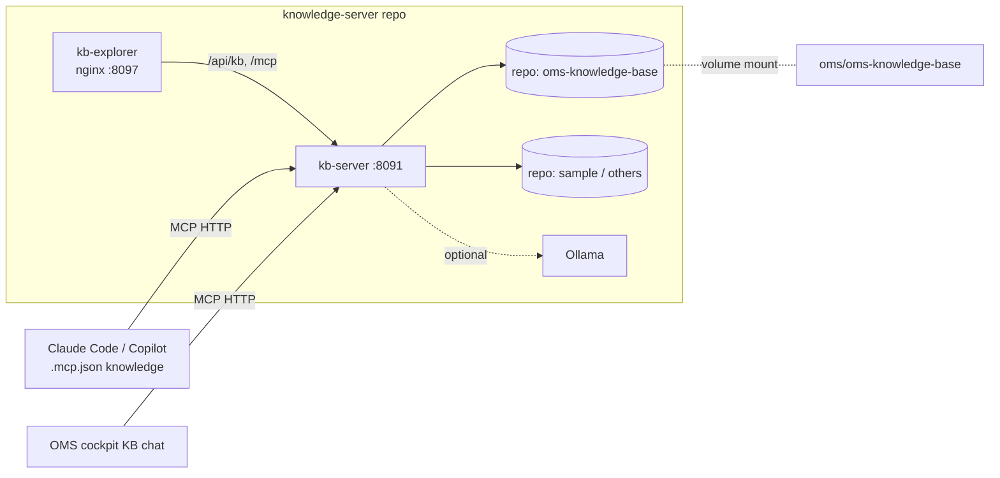

# Design — SPEC-0080: Extract knowledge server into its own repository

> **Stage 2 of 3 — how.** Concrete enough that the plan can be written without re-reading the
> code, and checked line by line against the architecture policies. Write "None — <reason>" for a
> section that genuinely does not apply.

## Context

The two modules today:

**`oms-mcp-server`** (Spring Boot 4, Spring AI MCP over WebFlux, port 8091, `org.example.mcp`)

- `docs/DocumentRepository` takes a comma-separated `domain.docs.paths`
  (`${DOMAIN_DOCS_PATHS:../oms-knowledge-base}`).
  - It silently drops directories that do not exist.
  - It names every document `<base-dir-basename>/<relative path>`, for example
    `oms-knowledge-base/domain/model/order.md`.
  - That prefix is already a de-facto repository id. Aliases (`resolveAlias`), links
    (`ConceptLinks`), citations and `kb://` resources all build on it.
- `index/KnowledgeIndexService` indexes section chunks into in-memory Lucene.
  - Its filter fields are `category`, `status`, `type` and `tag` (`buildFilter`).
  - `search(query, topK, category, status, type, tag)` is BM25 + HNSW with RRF.
- `kb/KnowledgeBaseTools` provides the MCP tools `searchKnowledgeBase`, `readKnowledgeBase` and
  `getKnowledgeBaseOverview`.
- `kb/KbMcpFeaturesConfig` provides `kb://<path>` resources and two prompts that say
  "OMS specification".
- `kbexplorer/KbExplorerController` serves `/api/kb`: `documents`, `documents/read`,
  `documents/sections`, `documents/links`, `search/{keyword,semantic,hybrid}` and `health`.
- `oms/*` is OMS-only:
  - `OrderSearchMcpTools` (`searchOrders`), `OrderQueryClient`, `DemoOrderController`,
    `OmsClientProperties`, `RestClientConfig`, `LoggingInterceptor` and `PageResponse`.
  - `McpConfig`, which registers *all* tool objects, including the KB and health tools.
- Build: `settings.gradle` has `includeBuild('../oms-contracts')`, and `build.gradle` has
  `implementation 'org.example.oms:oms-contracts'` (used only by `oms/*`).
- `Dockerfile` copies a jar built beforehand.
- Tests: `index/RetrievalEvalTest` runs 42 golden queries
  (`src/test/resources/retrieval-evals/golden-queries.yaml`) against `../oms-knowledge-base`.
  The baselines are recall@5 ≥ 0.90 and MRR ≥ 0.80.
- Config: `application.yml` sets `spring.application.name: oms-mcp-server`,
  `service.namespace: oms` and `oms.base-url`.

**`oms-kb-explorer`** (Vite + React 19 + TanStack Query + Tailwind 4)

- `services/api.ts` calls `VITE_KB_API_URL ?? http://localhost:8091/api/kb`, with sample data
  under `oms-knowledge-base/...` paths.
- `App.tsx` uses the oms-ui shell (`AcmeLogo`, "Acme Capital", dark only). The UI logic lives in
  `okf/*` (search, sidebar, links, header, status, keyboard) with node:test + vitest tests.
- It is not in `docker-compose.yml`, so it runs with `npm run dev` only.

**OMS repository references**

| Area | References |
|---|---|
| Build | root `settings.gradle` and `build.gradle` (`buildAll`/`cleanAll` list) |
| Specs | `specs/config.json` (modules, and the `impacts` of `oms-contracts`) |
| Runtime | `docker-compose.yml` (service `mcp-server`, volume `mcp-kb-index`) and `cockpit.yaml` (health check and `knowledgeBase.serverUrl`) |
| MCP clients | `.mcp.json` (`oms` → `http://localhost:8091/mcp`) and `.vscode/mcp.json` (stdio via `run-mcp.ps1`) |
| Agent guidance | `.github/*` agent and Copilot files, `.claude/skills/spec-verify/SKILL.md`, `specs/policies/architecture-policies.md` (P-04 consumer list) and `.vscode/launch.json` |
| Docs | `README.md`, `CLAUDE.md`, `ARCHITECTURE-REVIEW.md` and about 25 knowledge-base pages (see Knowledge Base Updates) |

**Closest examples followed.**
- The index filter fields (`FIELD_TYPE_FILTER` and friends) are the model for the new
  `repository` filter.
- `KnowledgeIndexProperties` (`@ConfigurationProperties`) is the model for the repository
  configuration.
- `okf/search.ts` `searchParams` is the model for the UI filter.

**Knowledge-base pages read:**
- `tools/knowledge-server.md` and `tools/kb-explorer.md`;
- `capabilities/knowledge-services.md`;
- FR-033, FR-034, FR-035 and FR-045 to FR-047;
- NFR-009.

## Approach

### 1. New repository layout (clean copy, no history)

Local clone: `c:\data\workspace\knowledge-server`. Remote: `github.com/tbaderts/knowledge-server`,
branch `main`.

```
knowledge-server/
├── README.md                     # what the knowledge server is, quick start, configuration, MCP client setup
├── docker-compose.yml            # kb-server + kb-explorer
├── .env.example                  # KB_REPO_NAME, KB_REPO_PATH, ports, Ollama URL, OTLP switches
├── .gitignore                    # build/, bin/, logs/, .gradle/, .kb-index/, node_modules/, dist/, .env
├── examples/sample-knowledge/    # small OKF bundle (~10 docs, 2 sub-folders) for tests, eval and demo
├── kb-server/           # former oms-mcp-server, standalone Gradle build
│   ├── build.gradle, settings.gradle, gradlew*, gradle/
│   ├── Dockerfile                # multi-stage: gradle build inside the image
│   ├── run-server.ps1 / run-server.sh   # former run-mcp.*
│   ├── docs/                     # former oms-mcp-server/docs, de-OMSed
│   └── src/main/java/io/kbserver/{docs,index,kb,api,tools,…}
└── kb-explorer/               # former oms-kb-explorer
    ├── package.json (name: kb-explorer), vite/ts/eslint configs
    ├── Dockerfile + nginx.conf   # static build, proxies /api and /mcp to kb-server
    └── src/…
```

The copy excludes build output and local state: `build/`, `bin/`, `logs/`, `.gradle/`,
`.kb-index/`, `.env`, `node_modules/` and `dist/`. Only source files and tests are copied.
`oms-mcp-server/.env` is never copied.

### 2. Renames (mechanical)

| From | To |
|---|---|
| Java package `org.example.mcp.*`, Gradle group `org.example` | `io.kbserver.*`, group `io.kbserver` |
| `SpringAiApplication` | `KbServerApplication` |
| `kbexplorer/KbExplorerController` | `api/KnowledgeApiController` (path `/api/kb` unchanged) |
| `spring.application.name: oms-mcp-server` | `kb-server` |
| OTLP `service.name` / `service.namespace` | `kb-server` / `knowledge-server` |
| `rootProject.name 'oms-mcp-server'` | `kb-server` |
| npm `name: oms-kb-explorer` | `kb-explorer` |
| `run-mcp.ps1` / `run-mcp.sh` | `run-server.ps1` / `run-server.sh` |

### 3. OMS coupling removed from the server

- Delete `OrderSearchMcpTools`, `OrderQueryClient`, `DemoOrderController`, `OmsClientProperties`,
  `RestClientConfig`, `LoggingInterceptor`, `PageResponse`, `OrderQueryClientTest` and
  `OrderSearchMcpToolsTest`.
- Move `McpConfig` to `io.kbserver.kb.McpToolsConfig`. It registers only `KnowledgeBaseTools`
  and `HealthTools`.
- Drop the `oms.base-url` setting, the `includeBuild('../oms-contracts')` line, the `oms-contracts`
  dependency, and the `jackson-databind-nullable` and `swagger-annotations` dependencies that only
  the generated models needed. Verify that by compiling.
- MCP prompts in `KbMcpFeaturesConfig`: "OMS specification" becomes "a knowledge base document".
  The example path becomes `<repository>/<path>.md`, and the resource description becomes
  "Knowledge document (<repository>)".
- Tool descriptions in `KnowledgeBaseTools`: the category examples stop naming OMS folders.

### 4. Multiple named knowledge repositories

Configuration replaces `domain.docs.paths`:

```yaml
knowledge:
  repositories:                       # ordered; order is the tie-break for ambiguous paths
    - name: sample                    # [a-z0-9][a-z0-9._-]*, unique; the document path prefix
      path: ../examples/sample-knowledge   # absolute, or relative to the working directory
```

- Env-var form (Spring relaxed binding, no custom parsing): `KNOWLEDGE_REPOSITORIES_0_NAME` and
  `KNOWLEDGE_REPOSITORIES_0_PATH`, then `_1_` for the next repository, and so on.
- New `io.kbserver.docs.RepositoryProperties`: a `@ConfigurationProperties("knowledge")`
  record holding `List<Repo(name, path)>`.
  - `@Validated` enforces the name pattern, and startup fails if two names are the same. These are
    configuration errors.
- New `io.kbserver.docs.KnowledgeRepository`: a record of `name`, `Path root` and
  `boolean available`.

`DocumentRepository` changes:

- **Constructor.** Takes `RepositoryProperties` instead of the `@Value` string. For each entry it
  resolves the path.
  - Missing or not a directory: it logs
    `WARN [Docs] Knowledge repository '<name>' unavailable: <path> does not exist`, keeps the entry
    with `available=false` and does not scan it (AC-5).
  - An empty list: one WARN, and the server starts with no documents.
- **Path prefix.** Every place that used `base.getFileName()` uses the repository **name** instead:
  `relativize`, `toMeta`, `conceptId` and the second loop of `resolveAgainstBases`.
  - Document paths become `<repository>/<relative path>`.
  - OMS configures its repository as `oms-knowledge-base`, so every existing OMS path, alias,
    citation and `kb://` URI stays the same.
- **Unprefixed paths.** `resolveAgainstBases` keeps its first loop: an unprefixed relative path
  resolves against the available repositories in configured order. That stays backward compatible
  for existing callers.
- **New API.**
  - `getRepositories()` returns `List<KnowledgeRepository>`.
  - `repositoryOf(String path)` returns `Optional<String>` (the prefix, if it names a configured
    repository).
  - `hasRepository(String name)` returns a boolean (case-sensitive; names are lowercase by rule).
- **`DocMeta`** gains `String repository` as its first component. `listAll()` takes an optional
  repository filter (`listAll()` and `listAll(String repository)`).
- `getBaseDirs()` is replaced by `getRepositories()`. Its two callers, `KnowledgeIndexService` and
  `ConceptLinks`, are adapted.

`SectionChunk`, `SectionChunker` and `KnowledgeIndexService` changes:

- `SectionChunk` gains `repository`, set from `DocumentRepository.repositoryOf(path)` while
  chunking.
- `toLuceneDoc` adds `StringField("repositoryFilter", repository, NO)` and
  `StoredField("repository", repository)`.
- `buildFilter(category, status, type, tag, repository)` adds a `TermQuery` on `repositoryFilter`
  when the repository is not blank.
- New overload `search(query, topK, category, status, type, tag, repository)`. The existing
  overloads delegate with `repository = null`.
- `SearchHit` gains `repository`.
- **Embedding cache.** Its key is the content hash (`EmbeddingService`), so the cache stays valid
  and is not invalidated by the path prefix.

Tools (`KnowledgeBaseTools`), where AC-3 and AC-4 are observed:

- `searchKnowledgeBase(query, topK?, category?, status?, type?, tag?, repository?)`, with
  `@ToolParam(required=false)` "Limit results to one knowledge repository (see overview)".
  - Each hit line starts with `[<repository>]`. The citation stays `<repository>/<path>#anchor`
    with its line range.
  - **Unknown repository:** the tool returns its normal "no results" text with
    `Results: 0` and `Unknown repository '<x>'. Known: a, b`. It does not throw. That is the
    "empty list for MCP" of AC-4.
- `getKnowledgeBaseOverview()` groups by repository:
  `## Repository <name> (<n> documents)`, then the existing per-document lines. An unavailable
  repository is listed as `## Repository <name> — unavailable (path not found)` (AC-5).
- `readKnowledgeBase(path, …)` is unchanged, because the path already carries the prefix. Its
  metadata summary gains a `Repository: <name>` line.

REST (`KnowledgeApiController`, `/api/kb`):

- `GET /api/kb/repositories` (new) returns `[{name, available, documentCount}]`. The absolute path
  is not exposed (P-16).
- `GET /api/kb/documents` takes an optional `repository` query parameter.
- `GET /api/kb/search/keyword`, `/search/semantic` and `/search/hybrid` take an optional
  `repository` query parameter. Each hit (`KeywordHit`, `HybridHit`) gains `repository`.
- **Unknown repository on any of these:** HTTP **400** `application/problem+json` (RFC 7807),
  raised as `ResponseStatusException(BAD_REQUEST, "Unknown repository 'x'")` with
  `spring.webflux.problemdetails.enabled: true`.
- **Interpretation of AC-4.** The proposal's `GET /api/kb/search` refers to the existing search
  endpoints `GET /api/kb/search/{keyword,semantic,hybrid}`. There is no single `/search`
  endpoint, and adding one would duplicate `/search/hybrid`. All three are tested.
- `GET /api/kb/health` keeps its shape. The status text becomes "Knowledge API is running".

### 5. UI (`kb-explorer`)

- **Shell and branding.**
  - Replace `AcmeLogo.tsx` with `KbLogo.tsx`, a simple wordmark plus glyph in inline SVG.
  - The header title becomes "KB Explorer". The Acme or OMS header and footer text go.
  - The theme tokens stay as they are (dark), and the `tokens.test.ts` comment no longer names
    oms-ui.
- `types/index.ts`:
  - `DocMeta.repository: string` and `SearchHit.repository`;
  - a new `Repository {name, available, documentCount}`.
- `services/api.ts`:
  - `listRepositories()` calls `GET /repositories`;
  - `SearchFilters` gains `repository?`, which `okf/search.ts` `searchParams` serialises;
  - the default base becomes the **relative** `/api/kb`, still overridable with `VITE_KB_API_URL`;
  - the Vite dev server proxies `/api` to `http://localhost:8091`;
  - the sample data paths become `sample/...`.
- `okf/sidebar.ts`:
  - The tree's top level is the repository, with folders below it.
  - With one repository the level is collapsed, so the tree looks as it does today.
  - An unavailable repository shows as a disabled node with an "unavailable" badge.
- **Search bar.** A repository filter select next to the existing filters: "All repositories"
  plus one option per available repository. The search results show a repository badge per hit.
- `App.tsx`: the `oms-knowledge-base/` prefix-stripping becomes stripping of the
  `<repository>/` prefix in the breadcrumb. The repository is shown as a badge in
  `DocumentHeader`.
- **Docker.** `kb-explorer/Dockerfile` has two stages:
  - stage 1: `node:22` running `npm ci && npm run build`;
  - stage 2: `nginx:alpine` serving `dist/`, with `nginx.conf` proxying `/api/` and `/mcp` to
    `http://kb-server:8091`. No CORS is needed.

### 6. Docker Compose in the new repository

```yaml
services:
  kb-server:
    build: ./kb-server
    image: kb-server:latest
    environment:
      SPRING_PROFILES_ACTIVE: dev            # HTTP transport (existing profile)
      KNOWLEDGE_REPOSITORIES_0_NAME: ${KB_REPO_NAME:-sample}
      KNOWLEDGE_REPOSITORIES_0_PATH: /knowledge/${KB_REPO_NAME:-sample}
      KNOWLEDGE_INDEX_CACHE_DIR: /kb-index
      SPRING_AI_OLLAMA_BASE_URL: ${OLLAMA_BASE_URL:-http://host.docker.internal:11434}
      KNOWLEDGE_INDEX_EMBEDDINGS_ENABLED: ${EMBEDDINGS_ENABLED:-true}
      OTLP_EXPORT_ENABLED: ${OTLP_EXPORT_ENABLED:-false}
      OTLP_ENDPOINT: ${OTLP_ENDPOINT:-http://host.docker.internal:4318}
    volumes:
      - ${KB_REPO_PATH:-./examples/sample-knowledge}:/knowledge/${KB_REPO_NAME:-sample}:ro
      - kb-index:/kb-index
    ports: ["${SERVER_PORT:-8091}:8091"]
  kb-explorer:
    build: ./kb-explorer
    image: kb-explorer:latest
    depends_on: [kb-server]
    ports: ["${UI_PORT:-8097}:80"]
volumes:
  kb-index:
```

- There is no dependency on `oms-core` or `alloy`.
- More repositories are added with an extra `KNOWLEDGE_REPOSITORIES_1_*` pair and a volume
  (documented in the README).
- **Port 8097.** It is free in the OMS stack (8090 to 8096 and 8098 are taken). Both stacks can
  run side by side.
- `kb-server/Dockerfile` becomes multi-stage:
  - build: `eclipse-temurin:25-jdk`, `./gradlew bootJar -x test`;
  - run: `eclipse-temurin:25-jre`.

  A fresh clone then builds without a jar built on the host (AC-6).

### 7. Retrieval eval without OMS

- **the knowledge server's own eval.**
  - `examples/sample-knowledge/` gets about 10 OKF documents on neutral topics (e.g. a small
    "library lending" domain: concepts, a glossary, two decisions, an index).
  - `src/test/resources/retrieval-evals/golden-queries.yaml` is rewritten with about 12 queries
    against `sample/...` paths.
  - `RetrievalEvalTest` reads the repository from `../examples/sample-knowledge`.
  - The baseline constants are set to the measured value rounded down to one decimal (proposal
    AC-1: "keeps recall@5 ≥ the value it records").
- **The OMS golden set is kept, not lost.**
  - The 42 OMS queries move to `oms/tools/retrieval-evals/oms-golden-queries.yaml`.
  - `RetrievalEvalTest` also honours the system properties `kb.eval.repository`
    (`name=path`) and `kb.eval.golden` (file), passed through from Gradle `-P`.
  - With those properties, the knowledge server runs the OMS set against the OMS knowledge base with the
    same 0.90 / 0.80 floors. NFR-009 and `tools/knowledge-server.md` document the command.
- `KnowledgeIndexServiceTest`, `KnowledgeBaseToolsTest`, `DocumentRepositoryTest` and
  `ConceptLinksTest` keep building their temp knowledge bases and configure them as named
  repositories via `IndexTestSupport`.

### 8. OMS repository changes

- **Delete** `oms-mcp-server/` and `oms-kb-explorer/`. That includes their untracked build output,
  `.env` and `.kb-index`, after the copy is verified.
- **Build:** remove `includeBuild('oms-mcp-server')` from `settings.gradle`, and
  `'oms-mcp-server'` from the module list in `build.gradle`.
- **`docker-compose.yml`:** remove the service `mcp-server` and the volume `mcp-kb-index`.
- **`specs/config.json`:**
  - remove the modules `oms-mcp-server` and `oms-kb-explorer`;
  - remove `oms-mcp-server` from `oms-contracts.impacts`.
  - Before that, run `spec set SPEC-0080 modules oms-knowledge-base`, so the ticket's own
    verification does not reference removed modules. It has no automated verify; the evidence for
    AC-1 and AC-6 is recorded from the `knowledge-server` clone.
- **`cockpit.yaml`:**
  - the check `mcp-server` becomes `kb-server`, a TCP check on 8091, plus a link to the UI at
    `http://localhost:8097`;
  - the comment says "The KB chat asks kb-server";
  - `serverUrl` is unchanged (`http://localhost:8091/mcp`).
- **MCP clients:**
  - `.mcp.json`: `"oms"` becomes `"knowledge": {"type":"http","url":"http://localhost:8091/mcp"}`.
  - `.vscode/mcp.json`: the stdio `oms-mcp` entry becomes an `http` entry
    `knowledge` → `http://localhost:8091/mcp`.
  - `.claude/settings.local.json`: allow-list entries `mcp__oms__*` become `mcp__knowledge__*`.
    It is a local, untracked file, edited for convenience.
  - `.vscode/launch.json`: remove the launch configs for the deleted module.
- **How OMS runs the knowledge server.** `CLAUDE.md` and `README.md` replace the MCP Server Integration
  section with this:

  ```
  git clone https://github.com/tbaderts/knowledge-server ../knowledge-server
  cd ../knowledge-server
  KB_REPO_NAME=oms-knowledge-base KB_REPO_PATH=../oms/oms-knowledge-base docker compose up -d
  ```

  The MCP endpoint is `http://localhost:8091/mcp` and the UI is `http://localhost:8097`.
- **Agent and docs files.** Re-point or remove the module mentions in:
  - `.github/agents/oms.agent.md`, `.github/chatmodes/Oms.chatmode.md` and
    `.github/copilot-instructions.md`;
  - `AGENTS.md` and `ARCHITECTURE-REVIEW.md`;
  - `.claude/skills/spec-verify/SKILL.md` (example list) and
    `specs/policies/architecture-policies.md` (P-04 consumer list: drop `oms-mcp-server`; wording
    only, no rule change);
  - `specs/templates/proposal.md` (the consumers row example);
  - `oms-contracts/build.gradle` and `README.md` (consumer comments);
  - `oms-core/scripts/lgtm-smoke-test.ps1` (drop the `oms-mcp-server` service-name check).
  - Policies are protected files. If the hook blocks the wording edit in
    `architecture-policies.md`, that line is left alone and reported in verification as a follow-up.
- **Other docs:** the knowledge-base pages listed under Knowledge Base Updates.

### 9. Order of work (summary; the plan details it)

1. Build the knowledge server in the sibling folder: copy, rename, strip OMS, add repositories, UI, Docker
   and the sample knowledge base.
2. Make it green locally (AC-1 to AC-6).
3. Commit and push to `main`.
4. Only then change the OMS repository (AC-7, AC-8).

That way the OMS side is never left without a working replacement.



## Contract Changes

None in `oms-contracts`: no OpenAPI or Avro file changes.

`oms-contracts` loses one consumer (`oms-mcp-server`), which only removes an `impacts` entry.

The knowledge server's own REST and MCP surface, now in the `knowledge-server` repository, changes as
follows:

- **Additive:** `GET /api/kb/repositories`, an optional `repository` query parameter on
  `/documents` and `/search/*`, and a `repository` field on `DocMeta`, `KeywordHit` and
  `HybridHit`.
- **Additive:** an optional `repository` parameter on the MCP tool `searchKnowledgeBase`.
- **BREAKING:** the MCP tool `searchOrders` is removed (the proposal names the consumers).
- **BREAKING for config only:** `domain.docs.paths` / `DOMAIN_DOCS_PATHS` are replaced by
  `knowledge.repositories`. The only deployment is the OMS compose service, which this ticket
  removes.

This surface is hand-written in the server (records in the controller) today, not generated from
an OpenAPI spec, and it stays that way (see Alternatives).

## Data & Persistence

None. The server has no database. The Lucene index lives in memory and is rebuilt at startup.

The embedding cache (`.kb-index/`, keyed by content hash) is a disposable cache, and its format
does not change. The compose volume gets a new name (`kb-index`), so it starts empty and is
refilled on first start.

## Events & Messaging

None. Neither component produces or consumes Kafka messages or touches `order_events` or the outbox.

## Domain, State & Orchestration

None. There is no order domain, state machine or task pipeline in these components.

Validation at the boundaries:
- an invalid or duplicate repository name in configuration makes startup fail with a binding error
  that names the property;
- an unknown repository in a REST filter returns 400 Problem+JSON;
- an unknown repository in an MCP filter returns an explained empty result (see Approach §4).

## Alternatives & Decisions

- **Identify a document by `<repository>/<path>`, using the configured name as the prefix.**
  - Rejected: a separate `repository` field with repository-relative paths. That would break every
    existing citation, alias, `kb://` URI and cross-document link in the OMS knowledge base.
  - Using the name and not the directory basename keeps the OMS paths unchanged
    (`name: oms-knowledge-base`) while making the prefix configurable.
- **Configure repositories as a YAML list bound by `@ConfigurationProperties`, indexed env vars in
  compose.**
  - Rejected: a custom `name=path,name=path` string. That needs a hand-written parser, and it is
    a second syntax alongside Spring's own.
  - Rejected: one mounted YAML file per deployment. That is heavier for the common single-repo
    case.
- **A missing repository directory is a warning, not a startup failure** (AC-5). A KB that is not
  checked out on one machine should not take down search over the others.
  - Invalid or duplicate *names* still fail fast. They are configuration errors and never
    environmental.
- **Drop `searchOrders` instead of a plugin hook or moving it to oms-core.** This was decided in the
  proposal, and it removes the only reason for the `oms-contracts` dependency.
- **Keep the REST API hand-written, not contract-first.** Contract-first OpenAPI with generated
  models is an OMS policy (P-01/P-02) scoped to `oms-contracts`.
  - The knowledge server has no `oms-contracts`. Adding an OpenAPI generator to it would be a new build
    dependency for about eight small records (P-17).
  - Revisit if the knowledge server gets external API consumers.
- **UI talks to a relative `/api/kb` behind an nginx proxy (compose) or the Vite proxy (dev).**
  - Rejected: a build-time absolute URL. Vite bakes it into the bundle, so it would need a rebuild
    per deployment, plus CORS.
- **Multi-stage Dockerfiles in place of copying a jar built on the host.** That is required for
  "fresh clone, `docker compose up`" (AC-6). The cost is a slower first image build.
- **UI port 8097.** It is free in the OMS stack (8080, 8090 to 8096, 8098 taken), so both stacks
  run side by side.
- **Java package `io.kbserver`.** It is neutral and reversible.
  - Rejected: keeping `org.example.mcp`. It would leave OMS-era naming in a product that is no
    longer an OMS module, and AC-2 forbids `org.example.oms`; `org.example` is just as generic.
- **The OMS golden queries live in the OMS repo (`tools/retrieval-evals/`) and run through
  the knowledge server's eval with system properties.**
  - Rejected: dropping the OMS eval. That would silently remove the NFR-009 regression guard.
  - Rejected: keeping OMS queries in the knowledge server. That violates AC-2.
- **Dependencies.**
  - **Removed:** `oms-contracts`, `jackson-databind-nullable` and `swagger-annotations`. Their
    removal is confirmed by compiling.
  - **Added:** none. nginx and node are image bases, not libraries.
- **Ticket modules set to `oms-knowledge-base` before the old modules leave `specs/config.json`.**
  The spec tool would otherwise try to verify modules that no longer exist. The knowledge server
  evidence is recorded explicitly in verification.

### Changed during implementation

- **Names.** The requester renamed the components to `kb-server` and `kb-explorer` (the proposal
  was reopened and re-approved). With that rename:
  - the package is `io.kbserver`;
  - the config is `knowledge.repositories`, sitting next to the existing `knowledge.index` under
    one `knowledge:` key, since YAML keys must be unique;
  - the eval system properties are `kb.eval.repository` / `kb.eval.golden`.
- **Problem+JSON via an explicit `@ExceptionHandler`.**
  - Planned: `ResponseStatusException` plus `spring.webflux.problemdetails.enabled`.
  - Done instead: `KnowledgeApiController` throws `UnknownRepositoryException` and handles it
    itself, returning a `ProblemDetail` with `application/problem+json`.
  - Why: the handler works the same in `WebTestClient.bindToController` tests and in the running
    server, and needs no global setting. The response is RFC 7807 either way.
- **Repository on hits is derived, not stored per chunk.**
  - `SectionChunk.repository()` and `SearchHit.repository()` read the path prefix. There is no new
    record component, so constructors stay unchanged.
  - The Lucene `repository_f` filter field is still indexed per chunk.
- **The test named `omsNamedRepositoryKeepsLegacyPaths` is now
  `directoryNamedRepositoryKeepsLegacyPaths`.**
  - It uses a repository named `team-knowledge-base`, because AC-2 forbids `oms` in the new
    repository.
  - It still proves the point: naming a repository after its former directory keeps every legacy
    path. The OMS case itself (`oms-knowledge-base`) is proven by the T-9 eval run, which resolves
    all 42 OMS golden paths.
- **AC-5's log assertion uses a logback `ListAppender`,** not `OutputCaptureExtension`. Once a
  Spring context in the same JVM has reconfigured logback, stdout capture is empty.
- **Server docs consolidated.**
  - `docs/ARCHITECTURE.md` is kept and de-OMSed.
  - Removed: `ARCHITECTURE_IMPROVEMENTS_SPEC.md` (an OMS-era roadmap), the Copilot integration
    guide, `MCP.md`, `QUICK_START_GUIDE.md`, `QUICK_REFERENCE.md` and `docs/README.md`. Their
    setup content is in the two READMEs.
  - Why: rewriting about 1,800 lines of OMS-specific prose would have been gold-plating (P-17).
- **`kb-explorer/src/theme/tokens.test.ts` removed.**
  - It asserted that the explorer's tokens equal `oms-ui`'s `_tokens.scss` in a sibling folder,
    which does not exist outside OMS.
  - The tokens are renamed `--oms-*` → `--kb-*`. `styleRules.test.ts` and `contrast.test.ts` still
    guard them.
- **Unused `mockKbApi` removed from `services/api.ts`.** Old OMS spec and AC numbers were also
  stripped from comments and test names in the new repository.

## Risks & Mitigations

- **Push of something broken or secret to a public remote.**
  - Copy an allow-list of source paths, never `.env`, build output or caches.
  - Run a secret scan (`git grep -iE "password|secret|token|api[_-]?key"`) and a review of
    `git status` before the first commit.
  - Push only after AC-1 and AC-2 pass locally.
- **Remote not empty**, for example a README created on GitHub.
  - `git ls-remote` first. If `main` exists, `git pull --rebase origin main` before the push.
  - Never force-push, as with OMS `main`.
- **Paths change for OMS users.** Mitigated by `name: oms-knowledge-base`. A
  `KnowledgeBaseToolsTest` case asserts that a document in a repository named `oms-knowledge-base`
  is cited as `oms-knowledge-base/...`, the same as before.
- **Mixed repositories hurt retrieval ranking.** BM25 IDF is computed over all repositories. This
  is accepted, because the repository filter exists for focused search. The OMS eval through
  system properties keeps the OMS floors measurable.
- **The OMS side breaks while the knowledge server is not running.**
  - Agents lose KB tools until the knowledge server is started, which is true today as well when
    oms-mcp-server is not running.
  - The cockpit KB chat already falls back to local search (`cockpit.yaml` comment).
- **Ollama is unreachable from containers.** This is unchanged: it degrades to BM25-only.
  `EMBEDDINGS_ENABLED=false` is documented.
- **The protected-file hook blocks edits to `architecture-policies.md` or `.claude/settings.local.json`.**
  The edit is wording only. If blocked, it is reported as a follow-up for the maintainer, and the
  path is excluded from AC-8's search only if the proposal is reopened. A hook block is not grounds
  to weaken AC-8 silently.
- **Parallel sessions** edit the same tree (memory note). The OMS-side deletion and the
  `specs/config.json` edit happen in one short step near the end, and AC-7 is re-run after it.

## Test Strategy

The knowledge server tests live in the new repository. The paths below are relative to its root. The OMS
checks run in this repository.

| AC | Level (unit / web-mvc / integration / e2e) | Test class#method | What it asserts |
|---|---|---|---|
| AC-1 | build + integration | `kb-server` `./gradlew check` (incl. `io.kbserver.index.RetrievalEvalTest#recallAt5AndMrrMeetBaseline`); `kb-explorer` `npm ci && npm run build` (runs node:test + vitest + tsc + vite), both in a fresh `git clone` into a temp dir with no siblings | Build and every test green from a clean clone; eval recall@5 and MRR at or above the baselines pinned in the test against `examples/sample-knowledge` |
| AC-2 | e2e (repo scan) | `kb-server` `io.kbserver.RepositoryNeutralityTest#noOmsReferencesInRepository` (walks the repo root from `..`, skipping `.git`, `build`, `node_modules`, `dist`), plus `git grep -inE "oms|acme|oms-contracts|org\.example\.oms"` recorded in verification | No match of `oms`, `acme`, `oms-contracts`, `org.example.oms` (case-insensitive, whole-token `\boms\b` so "atoms"/"roms" don't count) outside the README migration note |
| AC-3 | integration | `io.kbserver.kb.KnowledgeBaseToolsTest#searchSpansRepositoriesAndLabelsHits`, `#overviewGroupsByRepository`, `#omsNamedRepositoryKeepsLegacyPaths` | With temp repos `alpha` and `beta`: hits from both, each line `[alpha]`/`[beta]`, citations `alpha/...#anchor`; overview has both sections; repo named `oms-knowledge-base` yields `oms-knowledge-base/...` paths |
| AC-4 | unit + web (WebTestClient) | `io.kbserver.kb.KnowledgeBaseToolsTest#repositoryFilterLimitsResults`, `#unknownRepositoryReturnsEmptyResult`; `io.kbserver.api.KnowledgeApiControllerTest#searchFiltersByRepository` (keyword, semantic, hybrid), `#unknownRepositoryIs400ProblemJson`, `#listRepositories` | Filter `beta` → only `beta` hits on MCP and all three REST search endpoints; unknown → MCP `Results: 0` with known names, REST 400 `application/problem+json` |
| AC-5 | unit + integration | `io.kbserver.docs.DocumentRepositoryTest#missingRepositoryIsUnavailableNotFatal` (captures log via `OutputCaptureExtension`); `io.kbserver.kb.KnowledgeBaseToolsTest#overviewMarksUnavailableRepository`; `io.kbserver.KbServerApplicationTests#startsWithMissingRepository` (`@SpringBootTest` with one missing + one present repo) | Context starts; WARN line names repo and path; other repo searchable; overview shows "unavailable"; `GET /api/kb/repositories` reports `available=false` |
| AC-6 | e2e | `scripts/compose-smoke-test.ps1` in the `knowledge-server` repo (new): `docker compose up -d --build`, waits for ports, POSTs MCP `initialize` + `tools/list` to `:8091/mcp`, GETs `:8097/` and `:8097/api/kb/documents` and one `documents/read`, asserts no `searchOrders` in `tools/list`, then `docker compose down`; exit 0 = pass | Stack comes up from a clone with `KB_REPO_*` config; MCP answers; UI serves and proxies a document from the configured repository; `searchOrders` absent |
| AC-7 | build + e2e | OMS root `./gradlew build`; `node specs/tools/spec.mjs check SPEC-0080`; `docker compose config -q`; `test ! -e oms-mcp-server && test ! -e oms-kb-explorer`; `git grep -nE "oms-mcp-server|oms-kb-explorer" -- settings.gradle build.gradle docker-compose.yml specs/config.json cockpit.yaml` empty | Root build and spec checks pass; directories gone; build/compose/spec/cockpit files free of both names; compose file valid |
| AC-8 | e2e (repo scan) | `git grep -lE "oms-mcp-server|oms-kb-explorer" -- . ':!specs/archive' ':!specs/changes' ':!ARCHITECTURE-REVIEW.md' ':!oms-knowledge-base/archive' ':!oms-knowledge-base/log.md'` lists only files whose front matter has `point_in_time: true` (historical records, AC-8 as reopened 2026-11-28); `node tools/okf-check/okf-check.mjs oms-knowledge-base` exit 0; JSON check that `.mcp.json` and `.vscode/mcp.json` have a `knowledge` server at `http://localhost:8091/mcp`; FR-034 front matter `status: deprecated` | No stale references; KB checker green; clients registered; FR-034 deprecated |

The tests are written first:
- the AC-3, AC-4 and AC-5 server tests come before the `DocumentRepository` and index changes;
- the UI filter and sidebar tests (`okf/search.test.ts`, `okf/sidebar.test.ts`) come before the UI
  change;
- the AC-2 neutrality test comes before the renames, and it fails first.

## Policy Compliance

| Policy | Title | Status | How / Justification |
|---|---|---|---|
| P-01 | Contracts live only in oms-contracts | comply | No contract folders are created anywhere in OMS. The knowledge server is a separate repository outside the OMS policy scope and has no `src/main/openapi` or `avro`. |
| P-02 | Specification before code, generated models only | n/a | No OMS API or message changes. The OMS consumer `oms-mcp-server` is removed, and the knowledge server's small REST surface stays hand-written (see Alternatives). |
| P-03 | Never edit generated code | comply | No generated code is touched. The `build/` folders are not copied. |
| P-04 | Contracts evolve compatibly | comply | `oms-contracts` is unchanged. The removed `searchOrders` tool and the config rename are marked **BREAKING** in the proposal with their consumers. The knowledge server REST changes are additive. |
| P-05 | Every state change is recorded in the event log | n/a | No order state is involved. |
| P-06 | Kafka only through the transactional outbox | n/a | No Kafka. |
| P-07 | Schema changes through new Liquibase changesets | n/a | No database. |
| P-08 | Concurrency and idempotency are explicit | n/a | No orders or commands. Index rebuild is already `synchronized` and unchanged. |
| P-09 | Commands and queries stay separate | n/a | The knowledge server is read-only. |
| P-10 | State transitions go through the state machine and task pipeline | n/a | No state transitions. |
| P-11 | Layering and conventions | comply | The thin controller (`KnowledgeApiController`) calls `DocumentRepository` and `KnowledgeIndexService`. Constructor injection and Lombok `@Slf4j` stay as they are. Repository config follows `KnowledgeIndexProperties`, and the filter follows the existing type/tag filter fields. Packages are `io.kbserver.<layer>` (the module's own root; the OMS `org.example` prefix is deliberately dropped). |
| P-12 | Jackson 3 only | comply | No Jackson 2 imports are added. Removing `jackson-databind-nullable` removes a Jackson 2-era dependency. |
| P-13 | Errors and validation follow the framework specs | comply | An unknown repository on REST returns RFC 7807 Problem+JSON 400. Config is validated at startup. A missing directory is logged, not swallowed. MCP returns an explained empty result, not an exception (AC-4). |
| P-14 | Test first, every acceptance criterion is proven by an automated test | comply | Every AC maps to a named test or scripted check (Test Strategy), and the tests are written before the changes they cover. |
| P-15 | Observability | comply | SLF4J only. The WARN for an unavailable repository names it and its path. OTLP export is kept, optional, with service identity `kb-server`. There are no orders, so there is no orderId. |
| P-16 | Security | comply | `.env` is never copied, a secret scan runs before the push, and `.env.example` holds no values. `/repositories` does not expose host paths. Repository filter values are checked against the configured names. Mounts are read-only. |
| P-17 | Simplicity and dependencies | comply | No new libraries. Three dependencies are removed. Every build change (new repo, multi-stage images, nginx image) is recorded in Alternatives & Decisions. |
| P-18 | Modules build standalone | comply | The knowledge server builds from a clean clone with no siblings (AC-1). OMS root `./gradlew build` stays green without the module, and `oms-contracts` keeps building with one consumer fewer (AC-7). |
| P-19 | Documentation follows behaviour | comply | The OMS knowledge-base pages are updated (below). The new repository's README and `docs/` are de-OMSed. OpenWiki pages are not hand-edited; they regenerate. |

## Knowledge Base Updates

| Page | Change |
|---|---|
| `tools/knowledge-server.md` | Becomes the `kb-server` page: what it is, the repository link, how OMS runs it (`KB_REPO_NAME=oms-knowledge-base`), the MCP endpoint, tools without `searchOrders`, the repository filter, and how to run the OMS golden-query eval. Keeps `aliases`. |
| `tools/kb-explorer.md` | Becomes the `kb-explorer` page: port 8097, the repository tree and filter, and the repository link. |
| `tools/index.md` and `tools/developer-cockpit.md` | Names and links; the cockpit check is now `kb-server`. |
| `capabilities/knowledge-services.md` | The capability is now delivered by the external `kb-server` and `kb-explorer`. The built/not-built status for agent order search becomes "removed". |
| `capabilities/functional-requirements/FR-033`, `FR-035`, `FR-045`, `FR-046`, `FR-047` | Implementation references point at the knowledge server (`kb-server` / `kb-explorer`), and FR-033 gains multi-repository support. |
| `capabilities/functional-requirements/FR-034-search-orders-for-agents.md` | `status: deprecated`, with a note: removed in SPEC-0080, re-homing is a separate ticket. |
| `capabilities/non-functional-requirements/NFR-009-knowledge-retrieval-quality.md` | The golden set lives at `tools/retrieval-evals/oms-golden-queries.yaml`, plus the command to run it through the knowledge server. |
| `capabilities/non-functional-requirements/NFR-007-observability.md` | Drop `oms-mcp-server` from the OMS service list. The knowledge server exports OTLP when enabled. |
| `delivery/ai-augmented-development.md` and `delivery/ci-cd.md` | Re-point the MCP server mentions and setup. |
| `architecture/patterns/service-template.md` and `architecture/technical-debt/technical-debt-register.md` | Remove `oms-mcp-server` as an example or debt owner; close or re-point the related items. |
| `architecture/decisions/ADR-006-local-kubernetes-platform.md` and `architecture/assessments/architecture-review-2026-10-30.md` | Service lists: the names become `kb-server` and `kb-explorer` (external). The assessment is historical, so it gets a one-line note and is not rewritten. |
| `ui/design-system.md` | The KB explorer no longer shares the oms-ui shell. Remove it from the consumers. |
| `semantic-layer/knowledge-graph.md` and `semantic-layer/schema-and-constraints.md` | References to the server become `kb-server`. |
| `log.md` | An entry for SPEC-0080. |
