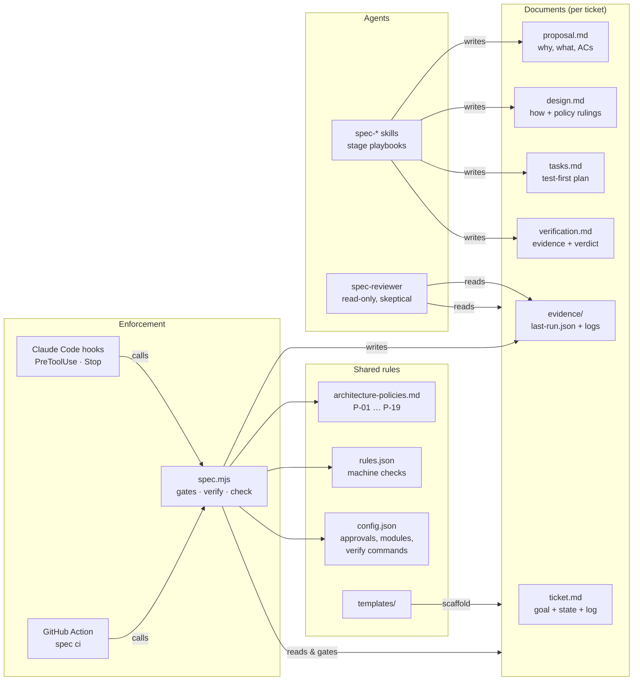
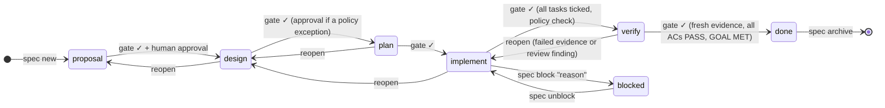
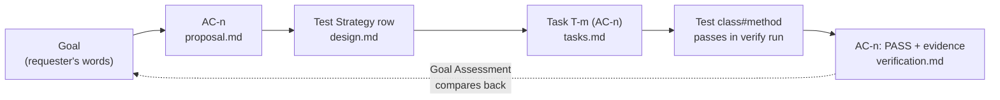
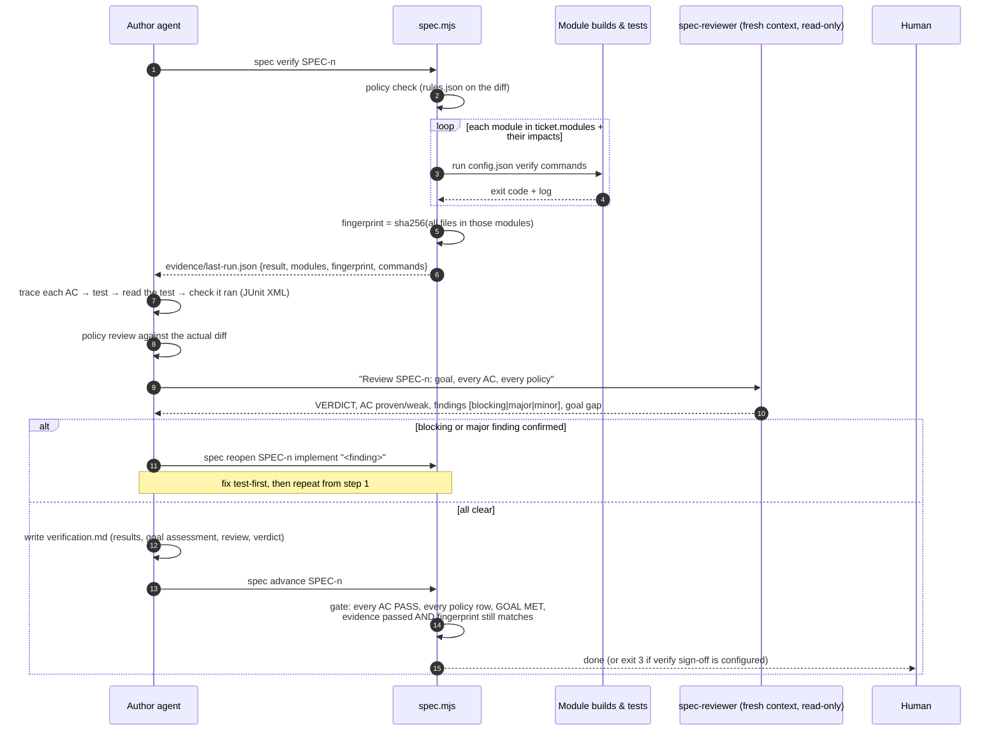
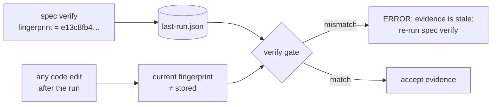
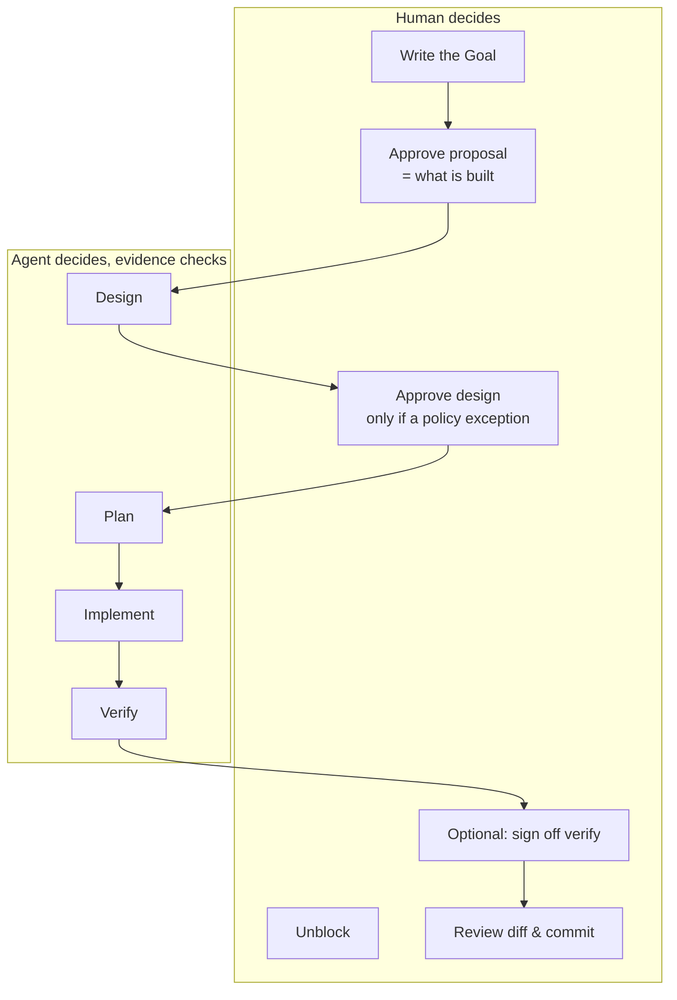

# The OMS Spec-Driven Process

How a change travels from a sentence in a ticket to a verified result in this repository, why it
is built that way, and where it is weak.

The companion document, [02-adoption-guide.md](02-adoption-guide.md), explains how to add the same
process to another project, in particular one that already writes specs but has no verification
step.

---

## 1. The idea in one paragraph

An AI agent can write code faster than a human can check it. Most spec-driven setups put all their
rigour at the start (a good proposal, a good design) and then accept "the agent says it's done" at
the end. This process treats the end as the hard part. A ticket is **done** only when four
independent kinds of evidence agree: a fresh, passing build and test run that is tied to the exact
code it ran against; a traceable line from each acceptance criterion to a passing test; a review
by a second agent whose only job is to prove the work is *not* done; and a comparison of the result
with the requester's original words. Gates between stages are enforced by a small script, not by
the agent's goodwill.

---

## 2. The moving parts

Everything is plain files plus one zero-dependency Node script.



| Piece | Location | Role |
|---|---|---|
| Templates | `specs/templates/` | Section skeletons with `<!-- FILL -->` markers. A gate fails while any marker remains. |
| CLI | `specs/tools/spec.mjs` | Creates tickets, runs gates, records approvals, runs `verify`, checks policies, serves the hooks. |
| Config | `specs/config.json` | Which stages need human approval, autopilot limits, git behaviour, and per-module `verify` commands and `impacts`. |
| Policies | `specs/policies/architecture-policies.md` | The architecture rules every design rules on and every verification reviews. |
| Machine rules | `specs/policies/rules.json` | Regex/path rules behind the policies that can be checked automatically. |
| Skills | `.claude/skills/spec-*/SKILL.md` | One playbook per stage, plus `spec-run` (autopilot) and `spec-archive`. |
| Reviewer | `.claude/agents/spec-reviewer.md` | A read-only sub-agent with a brief to find reasons the work is not done. |
| Hooks | `specs/tools/settings-hooks.json` | Reference registration for the PreToolUse and Stop hooks. |
| CI | `.github/workflows/spec-gates.yml` | Re-runs the policy check and every gate a ticket has already passed. |

---

## 3. The lifecycle



Any stage can be blocked; `spec unblock` returns the ticket to the stage it left (the diagram
shows `implement` as the typical case).

Each stage produces one document. `spec advance` runs that stage's gate and moves the ticket on
only if it passes. Exit codes are part of the contract: `0` advanced, `1` gate failed, `3` waiting
for a human.

### 3.1 What each gate checks

| Stage → gate | The document must… | Why it matters |
|---|---|---|
| **proposal** | have a Goal in `ticket.md` written by the requester; fill every section; have ≥1 `**AC-n**` (Given/When/Then is warned if missing); leave no `[open]` question; name its modules | ACs are the contract the verify stage checks. Vague ACs make verification meaningless. |
| **design** | fill every section; mention **every AC** in Test Strategy; give **every policy** a ruling of `comply`, `n/a` or `exception`, with a justification for anything but `comply` | Forces the design to consider every rule explicitly instead of the ones the agent happens to remember. |
| **plan** | list tasks as `- [ ] **T-n** … (AC-x)`, each with a `verify:` line; cover every AC with at least one task | Makes implementation mechanical and checkable task by task. |
| **implement** | have every task ticked; pass the policy check (`rules.json`) on the diff | Nothing is half-done, and machine-checkable rules hold. |
| **verify** | have a PASS row with evidence for every AC; a review row for every policy; `EXCEPTION` only where the design declared one; `Verdict: GOAL MET`; and `evidence/last-run.json` that passed, covers every affected module and **matches the current code fingerprint** | See section 4. |

### 3.2 Traceability

The gates enforce a chain of references. Breaking any link fails a gate.



The dotted arrow is what most processes leave out. ACs are written by the agent and can drift from
what the requester meant. The verify stage must re-read the original Goal and say whether the
requester would agree it is met.

---

## 4. The verification step in detail

This is the part your other project lacks, so it gets the most space.



### 4.1 The four kinds of evidence

| # | Evidence | Produced by | Checked by | Defends against |
|---|---|---|---|---|
| 1 | **Machine evidence**: build, tests and policy rules for every affected module *and its consumers* | `spec verify` | The gate, which compares the stored fingerprint with the current code | "It passed on my machine an hour ago"; the agent editing code after the tests ran; a contract change that breaks a consumer nobody rebuilt |
| 2 | **Traceability**: each AC cites the test that proves it | Author agent | Gate (row exists, says PASS, has evidence) and reviewer (test really asserts the *then*) | Tests that exercise code without asserting the criterion; ACs silently dropped |
| 3 | **Independent review** | `spec-reviewer` sub-agent | Author must fix or rebut each finding in writing | The author's bias towards "done"; scope creep; policy breaches the design claimed would not happen |
| 4 | **Goal assessment** | Author agent | Reviewer ("goal gap") and the human reading `verification.md` | ACs that are all green but miss what the requester asked for |

### 4.2 Evidence freshness

`spec verify` hashes the content of every tracked and untracked (non-ignored) file in the verified
modules, ignoring line endings and commits. The gate recomputes the hash. If a single byte changed
since the run, the evidence is **stale** and the ticket cannot reach `done`.



This closes the most common hole in agent workflows: fixing a review finding and then declaring
victory without running the tests again.

### 4.3 Why a separate reviewer agent

The author agent has spent the whole ticket building a story in which the work is correct. The
reviewer:

- starts with **fresh context**, so it reads the code rather than remembering intentions;
- has a **read-only toolset** (`Read, Grep, Glob, Bash` for inspection), so it cannot quietly fix
  things and hide the problem;
- has an **adversarial brief**: "The author believes the work is done. Your job is to find out
  whether it is not, with evidence";
- has a **fixed report format** (verdict, per-AC proven/weak, per-policy, findings with severity
  and file:line, goal gap), which the author must answer item by item in `verification.md`.

### 4.4 What it has caught here

Of the ten tickets that reached `done` in this repository, **eight were sent back by the
independent review after every automated gate had passed**. Some examples from the ticket logs:

| Ticket | Finding that sent it back |
|---|---|
| SPEC-0001 | *(blocking, reopened at design)* replayed cancel commands re-applied after a cancel reject because the state preconditions became true again; needed command identity for idempotency |
| SPEC-0002 | the new-ticket action showed no CLI output or exit code, so AC-7 was not actually met |
| SPEC-0003 | a reject without text left a stale earlier reason visible; the truncation test could not prove which prefix was kept; a knowledge-base page still described the old behaviour |
| SPEC-0008 | *(major)* saving a template body into another file dropped its file variables |
| SPEC-0010 | requirements marked "implemented" without adequate tests |

None of these would have been caught by "the build is green".

---

## 5. Human control and autonomy



- **One mandatory human gate by default: the proposal.** That is where a human confirms *what* will
  be built and how success is measured. After that, evidence replaces approvals.
- **Policy exceptions always escalate.** A design that marks any policy `exception` needs approval,
  whatever `config.json` says.
- **Approval is a human act.** `spec approve` records the git user. The PreToolUse hook blocks the
  agent from running it, and every skill says never to.
- **Autopilot** (`/spec-run`) lets the Stop hook push the agent onward until the ticket is done,
  awaiting approval or blocked. If the agent stops twice without changing anything, autopilot
  switches itself off. The agent must `spec block` with a reason rather than loop.
- **Autonomy rules** in `spec-run`: decide reversible things yourself and record them; escalate
  semantic or irreversible things (money, quantities, state semantics, contract breaks, lossy
  migrations); never weaken a gate to pass it.

---

## 6. Guardrails (hooks)

| Hook | Always | Only while a ticket is on autopilot |
|---|---|---|
| **PreToolUse** | blocks edits to generated code, stray contract folders, `ticket.md`, `evidence/`; blocks `spec approve` | blocks code edits before the plan gate passes; blocks edits to policies, templates, tools and config |
| **Stop** | — | refuses to let the agent end its turn before the ticket is done, awaiting approval or blocked |

These are guardrails against drift, not a security boundary.

---

## 7. Advantages

1. **"Done" means something.** Done requires fresh machine evidence, a traced test per criterion,
   a skeptical review and a goal check. The ticket logs show the review catching real defects that
   green builds missed, in eight of ten tickets.
2. **Human attention goes where it is worth most.** One approval on *what* to build, instead of
   rubber-stamping every intermediate document. Everything later is checked by evidence that a
   human can audit afterwards in `verification.md`.
3. **Architecture rules are applied every time.** Every design rules on every policy, and every
   verification reviews every policy against the actual diff. Adding a policy makes all open
   tickets address it at their next gate.
4. **Built-in decision record.** The archived ticket folder holds the goal, the alternatives
   considered, the policy rulings, the evidence summary and the review findings. That is better
   than most ADR practices, and it costs nothing extra.
5. **Contract changes verify their consumers.** `impacts` in `config.json` means a change to
   `oms-contracts` rebuilds and tests every consumer before the ticket can finish.
6. **Small and portable.** Markdown, JSON and one Node script with no npm dependencies. Nothing is
   specific to Claude except the skills and hooks, which are thin.
7. **Self-correcting.** `reopen` is a first-class move: when design, implementation or review
   contradicts an earlier document, the agent goes back and fixes the document, and a reopened
   proposal needs approval again.
8. **Tool-readable.** `--json` output and `gate --draft` let the Developer Cockpit show live gate
   results and progress without reimplementing any rules.

---

## 8. Risks and drawbacks

Some of these are inherent to the approach. Some are gaps found in this repository while writing
this document, and they should be fixed here before the process is copied elsewhere.

### 8.1 Gaps found in this repository

| # | Gap | Effect | Fix |
|---|---|---|---|
| G1 | **The hooks are not registered.** `.claude/settings.json` contains only a `curl` permission. `settings-hooks.json` was never merged into it. | None of the PreToolUse blocks or the Stop hook are active. Autopilot does not keep the agent going, and nothing technical stops an agent from running `spec approve`. Only the skill instructions do. | Merge `specs/tools/settings-hooks.json` into `.claude/settings.json`. |
| G2 | **The CI gate never runs.** `spec-gates.yml` triggers on `pull_request`, but this repository commits straight to `main` with no PRs. | The CI safety net in the README does not exist in practice. | Add `push: branches: [main]` with `--base HEAD~1` (or the push's `before` SHA), or run `spec ci` in a pre-push hook. |
| G3 | **The diff scope is "uncommitted changes" on trunk.** `spec check` and the reviewer diff against `merge-base main HEAD`. On `main` that is `HEAD`, so they see only uncommitted work. | Work committed mid-ticket escapes the policy check and the reviewer. Uncommitted work from several tickets is reviewed as one diff (the current working tree has changes from several tickets). | Record the start commit in `ticket.md` at `spec new` (e.g. `base: <sha>`) and diff against it, or re-enable `branchPerTicket`. |

### 8.2 Inherent risks

| Risk | Detail | Mitigation in place | Residual |
|---|---|---|---|
| **The gate checks form, not truth** | The verify gate confirms that `verification.md` *says* PASS and cites evidence. It does not confirm that the cited test exists or ran. Only the fingerprint and pass/fail of the whole run are machine-checked. | Reviewer re-reads tests; skill tells the author to check JUnit XML | An agent determined to pass can write plausible rows. *Improvement:* have the gate parse `TEST-*.xml` and confirm every cited `Class#method` ran without failure. |
| **The reviewer is the same kind of model** | Fresh context and an adversarial brief help, but blind spots in the model are shared between author and reviewer. | Fixed report format; author must rebut in writing | Use a different model for the reviewer, or a human verify sign-off for high-risk tickets (`approvals.verify: true`). |
| **Everything depends on AC quality** | The chain is only as strong as the ACs, and the agent writes them. Weak ACs produce a green, meaningless verification. | Human proposal approval; GWT warning; Goal Assessment; reviewer's goal gap | The proposal review is the one human gate. It must be a real review, not a click. |
| **Designs are not seen by a human** | With default config, a design goes from written to "plan" in minutes (SPEC-0003: design → plan → implement in 3 minutes). A human sees design decisions only at the end. | Policy exceptions force approval; reviewer checks the diff against the design | Turn on `approvals.design` for tickets touching money, quantities, schemas or public contracts. |
| **Overhead for small changes** | SPEC-0003 produced ~560 lines of documents for a feature spread across six modules. That is justified there, but heavy for a one-line fix. | Ticket `type` exists (`chore`, `fix`) but gates do not differ by type | Add a lighter profile for `chore` (e.g. proposal + verify only). Without one, people route around the process. |
| **Regex policy rules** | `rules.json` matches lines and paths. It gives false positives (strings in comments) and false negatives (an alias that avoids the pattern). | `review` questions for every policy; reviewer | Accept; keep `auto` rules for things regexes are good at. |
| **Long verify runs** | `spec verify` rebuilds every affected module and its consumers (Testcontainers included). Any later edit, even a typo, makes the evidence stale. | Runs in the background | Cost in time; deliberately chosen over trusting stale evidence. |
| **Hooks are not security** | A shell command can still write any file. | Documented as such | Fine for drift; not for an adversarial agent. |
| **Document drift after archive** | The archive is a decision record, not living documentation. | `spec-archive` checks the knowledge-base updates named in the design (P-19) | Knowledge-base pages, not archived tickets, must remain the source of truth. |

---

## 9. Command reference

```bash
node specs/tools/spec.mjs new "<title>" --type feature --modules a,b --goal "<verbatim goal>"
node specs/tools/spec.mjs status SPEC-0003            # stage, gate result, next step
node specs/tools/spec.mjs advance SPEC-0003           # run gate; 0 ok, 1 fail, 3 awaiting approval
node specs/tools/spec.mjs approve SPEC-0003           # humans only
node specs/tools/spec.mjs reopen SPEC-0003 implement "<why>"
node specs/tools/spec.mjs block SPEC-0003 "<what, tried, need>"
node specs/tools/spec.mjs verify SPEC-0003            # policy check + module builds → evidence/
node specs/tools/spec.mjs check [--all]               # policy rules on the diff (or whole repo)
node specs/tools/spec.mjs ci --base origin/main       # CI: policy check + re-check passed gates
node specs/tools/spec.mjs archive SPEC-0003
```

In Claude Code: `/spec-new`, `/spec-run`, or one stage at a time with `/spec-propose`,
`/spec-design`, `/spec-plan`, `/spec-implement`, `/spec-verify`, then `/spec-archive`.
