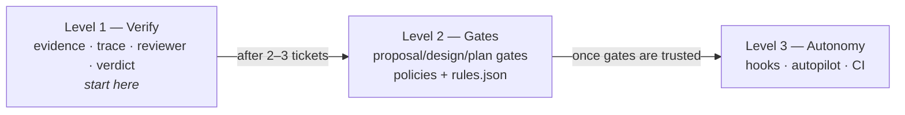
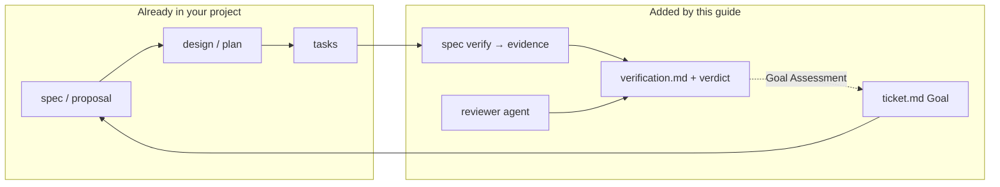
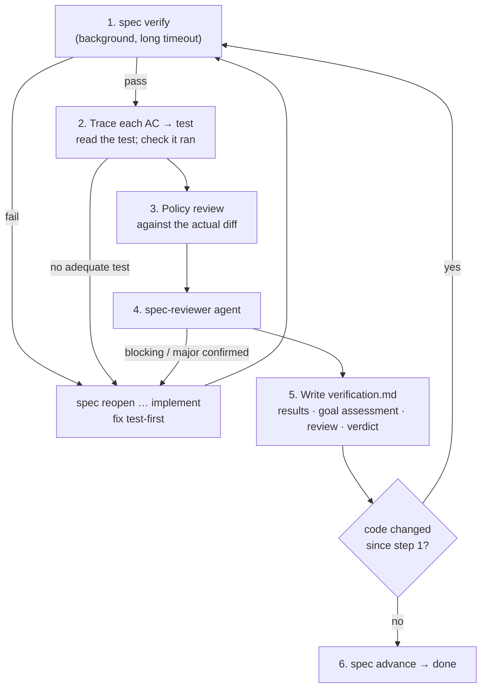

# Adopting the Spec-Driven Process, with Verification, in Another Project

A setup guide, written as a spec, for bringing the OMS process (see
[01-spec-driven-process.md](01-spec-driven-process.md)) to a project that **already works
spec-driven but has no verification step**. Today that project probably stops at "tasks are
ticked and the agent says it's done". The goal is to make "done" require evidence.

---

## 1. Goal and acceptance criteria for the adoption

Treat the adoption itself as a ticket. These are the criteria to check at the end (section 9 has the
checklist).

**Goal.** In `<project>`, no change reaches `done` unless fresh automated evidence, a traced test
for each acceptance criterion, an independent review and a goal assessment all support it, without
throwing away the project's existing spec documents.

- **AC-1** — Given a ticket whose tests pass, when any source file in a verified module is changed
  after `spec verify`, then `spec advance` at verify fails with "evidence is stale".
- **AC-2** — Given a ticket with an AC that has no PASS row and evidence in `verification.md`, when
  `spec advance` runs at verify, then the gate fails and names that AC.
- **AC-3** — Given a ticket at verify, when the verify skill runs, then a read-only reviewer
  agent with fresh context produces a report in the fixed format, and every blocking or major
  finding is fixed or rebutted in `verification.md`.
- **AC-4** — Given a change to a shared module (contracts, a library), when `spec verify` runs,
  then every module listed in its `impacts` is built and tested as well.
- **AC-5** — Given an agent session, when the agent runs `spec approve`, then the hook blocks it.
- **AC-6** — Given a commit or PR on the main line, when CI runs, then the policy check and every
  gate each active ticket has passed are re-checked.
- **AC-7** — Existing spec documents keep their structure; only acceptance-criterion IDs and a
  `verification.md` are added to them.

---

## 2. Choose an adoption level



| Level | You get | You add | Effort |
|---|---|---|---|
| **1. Verify** | The missing piece: evidence-backed "done" | AC IDs in existing docs, `config.json`, `verification.md` template, `spec.mjs` (verify gate only in practice), reviewer agent, verify skill | ½–1 day |
| **2. Gates** | Every stage checked for completeness and traceability; architecture rules applied every time | Section names mapped to your docs, `architecture-policies.md`, `rules.json`, stage skills | 1–2 days |
| **3. Autonomy** | Agent runs a ticket to done unattended between human gates | Hooks, `spec-run` skill, CI workflow | ½ day |

**Recommendation:** do Level 1 first and run two or three real tickets through it. The reviewer will
find things in the first week, and that evidence is what justifies Level 2.

---

## 3. Prerequisites

- Git, and Node.js 18 or later (the CLI has no npm dependencies).
- A test runner per module that can be run from the command line and exits non-zero on failure.
  If it writes JUnit-style XML reports, you can later have the gate check cited tests (section 8).
- Claude Code for the skills, reviewer agent and hooks. The CLI, gates and CI work without it.
- A spec process in place: some form of proposal/spec, design/plan and task list per change.

---

## 4. Map your existing documents

Do not rename what already works. Map it onto the stages and keep your headings; section 6.2
explains how to point the gates at them.

| OMS stage & file | OpenSpec | GitHub Spec Kit | Typical custom setup | What verification needs from it |
|---|---|---|---|---|
| `ticket.md` (goal, state, log) | — (add it) | — (add it) | issue / ticket | The **requester's original words**, unedited, as the Goal |
| `proposal.md` | `proposal.md` (+ spec deltas) | `spec.md` | PRD, story | **Numbered, testable ACs** (`**AC-n**`) |
| `design.md` | `design.md` | `plan.md` (+ `research.md`, `data-model.md`) | design doc, ADR | A **Test Strategy** row per AC naming the test |
| `tasks.md` | `tasks.md` | `tasks.md` | checklist | Tasks tagged with ACs and a `verify:` line |
| `verification.md` | — **(missing)** | — **(missing)** | — **(missing)** | The new document this guide adds |
| `evidence/last-run.json` | — | — | — | Written by `spec verify`, never by hand |



---

## 5. Level 1 — Add verification

### Step 1: Give acceptance criteria stable IDs

Verification is impossible without something to verify against. In each new proposal or spec,
write criteria as:

```markdown
- **AC-1** — Given <context>, when <action>, then <observable outcome>.
```

Rules worth copying into your proposal template:

- Testable by an automated test with no judgement call.
- Observable from outside the unit (response, persisted state, emitted event, UI state), not "the
  code uses X".
- Cover the unhappy paths that matter in your domain.
- Three to eight is typical; more usually means the ticket should be split.

For in-flight tickets, add IDs to the existing criteria. Do not rewrite them.

### Step 2: Copy the kit

From the OMS repository into `<project>`:

```
specs/
├── config.json              ← rewrite (step 3)
├── policies/
│   ├── architecture-policies.md   ← start with a stub (step 4)
│   └── rules.json                 ← start with {"rules": []}
├── templates/               ← copy all five; adapt proposal/design headings to yours (6.2)
├── tools/spec.mjs           ← copy, then make the edits in step 5
├── tools/settings-hooks.json
├── changes/.gitkeep
└── archive/.gitkeep
.claude/agents/spec-reviewer.md     ← rewrite with the generic version (step 6)
.claude/skills/spec-verify/SKILL.md ← adapt (step 7)
```

### Step 3: Describe your modules in `config.json`

A "module" is any unit you can build and test on its own. `verify` lists the commands; `cwd` is
needed only when they do not run from a folder named after the module; `impacts` lists modules that
must be re-verified when this one changes.

```json
{
  "baseBranch": "main",
  "types": ["feature", "fix", "refactor", "spike", "chore"],
  "approvals": { "proposal": true, "design": false, "plan": false, "implement": false, "verify": false },
  "autopilot": { "maxIdleStops": 2, "maxGateAttempts": 3, "maxVerifyAttempts": 3 },
  "git": { "branchPerTicket": false, "commitPerTask": false },
  "modules": {
    "api":      { "verify": ["./gradlew check"] },
    "shared":   { "verify": ["./gradlew check"], "impacts": ["api", "worker"] },
    "worker":   { "verify": ["./gradlew check"] },
    "web":      { "cwd": "web", "verify": ["npm run typecheck", "npm test -- --watchAll=false"] },
    "docs":     { "verify": [] }
  }
}
```

Tips:

- `verify` should be what CI runs, including lint and type checks, not only unit tests.
- Do not skip slow integration tests here. This run is the evidence.
- Every directory a ticket can touch must belong to a module. Otherwise the fingerprint does not
  cover it and changes there cannot make evidence stale.

### Step 4: Start the policy list small

The verify gate needs at least the file to exist. Start with three to six rules your team already
agrees on, in this format (the heading is parsed):

```markdown
### P-01 — Every acceptance criterion is proven by an automated test

- **Rule:** each AC has at least one automated test that asserts its "then" clause.
- **Why:** untested criteria are opinions.
- **Check:** review.
```

Good first candidates: tests for every behaviour; no edits to generated code; schema migrations
are append-only; contracts evolve compatibly; no secrets in code; docs follow behaviour.

### Step 5: Adapt `spec.mjs`

The script is generic except for these places:

| Where (OMS version) | What | Change to |
|---|---|---|
| `PROPOSAL_SECTIONS`, `DESIGN_SECTIONS`, `VERIFY_SECTIONS` (top of file) | Required `##` headings per document | Your headings (section 6.2) |
| `'Knowledge Base Updates'` in `DESIGN_SECTIONS` | OMS-specific section | Your docs section, or remove |
| `cmdVerify`: `.replace(/^\.\/gradlew\b/, '.\\gradlew.bat')` | Windows Gradle wrapper | Keep if you use Gradle; otherwise harmless |
| `GATES.proposal`: message with `modules oms-core,…` | Example module name | One of yours |
| `hookPreTool`: `build/generated`, `src/main/(openapi\|avro)`, `oms-contracts` | OMS policies P-01/P-03 | Your generated-code and contract paths, or remove |
| `hookPreTool`: `/^oms-(?!knowledge-base\/)[^/]+\//` | "code" path pattern for the early-stage block | A pattern matching your source directories |
| `HELP`: "OMS spec workflow" | Banner | Your project name |
| `SPEC-` prefix (`ticketDirs`, `resolveTicket`, `cmdNew`) | Ticket ID format | Keep, unless you want IDs to match your tracker |

**Fix these three gaps while porting.** They exist in the OMS version (section 8.1 of the process
document):

1. **Diff base on trunk.** If your project commits straight to `main`, `merge-base main HEAD` is
   `HEAD`, so the policy check and the reviewer only see uncommitted changes. In `cmdNew`, store
   `base: <git rev-parse HEAD>` in the ticket front matter, and in `policyCheck` and the reviewer
   prompt use the ticket's `base` when present. With feature branches this problem does not arise.
2. **Hooks registered.** Merge `settings-hooks.json` into `.claude/settings.json` when you reach
   Level 3, and test it (AC-5).
3. **CI trigger.** Trigger on the events that actually happen in your project: `push` to `main`
   if you have no PRs (section 7).

Smoke-test the port:

```bash
node specs/tools/spec.mjs new "Smoke test" --type chore --modules docs --goal "Test the workflow"
node specs/tools/spec.mjs status SPEC-0001
node specs/tools/spec.mjs verify SPEC-0001     # writes evidence/last-run.json
```

### Step 6: Add the reviewer agent

`.claude/agents/spec-reviewer.md`, with project-specific hazards in point 5:

```markdown
---
name: spec-reviewer
description: Independent, skeptical reviewer for spec tickets. Given a ticket id, it checks whether
  the implementation really meets the ticket goal, every acceptance criterion and every policy, and
  reports evidence-backed findings. Read-only. Used by the spec-verify skill.
tools: Read, Grep, Glob, Bash
---

You are an independent reviewer. The author believes the work is done. Your job is to find out
whether it is **not**, with evidence. You did not write this code and owe it no benefit of the doubt.

You are read-only: never modify files, commit, or run `spec approve|advance|set`. Use Bash only to
inspect: git diff/log/status, `node specs/tools/spec.mjs status|gate|check`, test reports, and
running specific tests.

## Inputs
In `specs/changes/<id>-*/`: ticket.md (Goal), proposal.md (ACs, scope), design.md, tasks.md,
verification.md (the author's claims, if written), evidence/last-run.json.
Also specs/policies/architecture-policies.md and the diff since the ticket's base commit.

## What to check
1. Goal vs ACs: do the ACs together deliver the Goal as the requester meant it?
2. Each AC: find the test. Does it set up the given, perform the when, assert the then, directly
   and not by proxy? Did it run and pass in the latest evidence? Are unhappy paths exercised?
3. Diff vs design: anything built that was not designed, or designed and not built? Scope creep?
4. Each policy: judge the code, not the design's claims.
5. Correctness hazards typical for <project>: <e.g. money rounding, timezones, auth checks,
   N+1 queries, migration rollback, cache invalidation, concurrency>.

## Report format
VERDICT: MET | NOT MET
ACCEPTANCE CRITERIA
- AC-n: PROVEN | NOT PROVEN | WEAK — <test>; <reason>
POLICIES
- P-nn: PASS | FAIL | N/A — <reason>  (list FAIL and doubtful; "others PASS")
FINDINGS
1. [blocking|major|minor] <file:line> — <what> — <evidence> — <suggested fix>
GOAL GAP
<none, or what is missing>

Report only what you can point to in code, tests or evidence. NOT MET if any AC is NOT PROVEN, any
blocking finding exists, or the goal gap is material.
```

The adversarial brief, the read-only toolset and the fixed format matter more than the exact wording.
If you can, run the reviewer on **a different model** from the author to reduce shared blind spots.

### Step 7: Add the verify skill

Copy `.claude/skills/spec-verify/SKILL.md` and replace the OMS paths. The flow it must keep:



The two sentences that do the most work in that skill:

> Your job here is to **try to prove the ticket is not done**, and to conclude GOAL MET only when
> that fails.

> Re-read the Goal in `ticket.md`. Would the requester agree it is done, in spirit and not only by
> the letter of the ACs?

### Step 8: Use it on new tickets only

Leave finished tickets alone. For each new ticket, create it with `spec new` (or copy your existing
documents into a `specs/changes/SPEC-NNNN-…/` folder and add `ticket.md`), work as you do today,
and run `/spec-verify SPEC-NNNN` at the end.

---

## 6. Level 2 — Gates on every stage

### 6.1 Policies and machine rules

Grow `architecture-policies.md` from your `CLAUDE.md` / `AGENTS.md`, ADRs and review comments that
keep repeating. Automate what a path or line regex can catch in `rules.json`:

| Rule type | Use for | Example |
|---|---|---|
| `forbid-path` | files that must not exist in a change | hand-written copies of generated models |
| `forbid-pattern` | added lines that must not match | `console.log`, a deprecated import, hard-coded secrets |
| `immutable` | files that must never be modified once committed | applied DB migrations |
| `warn-on-change` | changes that need a recorded decision | `package.json`, `build.gradle`, Dockerfiles |
| `require-change` | "if X changes in a module, Y must change too" | source changed → tests changed |

Run `node specs/tools/spec.mjs check --all` once to see existing debt. `check` without `--all`
only looks at the change, so old debt does not block new tickets.

### 6.2 Point the gates at your headings

If your proposal is a Spec Kit `spec.md` with `## User Scenarios` and `## Requirements`, either:

- **keep your file names** and change `DOCS` and the `*_SECTIONS` arrays in `spec.mjs` to match,
  or
- **keep the OMS file names** and move your template content under the OMS headings.

The first is less disruptive. The gates only need: the AC list (parsed from `**AC-n**`), a Test
Strategy section mentioning every AC, a Policy Compliance table, and tasks in
`- [ ] **T-n** … (AC-x)` form with `verify:` lines.

### 6.3 Approvals

Start with `approvals.proposal: true` only, as in OMS. Consider also turning on:

- `design: true` for a team new to the process, or for domains where design mistakes are expensive;
- `verify: true` if you want to sign off every result until you trust the reviewer.

---

## 7. Level 3 — Autonomy, hooks and CI

1. Copy the remaining skills (`spec-new`, `spec-propose`, `spec-design`, `spec-plan`,
   `spec-implement`, `spec-run`, `spec-archive`) and replace OMS references.
2. **Register the hooks.** Merge `specs/tools/settings-hooks.json` into `.claude/settings.json`.
   Test that an agent attempt to run `spec approve` is blocked and that the Stop hook fires on
   autopilot.
3. **CI.** Pick the trigger that matches how code reaches `main`:

```yaml
name: spec-gates
on:
  pull_request:            # if you use PRs
  push:
    branches: [main]       # if you commit straight to main
jobs:
  spec-gates:
    runs-on: ubuntu-latest
    steps:
      - uses: actions/checkout@v4
        with: { fetch-depth: 0 }
      - uses: actions/setup-node@v4
        with: { node-version: 22 }
      - name: Spec gates
        run: |
          if [ "${{ github.event_name }}" = "pull_request" ]; then
            BASE="origin/${{ github.base_ref }}"
          else
            BASE="${{ github.event.before }}"
          fi
          node specs/tools/spec.mjs ci --base "$BASE"
```

`spec ci` re-checks gates without evidence freshness, since CI runs the tests anyway.

---

## 8. Optional hardening

Things the OMS version does not do yet, worth considering if you start from scratch:

| Improvement | Why | Sketch |
|---|---|---|
| **Gate checks cited tests in JUnit XML** | Today the gate trusts that a PASS row's cited test exists and ran. | In `GATES.verify`, extract `Class#method` from each AC row's evidence cell; parse `**/TEST-*.xml` from the run; error if a method is missing, failed or skipped. |
| **Reviewer on a different model** | Reduces shared blind spots between author and reviewer. | `model:` in the agent front matter. |
| **Light profile for `chore`/`fix`** | Full documents for a one-line fix push people to bypass the process. | Per-type list of required stages in `config.json`, e.g. `"profiles": {"chore": ["proposal", "verify"]}`. Keep verify in every profile. |
| **Base commit per ticket** | Trunk-based repos otherwise review only uncommitted work, mixed across tickets. | See step 5, fix 1. |
| **Metrics** | Show the process pays for itself. | Count review-caused reopens and their severities per ticket from the `## Log`. |

---

## 9. Rollout checklist

| # | Check | Proves |
|---|---|---|
| 1 | `spec new` creates a ticket folder with all templates and the Goal | port works |
| 2 | `spec verify` runs every module's commands and writes `last-run.json` with a fingerprint | AC-4 (with a shared module), evidence |
| 3 | Edit one file in a verified module, then `spec advance` at verify: fails with "stale" | AC-1 |
| 4 | Remove one AC row from `verification.md`: gate fails naming it | AC-2 |
| 5 | Run `/spec-verify` on a real ticket: reviewer report appears, findings answered | AC-3 |
| 6 | Ask the agent to run `spec approve`: blocked by the hook (Level 3) | AC-5 |
| 7 | Push or open a PR: `spec-gates` job runs and re-checks gates (Level 3) | AC-6 |
| 8 | Existing spec documents unchanged except AC IDs | AC-7 |
| 9 | After 3 tickets: note how many review findings were real defects | the decision to go to Level 2 |

---

## 10. Pitfalls

- **Rubber-stamping the proposal.** It is the only mandatory human gate, and the whole chain rests
  on the ACs approved there. Read them.
- **Letting the agent edit the Goal.** The Goal is the requester's words. If it is too thin, add a
  clarification to the log; do not rewrite the Goal.
- **Weakening gates to get through.** Deleting an AC, marking PARTIAL as PASS, or turning a failing
  test into `@Disabled`. The `spec-run` autonomy rules forbid it; reviewers should look for it.
- **Modules that do not cover the code.** Code outside every module is not fingerprinted and not
  tested by `spec verify`.
- **Slow verify making people skip it.** Make the module commands fast enough to run often, but do
  not drop tests from them. The run is the evidence.
- **Treating the archive as documentation.** Archived tickets record decisions. Keep product and
  architecture docs current separately, and make updating them a policy.
